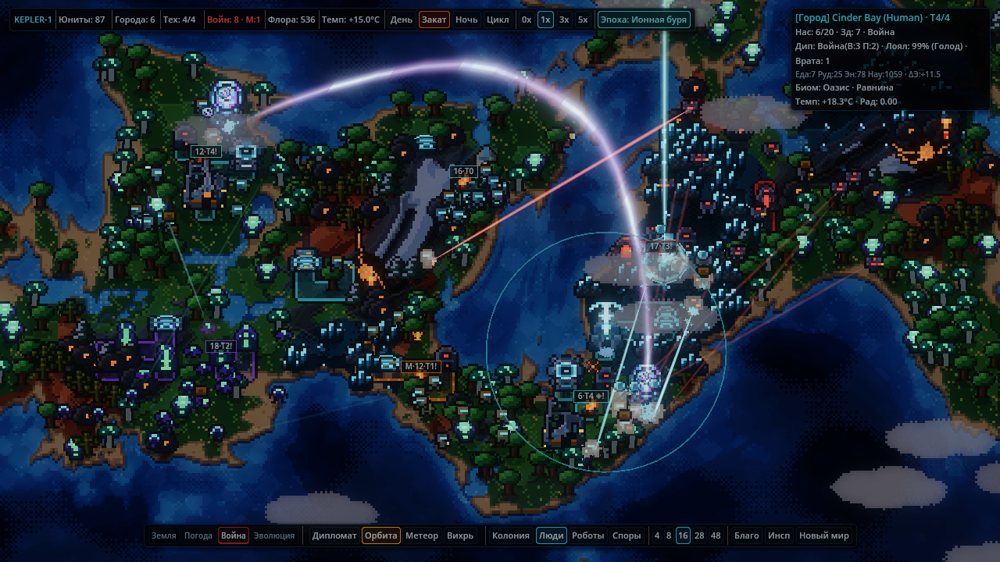
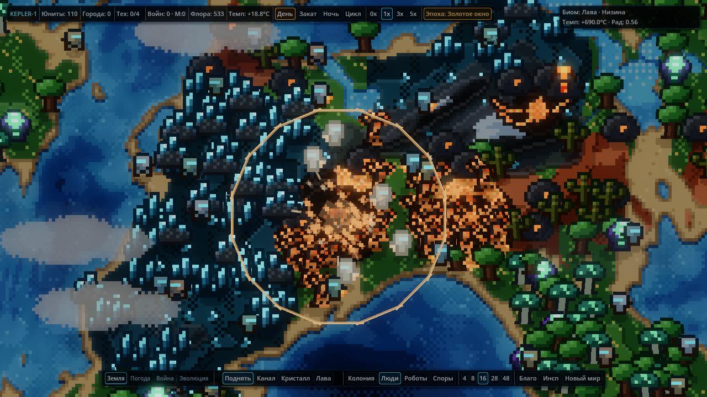

# Kepler Sandbox — Sci-Fi God Simulator

**2D Pixel-Art Sci-Fi God Sandbox & Emergent Civilization Simulator (Godot 4.7.2 / GDScript 2.0)**

Космическая песочница бога на живой пиксельной экзопланете `640×360` с плоской SoA-симуляцией цивилизаций, терраформингом, орбитальными ударами, дипломатией, войнами, квантовыми вратами и безассетным процедурным синтезом звука.

- **Играть в браузере (GitHub Pages):** https://sunil123456897.github.io/kepler-sandbox/
- **Скачать сборку Windows x64 (`.zip`):** https://github.com/sunil123456897/kepler-sandbox/releases/latest



## Галерея

| Макро-вид планеты (`640×360`) | Рост колоний и границы зон `8×8` |
| :---: | :---: |
|  |  |
| **Ночной цикл и HDR-эмиссия** | **Приближение на биомы и юнитов** |
|  |  |

## Ключевые механики

- **Живая среда и климат (`WorldTerrain`):**
  - Карта `640×360` (`40×23` чанков `16×16`), 5 биомов (`RUST`, `LUSH`, `CRYSTAL`, `SCORCHED`, `LAVA`), 16 рек, вулканические очаги, лесные пожары, прибрежная пена, каустика в шейдере `terrain_water.gdshader` и 5 космических эпох (`Золотое окно`, `Солнечная буря`, `Ледяная тень`, `Спороцвет`, `Ионный шторм`).
- **Цивилизации, дипломатия и войны (`CivSim`, `CombatAndBeams`):**
  - Три асимметричные фракции (*Люди*, *Роботы*, *Споры*), автоматический захват `8×8` зон с внешним контуром и дорогами, технологическая шкала `tech_tier 0..4` от костров до квантовых врат и космодромов.
  - Дипломатические состояния (`Мир`, `Пакт`, `Война`, `Мятеж`), орбитальные удары, купольные щиты (`shield_pylon`), челноки, межконтинентальные телепорт-дуги (`teleport_arc.gdshader`) и прямое вселение в любого юнита (`[P]`).
- **Арсенал бога (4 вкладки сил):**
  - *Земля:* поднятие суши / биом жизни, прокладка каналов, кристаллизация, вулканы и лава.
  - *Погода:* ливни, огненные смерчи, ионные штормы.
  - *Война:* дипломатическая искра, орбитальный луч, метеоритные кратеры с `Hit-Stop` и тряской камеры `T^2/T^3`, гравитационный вихрь.
  - *Эволюция:* ИИ-сбой, ксено-вирус, био-сеятель, спавн колоний и благословение.
- **Процедурный звук и сохранение мира (`FxAudio`, `KEPL`):**
  - 18 синтезируемых в реальном времени звуковых профилей на `AudioStreamGenerator` (`22 050 Гц`, 16 голосов, стереопанорама).
  - Сериализация полного состояния мира (`KEPL`, формат `SAVE_VERSION = 5`) в `user://kepler_slot1.dat`.

## Управление

- **ЛКМ:** применить выбранную кисть или инструмент (размеры `4 / 8 / 16 / 28 / 48`).
- **ПКМ + мышь / `WASD`:** панорамирование камеры.
- **Колесо мыши:** плавный зум (`1.2x..12.0x`).
- **`[P]`:** взять/снять прямое управление выбранным юнитом (`Esc` — выход).
- **`[G]`:** переключить космическую эпоху.
- **`0x / 1x / 3x / 5x` и `День / Закат / Ночь / Цикл`:** скорость симуляции и орбитальное освещение.

## Структура репозитория

```text
kepler_sandbox/
├── project.godot              # Конфиг Godot 4.7 (Desktop: Forward Plus, Web: gl_compatibility)
├── export_presets.cfg         # Пресеты сборки Web (no-threads) и Windows Desktop (x86_64)
├── Запустить_игру.bat         # Быстрый запуск локальной копии
├── Открыть_в_Godot.bat        # Открыть проект в редакторе Godot 4.7.2
├── scenes/main.tscn           # Главная сцена и HUD
├── scripts/
│   ├── main.gd                # Цикл симуляции, камера, кисти, HUD, CLI-флаги, сохранения KEPL
│   ├── world_terrain.gd       # Карта 640x360, чанки, биомы, реки, вулканы, климат
│   ├── unit_physics.gd        # SoA-физика юнитов и флоры, spatial hash, роли и вселение
│   ├── civ_sim.gd             # Города, 8x8 зоны, здания, ресурсы, тех-тиры, дипломатия
│   ├── combat_and_beams.gd    # Сражения, щиты, шаттлы и телепорт-дуги квантовых врат
│   └── fx_audio.gd            # Пул частиц, эмодзи-стрипы, лайтмапа и 18-голосный аудиосинтез
├── shaders/                   # 2D-шейдеры воды, облаков, юнитов/зданий и портальных дуг
├── assets/
│   ├── atlases/               # Собранные PNG-атласы, *_mask.png (sprite_mode=3) и JSON-метаданные
│   └── src_sprites/           # Исходные пиксельные спрайты 8x8..24x24
├── tools/build_atlases.py     # Генератор атласов и масок из src_sprites
├── docs/                      # GDD, спецификации механик, визуала и дорожной карты
└── verify_tracer.ps1          # Автоматическая headless-проверка и регрессия скриншотов
```

## Локальный запуск и проверка

```powershell
# Открыть игру из исходников (требуется Godot 4.7.2 в ..\bin\ или в PATH)
.\Запустить_игру.bat

# Полный набор headless smoke-тестов, проверок производительности и рендера
powershell -NoProfile -ExecutionPolicy Bypass -File .\verify_tracer.ps1
```
