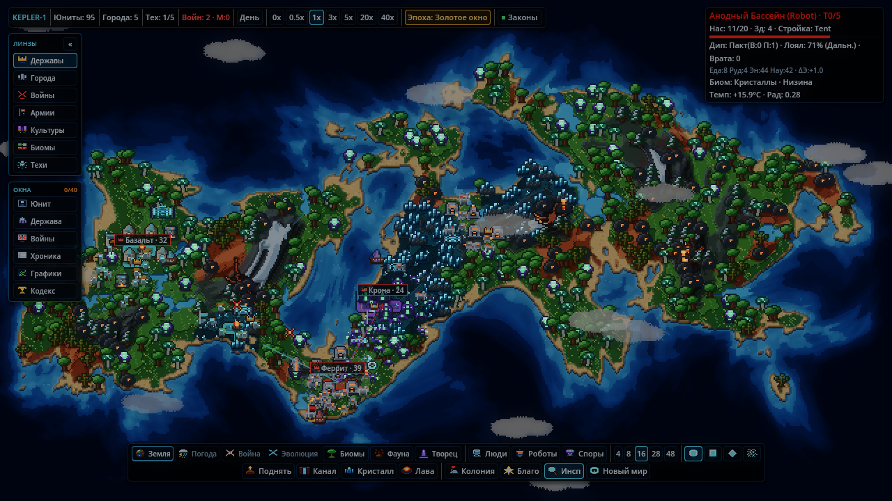
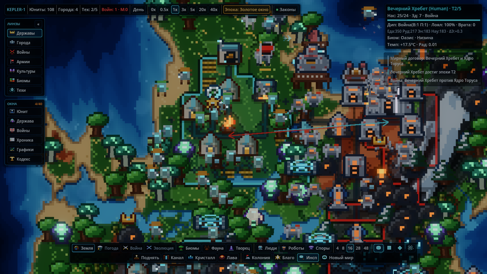
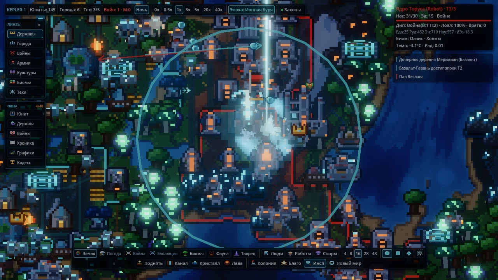

# Kepler Sandbox — Sci-Fi God Simulator

**2D Pixel-Art Sci-Fi God Sandbox & Emergent Civilization Simulator (Godot 4.7.2 / GDScript 2.0)**

Космическая песочница бога на живой пиксельной экзопланете `640×360` с плоской SoA-симуляцией цивилизаций, терраформингом, орбитальными ударами, дипломатией, войнами, квантовыми вратами и безассетным процедурным синтезом звука.

- **Играть в браузере (GitHub Pages):** https://sunil123456897.github.io/kepler-sandbox/
- **Скачать сборку Windows x64 (`.zip`):** https://github.com/sunil123456897/kepler-sandbox/releases/latest


## Галерея

| Макро-вид планеты (`640×360`) | Рост колоний и границы зон `8×8` |
| :---: | :---: |
|  |  |
| **Ночной цикл и HDR-эмиссия** | **Приближение на биомы и юнитов** |
|  |  |

## Ключевые механики

- **Живая среда, капли и «Грави-длань» (`WorldTerrain`, `WorldDrops`):**
  - Карта `640×360` (`40×23` чанков `16×16`), `12` биомов + крипы, `8` шаблонов генерации мира, `16` рек, 3-зонные вулканы/кратеры с углями, вспышки молний в лайтмапе, прибрежная пена, каустика в `terrain_water.gdshader` и `5` космических эпох (`Золотое окно`, `Солнечная буря`, `Ледяная тень`, `Спороцвет`, `Ионный шторм`).
  - Физические 2.5D-капли с неба (`WorldDrops`, `26` типов `0..25` включая десантные капсулы `HOSTILE_POD`, `MAX_DROPS = 512`), `4` формы кисти (`Circle / Square / Diamond / Scatter`) и тактильная «Грави-длань» (захват, подъём по `pos_z`, бросок по параболе, брызги, пружинное сжатие и кратеры).
- **Юниты, фауна, черты и боёвка (`UnitPhysics`, `UnitTraitsFauna`, `CombatAndBeams`):**
  - Дикая фауна (`MAX_FAUNA = 192`) и `4` босса, `36` черт, `16` статусов, `10`-локусная генетика / Монолит и `3` слота снаряжения.
  - Снаряды (`MAX_PROJECTILES = 192`), орбитальные удары, купольные щиты (`shield_pylon`), челноки, межконтинентальные телепорт-дуги (`teleport_arc.gdshader`) и боевой режим Аватара (`[P]`: `WASD`, `ЛКМ` удары фракции, `Space` ударная волна, `Shift` рывок, `R` сбор свиты).
- **Цивилизации, Теология Свидетелей и морской флот (`CivSim`, `CivMetaNoosphere`, `CivTerritory`, `CivDiplomacy`):**
  - Три цивилизации (*Люди*, *Роботы*, *Споры*), связный захват `8×8` зон с дорогами и переносом центра, флот (`MAX_SHIPS = 32`) с реальной морской высадкой десантов, охотничьи перемирия перед боссами, союзы/кланы/войны/заговоры, ноосфера, слоговая ономастика и `7` линз карты (`Державы`, `Города`, `Войны`, `Армии`, `Культуры`, `Биомы`, `Техи`).
  - **Теология Свидетелей и ПВО `T3–T5`:** города запоминают действия игрока и меняют доктрину (*Солярный культ*, *Техно-скептики*, *Стражи Орбиты*), а пилоны и турели `T3–T5` перехватывают падающие метеориты и капсулы в воздухе.
- **HUD, сценарии, звук и сохранение (`HudWindows`, `HudWorldLaws`, `FxAudio`, `KEPL`):**
  - Нижний док с `7` категориями сил, `20` законов мира, `6` модальных окон, `40` записей Кодекса, `9` настроений, `4` мгновенных сценария и клик-перелёт камеры по событиям Хроники и Войн.
  - `29` аудиопрофилей + `4`-слойный реактивный эмбиент (`Space / Surf / Forge / Storm`) на `AudioStreamGenerator`; бинарная сериализация `KEPL` (`SAVE_VERSION = 8`) в `user://kepler_slot1.dat`.

## Управление

- **ЛКМ:** применить выбранную кисть или инструмент (размеры `4 / 8 / 16 / 28 / 48`, формы `Circle / Square / Diamond / Scatter`); повторный клик по активному инструменту или `Esc` возвращает режим инспектора.
- **ПКМ + мышь / `WASD`:** панорамирование камеры.
- **Колесо мыши:** плавный зум (`1.2x..12.0x`) без прокрутки сквозь HUD.
- **`[P]`:** взять/снять боевое управление Аватаром (`Shift` — рывок, `Space` — волна, `R` — свита, `E` — жест, `Esc` — выход).
- **`[G]`:** переключить космическую эпоху.
- **`0x..40x` и `День / Закат / Ночь / Цикл`:** скорость симуляции и орбитальное освещение.

## Структура репозитория

```text
kepler_sandbox/
├── project.godot              # Конфиг Godot 4.7 (Desktop: Forward Plus, Web: gl_compatibility)
├── export_presets.cfg         # Пресеты сборки Web (no-threads) и Windows Desktop (x86_64)
├── Запустить_игру.bat         # Быстрый запуск локальной копии
├── Открыть_в_Godot.bat        # Открыть проект в редакторе Godot 4.7.2
├── scenes/main.tscn           # Главная сцена и HUD
├── scripts/
│   ├── main.gd                # Цикл симуляции, камера, кисти, сценарии, HUD, CLI-флаги, KEPL v8
│   ├── world_terrain.gd       # Карта 640x360, чанки, 12 биомов + крипы, шаблоны мира, климат
│   ├── world_drops.gd         # 2.5D-капли с неба (26 типов, MAX_DROPS = 512) и ПВО-перехват
│   ├── unit_physics.gd        # SoA-физика юнитов и флоры, pos_z, Грави-длань, десант и Аватар
│   ├── unit_traits_fauna.gd   # Фауна, 4 босса, 36 черт, 16 статусов, генетика/Монолит
│   ├── unit_harvest.gd        # Сбор ресурсов, стройка и логистика депо
│   ├── unit_combat_ai.gd      # Боевой ИИ юнитов, фауны и сопровождения Аватара
│   ├── combat_and_beams.gd    # Сражения, снаряды (192), щиты, шаттлы и телепорт-дуги
│   ├── civ_sim.gd             # Города, 8x8 зоны, здания, Теология Свидетелей, ПВО T3-T5
│   ├── civ_meta_noosphere.gd  # Корабли (32), десанты, союзы, кланы, войны и ономастика
│   ├── civ_territory.gd       # 7 линз карты и многопроходное сглаживание анклавов
│   ├── civ_diplomacy.gd       # Заговоры, дипломатия, охота на боссов и захват зон
│   ├── hud_windows.gd         # Икон-док, 4 формы кисти, 6 модальных окон, сценарии и Кодекс
│   ├── hud_world_laws.gd      # 20 законов мира и кликабельный журнал событий
│   └── fx_audio.gd            # Пул частиц, эмодзи-стрипы, лайтмапа, 29 SFX и 4-слойный эмбиент
├── shaders/                   # 2D-шейдеры воды, облаков, юнитов/зданий и портальных дуг
├── assets/
│   ├── atlases/               # Собранные PNG-атласы, *_mask.png (sprite_mode=3) и JSON-метаданные
│   └── src_sprites/           # Исходные пиксельные спрайты 8x8..24x24
├── tools/build_atlases.py     # Генератор атласов и масок из src_sprites
├── docs/                      # GDD, спецификации механик, визуала и дорожной карты
└── verify_tracer.ps1          # Автоматическая headless-проверка (11 шагов) и регрессия скриншотов
```

## Локальный запуск и проверка

```powershell
# Открыть игру из исходников (требуется Godot 4.7.2 в ..\bin\ или в PATH)
.\Запустить_игру.bat

# Полный набор headless smoke-тестов, проверок производительности и рендера
powershell -NoProfile -ExecutionPolicy Bypass -File .\verify_tracer.ps1
```
