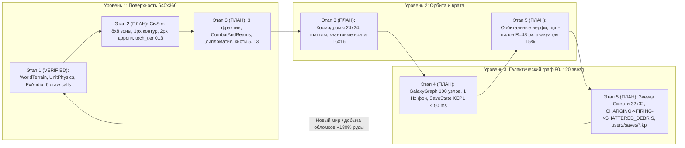

# Мастер-GDD: Kepler Sandbox (`00_MASTER_GDD.md`)

**Вердикт:** рабочий 2D-прототип на Godot 4.7.2 (`640×360`, `1200` юнитов, `450` флоры, `600` частиц, `60 FPS`) расширяется вертикальными срезами до трёхуровневой космической песочницы бога (`Поверхность 640×360 -> Орбита и врата -> Галактический граф из 100 звёзд`) при жёстком потолке `<= 12` draw calls на планете, нуле `Node2D` на сущность и переходе без тупиков через правила `Failure-Forward`. Все три профильные спецификации (`01`, `02`, `03`) прошли перекрёстный аудит без расхождений (`CLEAR`).

---

## 1. Видение игры и целевая эмоция

Игрок держит в одном окне две противоположные роли:
- **Прямая рука бога (`0–3` кадра отклика):** метеорит пробивает воронку на `640×360`, вспарывает берег, испаряет воду на стыке с лавой, швыряет юнитов волной $1/r$ и встряхивает камеру (`Trauma T^2/T^3`, `Hit-Stop <= 85 ms`) с процедурным звуком из `AudioStreamGenerator`.
- **Хроника восходящих цивилизаций:** на той же живой карте три асимметричные фракции (`HUMAN = 0`, `ROBOT = 1`, `SPORE = 2`) захватывают `TileZone` (`8×8 px`), прокладывают `2px` каналы, поднимаются по единой шкале `tech_tier 0..5` от костров и палаток до космодромов (`Tier 3`), квантовых врат (`Tier 4`) и орбитальных щитов со «Звездой Смерти» (`Tier 5`).

Защита интереса держится на инварианте **Failure-Forward** (см. подробности в [01_SYSTEMS_AND_MECHANICS.md](01_SYSTEMS_AND_MECHANICS.md)): гибель города оставляет `Руины` с `30%` руды и `+0.5 науки/с` плюс отряд `Скитальцев`, радиационный скачок запускает мутации и кристаллическую трансформацию, тепловой коллапс открывает горные термальные жилы, а выстрел «Звезды Смерти» по незащищённому миру превращает систему в богатый рудой `SHATTERED_DEBRIS` (`+180%` добычи) после эвакуации `15%` населения `Tier 3+`.

---

## 2. Каталог документации, концепт-арта и верифицированной базы кода

### 2.1. Спецификации и референсный концепт-арт

| Категория | Документ / кадр | Размер (байт) | Зона ответственности | Статус |
|---|---|---:|---|---|
| Спецификация | [01_SYSTEMS_AND_MECHANICS.md](01_SYSTEMS_AND_MECHANICS.md) | `47694` | 4 петли времени, Failure-Forward, `TileZone 8×8`, экономика, `tech_tier 0..5`, 3 фракции, 14 кистей, галактика `1 Hz`, `TUNING_KNOBS` | `CLEAR` (аудит) |
| Спецификация | [02_SPRITES_MODELS_AND_VFX.md](02_SPRITES_MODELS_AND_VFX.md) | `60759` | Палитры 5 биомов, HDR `AgX` (`white=6.0`), размеры `8×8..32×32`, `sprite_mode=3` с `*_mask.png`, `MAX_PARTICLES=1600`, `16` `SfxKind`, `tools/build_atlases.py` | `CLEAR` (аудит) |
| Спецификация | [03_ARCHITECTURE_AND_ROADMAP.md](03_ARCHITECTURE_AND_ROADMAP.md) | `51405` | SoA-модули, `<= 12` draw calls, LRU + `KEPL`/Zstd `< 50 ms`, триггер C#/GDExtension (`> 4000` или `p95 > 4.0 ms`), Этапы 2–5, *Via Negativa* | `CLEAR` (аудит) |
| Концепт-арт | `ref_v2_01_continent_scale_1794672653361.jpg` | `998515` | Ориентир континентального масштаба, читаемых силуэтов поселений и побережий (`Этап 2`) | Визуально проверен |
| Концепт-арт | `ref_v2_02_late_era_chaos_1794672727812.jpg` | `751626` | Ориентир поздней эры: геокупола, дуги телепортов, щиты и залпы с орбиты (`Этапы 3 и 5`) | Визуально проверен |
| Концепт-арт | `ref_v2_03_galaxy_macro_1794672659123.jpg` | `775864` | Ориентир галактической карты: 100 звёзд, гиперлинии, флоты и «Звезда Смерти» (`Этапы 4 и 5`) | Визуально проверен |

### 2.2. Текущий инвентарь кодовой базы (`VERIFIED`, Фаза 1)

| Файл | Размер (байт) | Строки | Подтверждённая роль в текущем прототипе |
|---|---:|---:|---|
| [project.godot](../project.godot) | `714` | `27` | Godot `4.7` (`Forward Plus`), окно `1280×720`, `canvas_items`/`expand`, `default_texture_filter=0`, фон `#080E18` |
| [main.tscn](../scenes/main.tscn) | `5755` | `219` | `Main` -> `WorldEnvironment`, `WorldTerrain (z=0)`, `UnitPhysics (z=1)`, `FxAudio (z=2)`, `BrushReticle (z=5)`, `Camera2D`, `HUD` (`CanvasLayer layer=2`) |
| [world_terrain.gd](../scripts/world_terrain.gd) | `46700` | `1495` | `class_name WorldTerrain`, `640×360`, чанки `16×16` (`40×23=920`), `Tier (0..8)`, `Biome (0..4)`, `BrushMode (0..4)`, 16 рек, 3 вулкана, 4 крист. очага, 26 облаков |
| [unit_physics.gd](../scripts/unit_physics.gd) | `38362` | `1166` | `class_name UnitPhysics`, SoA на `1200` юнитов (`64 B/юнит`, `8×8` тайл в `32×8` атласе, `UNIT_QUAD_PX=5.0`) + `450` флоры (`41 B/экз`, `96×12` атлас, `FLORA_SYNC_SLICE=75`), хэш-сетка `CELL_SIZE=16` |
| [fx_audio.gd](../scripts/fx_audio.gd) | `17776` | `614` | `class_name FxAudio`, пул `MAX_PARTICLES=600` (`74 B/слот`), `SHOCKWAVE_RING_COUNT=36`, `AudioStreamGenerator` (`22050 Hz`, `8` голосов, `SfxKind` `0..5`) |
| [main.gd](../scripts/main.gd) | `30311` | `820` | `use_hdr_2d=true`, `AgX` (`white=6.0`), `ZOOM_MIN/MAX=1.2..12.0`, `HIT_STOP_MAX_SEC=0.085`, `TRAUMA_DECAY=1.65`, CLI `--smoke-test`, `--screenshot=`, `--zoom-shot=` |
| [terrain_water.gdshader](../shaders/terrain_water.gdshader) | `3285` | `88` | Маска `mask_tex` (`R` глубина, `G` пена, `B` жар лавы, `A` кристалл), `bayer4`-каустики, HDR-свечение лавы и кристаллов |
| [cloud_shadow.gdshader](../shaders/cloud_shadow.gdshader) | `1915` | `60` | `64×32` квантование теней облаков и экзопланетной пылевой дымки с `bayer4`-дизерингом |
| [unit_sprite.gdshader](../shaders/unit_sprite.gdshader) | `3499` | `107` | `sprite_mode` `0/1/2`, V-флип `1.0 - UV.y`, UV-кламп `0.002..0.998`, ветер, отдача, `spawn_spring`, HDR визора/пламени/кристалла/лавы |
| [verify_tracer.ps1](../verify_tracer.ps1) | `4714` | `124` | Одиночный запуск `Godot_v4.7.2-stable_win64_console.exe` с watchdog `25s`, фильтром ошибок и 3 прогонами |
| `screenshots/*.png` | `1159781` | — | [world_macro.png](../screenshots/world_macro.png) (`594523` Б), [world_zoom.png](../screenshots/world_zoom.png) (`459243` Б), [tracer_frame.png](../screenshots/tracer_frame.png) (`106015` Б) |
| Ярлыки `.bat` | `171` | `6` | [Запустить_игру.bat](../Запустить_игру.bat) (`84` Б), [Открыть_в_Godot.bat](../Открыть_в_Godot.bat) (`87` Б) |

> **Зафиксировано на входе (`VERIFIED`):** модулей `civ_sim.gd`, `combat_and_beams.gd`, `galaxy_graph.gd`, `save_state.gd`, скрипта `tools/build_atlases.py`, папки `assets/atlases/`, режима `sprite_mode = 3` и флагов `--smoke-civ` / `--shot-civ` в проекте **пока нет** — это целевой объём Этапов 2–5 (`[ПЛАН]`).

---

## 3. Сводка консистентности и единые контракты (`CLEAR`)

| Параметр / Контракт | Зафиксированное значение | Статус | Где закреплено |
|---|---|---|---|
| Поле планеты | `640×360 px` (`230 400` px), `40×23 = 920` чанков `16×16` | `VERIFIED` | `world_terrain.gd`, все 3 GDD |
| Зоны цивилизации `[ПЛАН]` | `80×45 = 3600` `TileZone` (`8×8 px`), единый хелпер `_get_zone_owner(zx, zy)` -> `1px` контур + `3%` заливка + `2px` каналы в `_border_image` | `CLEAR` | `01`, `02`, `03` |
| Размеры спрайтов и щита `[ПЛАН]` | Костры `8×8`, палатки/буры/склады/панели `12×12`, купола/реакторы/врата `16×16`, космодром/верфь `24×24` (`16×16` база), «Звезда Смерти»/Левиафан `32×32`; радиус `bld_shield_pylon` `R = 48 px` | `CLEAR` | `01`, `02`, `03` |
| Перечисления и шкалы | `Tier (0..8)`, `Biome (0..4)`, `BrushMode (0..4 -> 0..13)`, `Faction { HUMAN=0, ROBOT=1, SPORE=2 }`, `Diplomacy { NEUTRAL=0, PACT=1, TOTAL_WAR=2, REBELLION=3 }` | `CLEAR` | `world_terrain.gd`, `01`, `02`, `03` |
| Анти-спам `tech_tier 0..5` `[ПЛАН]` | `TIER_DUP_DIMINISH_COUNT = 3`: `1–3` копии здания дают `100%`, `4–6` — `25%`, `7+` — `0%` вклада в `tech_tier` | `CLEAR` | `01`, `03` |
| Шейдер и бюджеты рендера | Новые атласы строго в `sprite_mode = 3` (`Albedo + *_mask.png`); мир Планеты `<= 12` draw calls (`6` есть + `6` план); Галактика `3` draw calls; `MAX_PARTICLES = 600 -> 1600`; `HIT_STOP_MAX_SEC = 0.085` (`85 ms`) | `CLEAR` | `main.gd`, `01`, `02`, `03` |
| Производительность и память | На планете `<= 4.00 ms/кадр` @ `60 FPS`; SoA `4000` юнитов = `250.0 KiB` (`4096` макс. = `256.0 KiB`); `switch_planet < 50 ms` (`KEPL` + Zstd + 6-слотовый LRU) | `CLEAR` | `03` |
| Проверочные команды | `0` AI-штампов, `0` расхождений `DeathStarState` (`IDLE -> CONSTRUCTING -> TRANSITING -> CHARGING -> FIRING -> COOLDOWN` -> `SHATTERED_DEBRIS`), `0` «резиновых» эпитетов без цифр в `TUNING_KNOBS` | `CLEAR` | `01`, `02`, `03` |

---

## 4. Архитектура 3 уровней масштаба и дорожная карта срезов

---

## 5. Немедленный план действий: Этап 2 — Трассер (`Города, ресурсы, границы, tech_tier 0..3`)

**Цель Этапа 2:** превратить заселённый архипелаг `640×360` в живую цивилизацию первой фракции (`Faction.HUMAN = 0`, «Колонисты») с автоматическим захватом зон `8×8`, общим `1px` внешним контуром без внутренней сетки, циклом рабочих (`добыча -> склад -> стройка`) и ростом от `tech_tier 0` до космодрома (`tech_tier 3`).

### Якоря плана (зафиксировать до старта кода)
- **Главный риск среды:** два разных места по-разному читают владельца клетки `8×8` -> на границе вылезает внутренняя сетка `8×8` (лечится одним методом `CivSim._get_zone_owner(zx, zy)` на чтении и пересборке `_border_image`); второй риск — застревание рабочих на изогнутых берегах при возврате к складу; третий — `Parse Error` при холодном запуске `--headless`, если между скриптами поставить взаимные аннотации `class_name` вместо `Node2D` + `preload()`.
- **Трассер №1 (минимальный рабочий срез):** заспавнить `1` стартовый город Колонистов на суше (`tech_tier = 0`), прогнать `60` шагов по `dt = 0.05 s`: рабочий доходит до дерева, запускает дрожание флоры (`_flora_shake`), приносит ресурс в город, город расширяется до `>= 4` зон `8×8` и ставит `>= 1` здание через `_mm_buildings`. Проверить `Godot --headless` до добавления ферм, дорог и буров `Tier 1–3`.
- **Порог Стоп-крана:** (а) `verify_tracer.ps1` падает два раза подряд; (б) `step_physics + step_civ > 3.0 ms` на `1200` юнитах; (в) в коде появляется `Node2D` на здание/зону, прямая проверка пикселя чужого буфера вместо `_get_zone_owner()` или метод с `> 3` параметрами.

### Конкретные тикеты к выполнению (`T2.1 -> T2.6`)

| Тикет | Файлы (`[ПЛАН]` правки/создание) | Суть задачи и узкий контракт | Проверка готовности |
|---|---|---|---|
| **T2.1** Атласы + маска `sprite_mode = 3` | Новый `tools/build_atlases.py`, `assets/src_sprites/`, `assets/atlases/buildings_atlas.png` + `*_mask.png`, правка [unit_sprite.gdshader](../shaders/unit_sprite.gdshader) | Собрать горизонтальный атлас построек `HUMAN` (`8×8` костёр, `12×12` палатка/бур/склад/солнечная панель, `16×16` купол/реактор, `24×24` космодром с базой `16×16`) + парную `*_mask.png` (`R` тинт, `G` HDR-свечение). Добавить ветку `sprite_mode = 3`, отключив на ней эвристический HDR по красным пикселям. | `python tools/build_atlases.py` завершается с кодом `0`, проверяет сетку и отсутствие `#000000` / не-HDR `> 0.95`. |
| **T2.2** Ядро городов `CivSim` (SoA + границы + `2px` каналы) | Новый `scripts/civ_sim.gd`, правка [main.tscn](../scenes/main.tscn) | Поле `80×45` (`3600` зон `8×8`) на плоских `Packed*Array`, список городов с локальными складами, единый хелпер `_get_zone_owner(zx, zy)`. `_border_sprite` рисует только внешний `1px` контур + `3%` заливку + `2px` дороги/энергопроводы; `_mm_buildings` (`MultiMeshInstance2D`, `sprite_mode = 3`) рисует здания с `spawn_spring`. Формула `tech_tier 0..3` с `TIER_DUP_DIMINISH_COUNT = 3`. | Публичный интерфейс `<= 3` аргументов на метод (в т.ч. `step_civ`), без взаимных аннотаций `class_name`. |
| **T2.3** Связка рабочих и ресурсов с `UnitPhysics` | [unit_physics.gd](../scripts/unit_physics.gd) | Добавить SoA-поля роли/цели/груза, чтение цели из `CivSim`, анимацию рубки дерева (`_flora_shake`) и добычи рудной жилы (температурный/биомовый срез), доставку на склад города и обход заливов без тормозов по кэш-сетке. | Сборка без `SCRIPT ERROR`, суммарный кадр `step_physics + step_civ <= 3.0 ms` при `1200` юнитах. |
| **T2.4** Звук стройки `BUILD_POP` и мелкая пыль | [fx_audio.gd](../scripts/fx_audio.gd) | Добавить пресет `SfxKind.BUILD_POP` (треугольник `240 -> 580 Hz` за `45 ms`, общая длительность `80 ms`, кулдаун `40 ms`, питч-джиттер `±10%`) и лёгкий спавн `3` пылинок + `Trauma 0.04` при закладке здания. | `--headless` (драйвер `Dummy`) не падает при вызове `play_sfx(SfxKind.BUILD_POP)`. |
| **T2.5** Кисть колонии и счётчики в HUD | [main.gd](../scripts/main.gd), [main.tscn](../scenes/main.tscn) | Подключить `CivSim` в цикл `Main`, добавить кнопку спавна тестовой колонии Колонистов в панель `BottomDock`, вывести счётчик городов и максимального `tech_tier` в `TopBar` (`layer = 2`), добавить CLI-флаги `--smoke-civ` и `--shot-civ`. | Свободный прогон в `--headless` без наложения HUD на карту и без клиппинга текста. |
| **T2.6** Автоприёмка Этапа 2 в раннере | [verify_tracer.ps1](../verify_tracer.ps1) | 1) Добавить `--smoke-civ`: `150` детерминированных тиков (`dt = 0.05 s`), проверки `cities >= 1`, `zones_owned >= 4`, `buildings >= 4`, `tech_tier >= 1`, ненулевая добыча на складе -> вывод `SMOKE_CIV_PASS`, exit `0`. 2) Добавить `--shot-civ` -> `screenshots/stage2_civ.png` на `5.5x` зуме. | Прогон `.\verify_tracer.ps1` зелёный, а осмотр `screenshots/stage2_civ.png` через `read_file` подтверждает сплошной `1px` внешний контур без сетки `8×8`, `2px` дороги, выросшие здания и чистый HDR. |
