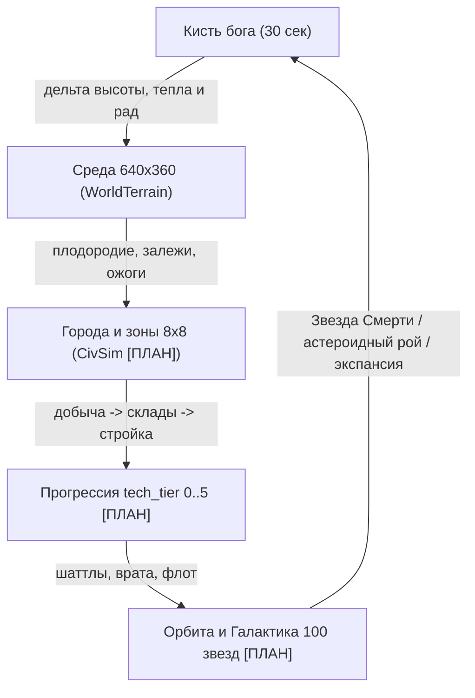

# Системный геймдизайн: Kepler Sandbox (`01_SYSTEMS_AND_MECHANICS.md`)

**Вердикт:** живая 2D-песочница бога на базе существующего `640×360` физического ядра расширяется до трёхуровневой космической стратегии (планета -> орбита/врата -> галактический граф из `100` звёзд) через пересечение `<= 3` базовых правил на слой: физика среды меняет ресурсы зон, ресурсы кормят рост `tech_tier 0..5`, а космическая экспансия и «Звезда Смерти» перекраивают узлы галактики без тупиковых поражений.

---

## 1. Целевой опыт и 4 временных цикла (Reverse MDA)

### 1.1. Целевая эмоция (Aesthetics -> Dynamics -> Mechanics)

Игрок переключается между двумя ролями на одном экране:
1. **Вмешательство бога:** физический отклик мира на кисть за `0–3` кадра (`<= 50 ms`) — метеорит пробивает кратер, поджигает лес, раскидывает юнитов волной $1/r$ и трясёт камеру (`Hit-Stop 60 ms`).
2. **Хроника цивилизаций:** наблюдение за тем, как 3 асимметричные фракции осваивают архипелаг из `9` ярусов высоты, спорят за рудные жилы, выходят в космос, пробивают океан квантовыми вратами и сталкиваются на `100`-звёздном графе.

### 1.2. Четыре временных петли

| Цикл | Длительность | Вход игрока | Системная динамика | Наблюдаемый исход |
| :--- | :--- | :--- | :--- | :--- |
| **1. Атомная петля** | `5–30 с` | Мазок кистью (`LMB`) | Обновление массивов `_height/_temp/_rad`, импульс $1/r$, выброс `4–60` частиц, `T^2/T^3` тряска, процедурный звук | Воронка, пар на стыке с водой, паника и разлёт юнитов за `<= 3` кадра |
| **2. Тактическая петля** | `3–5 мин` | Точечная правка биома, провокация или спавн отряда | Захват соседних `TileZone` (`8×8 px`), цикл сборщика (`добыча -> склад -> стройка`), пограничные стычки | Рост границ на `4–12` зон, перехват шахты или кризис после метеорита |
| **3. Планетарная петля** | `30–90 мин` на `1x` (`8–15 мин` на `25x`) | Терраформинг под города, управление погодой и войнами | Восхождение по шкале `tech_tier 0 -> 5`, выход к космодромам (`Tier 3`) и телепорт-аркам (`Tier 4`) | Полное заселение континентов, ракетные запуски, война с портальными десантами |
| **4. Галактическая мета-петля** | `90+ мин` (сквозная) | Переключение уровня (`1/2/3`), прокладка червоточин, наведение «Звезды Смерти» | Ленивый `1 Hz` тик на `99` фоновых узлах, полёты флотов по гиперлиниям, перестройка расколотых миров | Передел границ `100` звёздных систем, захват астероидных роёв, цикл новых поколений |

### 1.3. Состояния Failure-Forward (тупиков нет)

| Кризисное событие | Порог срабатывания `[ПЛАН]` | Необратимый тупик (запрещено) | Failure-Forward исход (правило симуляции) |
| :--- | :--- | :--- | :--- |
| **Крах города** | Население города `= 0` или разрушена ратуша | Полное удаление следов и остановка фракции | Клетка ратуши становится **`Руинами`** с `30%` остатка руды и `+0.5 науки/с` для будущих исследователей. Выжившие (`1–5` юнитов) уходят в **`Скитальцы`** (`+20%` скорости, поиск свободной земли в радиусе `120 px`) |
| **Радиационный скачок** | `_rad >= 0.60` в жилой зоне | Тихая смерть всех юнитов без последствий | У Людей через `12 s` (`720` кадров при `60 FPS`) запускается мутация (`12%` шанс стать **Мутантом**: `150 HP`, иммунитет к радиации); у биоты возникают споры-мутанты (`+40%` роста `Ксено-Споры`); почва при `moisture >= 0.22` переходит в `Biome.CRYSTAL` с `+60%` энергоотдачи сектора |
| **Тепловой коллапс** | `get_avg_temp() >= 65.0°C` | Вымирание карты навсегда | Реки пересыхают до `Tier.SAND`, но при `_temp >= 180°C` на горах открываются термальные жилы (`+4.0 энергии/с` геотермальным бурам); Роботы и выжившие под гео-куполами получают монополию на планету |
| **Раскол планеты «Звездой Смерти»** | Попадание суперлазера по миру без щита | Исчезновение узла с карты галактики | Узел превращается в **`Астероидный рой` (`SHATTERED_DEBRIS`)**: обнуляет популяцию и атмосферу (`15%` жителей `Tier 3+` эвакуируются на шаттлах к союзникам), но даёт **`+180%` добычи руды** орбитальным фрегатам и служит точкой засад |

### 1.4. `TUNING_KNOBS` темпа и петли кризисов

| Variable | Min | Default | Max | Влияние на игру |
| :--- | :---: | :---: | :---: | :--- |
| `REALTIME_PACE_SCALE` `[ПЛАН]` | `0.10` | `0.25` | `1.00` | Множитель скорости civ-экономики на `1x`, чтобы стройка читалась глазами без спешки |
| `FAST_WARP_MULT` `[ПЛАН]` | `10.0` | `25.0` | `50.0` | Ускорение времени для сжатия перехода от `Tier 0` к `Tier 4–5` до `8–15 мин` |
| `RUIN_ORE_RETAIN_RATIO` `[ПЛАН]` | `0.10` | `0.30` | `0.60` | Доля складской руды, остающаяся в руинах павшего города |
| `MUTATION_RAD_THRESHOLD` `[ПЛАН]` | `0.40` | `0.60` | `0.85` | Порог радиации тайла, запускающий мутацию юнитов |
| `DS_EVAC_SURVIVAL_RATIO` `[ПЛАН]` | `0.05` | `0.15` | `0.35` | Доля населения `Tier 3+`, успевающая улететь на челноках за `5.0 s` заряда суперлазера |

---

## 2. Базовый слой мира и физики (`VERIFIED` из кода) + надстройки `[ПЛАН]`

### 2.1. Инвентаризация работающего прототипа (`VERIFIED`)

| Модуль | Верифицированные параметры и контракты из текущих скриптов | Привязка к коду |
| :--- | :--- | :--- |
| **Ландшафт и климат** (`WorldTerrain`) | Сетка `640×360` (`230,400` пикселей, `40×23 = 920` чанков по `16×16`), фильтр `NEAREST`. `9` ярусов `Tier` (`0..8`, пороги высоты `0.210`, `0.290`, `0.355`, `0.395`, `0.505`, `0.605`, `0.685`, `0.755`). `5` биомов `Biome`: `RUST=0`, `LUSH=1`, `CRYSTAL=2`, `SCORCHED=3`, `LAVA=4`. Плоские буферы `_tiers`, `_biomes`, `_river_mask`, `_vent_mask`, `_height`, `_temp`, `_rad`, `_moisture` | [world_terrain.gd](../scripts/world_terrain.gd#L8-L148), [L702-L719](../scripts/world_terrain.gd#L702-L719) |
| **Генерация и шаг среды** (`WorldTerrain`) | `16` рек от гор к океану, `4` кармана кристаллов, `3` вулкана с разломами, `26` слоёв дрейфующих облаков/дымки. Шаг `step_environment(dt)` обрабатывает до `180` активных чанков за кадр: диффузия тепла (`1.35`), остывание к фону `18.0°C` (`0.16`), тушение лавы водой (`surface_impact "steam"`), распад радиации (`-0.012/s`), расползание кристаллов (`0.012/s` при `rad >= 0.34`, `moisture >= 0.22`, `temp < 55°C`), восстановление `LUSH` (`0.008/s` при `temp < 32°C`, `rad < 0.14`, `moisture > 0.42`) | [world_terrain.gd](../scripts/world_terrain.gd#L12-L28), [L909-L1050](../scripts/world_terrain.gd#L909-L1050) |
| **Юниты, флора и физика** (`UnitPhysics`) | `1200` колонистов в плоских SoA `PackedArrays` (`5×5 px` из атласа `32×8`), `450` объектов флоры (`12×12 px` из атласа `96×12`, `8` вариантов, пружина `omega=18.0`, `zeta=0.25`). Пространственный хэш `CELL_SIZE=16` (`40×23` ячеек, нулевые аллокации). Boids: сепарация `4.2 px` (вес `56.0`), стая `10.5 px` (макс. `10` соседей). Сопротивление склону (`0.45`), скатывание (`26.0`), обход воды (`62.0`), ожог при `temp > 70°C` или `LAVA` (`-28.0 HP/s`, бегство `1.75x`). В текущей версии при `HP <= 0` юнит телепортируется на сушу с `100 HP` | [unit_physics.gd](../scripts/unit_physics.gd#L6-L96), [L598-L846](../scripts/unit_physics.gd#L598-L846) |
| **Импульсы, VFX и звук** (`FxAudio`, `main.gd`) | `5` кистей `BrushMode` (`TERRAFORM_LIFE=0`, `CRYSTAL_FLORA=1`, `LAVA_VOLCANO=2`, `METEOR_CRATER=3`, `VORTEX_PULL=4`), размеры `S=8 / M=16 / L=28`. `MAX_PARTICLES=600`, ударная волна из `36` пикселей кольца + `18` искр (`0.42 s`), `8`-голосный синтез `AudioStreamGenerator` (`22050 Hz`, джиттер тона `0.90..1.10`). Камера: зум `1.2x..12.0x`, скорости `0x/1x/3x/5x`, `Hit-Stop <= 85 ms`, тряска `T^2/T^3` (`TRAUMA_DECAY=1.65`), `use_hdr_2d=true` + `AGX` | [main.gd](../scripts/main.gd#L5-L35), [fx_audio.gd](../scripts/fx_audio.gd#L6-L40) |

### 2.2. Надстройки физических правил поверх текущих массивов (`[ПЛАН]`)

1. **Распространение огня (`_fire_mask: PackedByteArray`, `0..255`):**
   - Источник огня: `_temp[idx] >= 240.0°C` на клетках `Biome.LUSH` или `Biome.RUST`, попадание лазера или горящие обломки.
   - Шаг огня (внутри активного цикла чанков): перекидывается на кардинальных соседей с вероятностью `FIRE_SPREAD_BASE * (1.0 - _moisture[nb]) * biome_mult * dt`, где `biome_mult = 1.6` для `RUST`, `1.0` для `LUSH`, `0.0` для воды, `SAND`, `SUMMIT` и мицелия ниже `140°C`.
   - Горение длится `4.5 s`: держит `_temp >= 280°C`, снижает `_moisture` соседа на `-0.20/s`, сжигает флору/постройки и переводит пиксель в `Biome.SCORCHED`. Дождь или `_moisture >= 0.72` гасит клетку за `0.8 s`.
2. **Термальное плавление и климат планеты:**
   - При `_temp >= 480°C` песок (`Tier.SAND`) остекляется в `Biome.SCORCHED`; снег на `Tier.SUMMIT` при `_temp > 5.0°C` сползает в `MOUNTAINS` и прибавляет `+0.25` влажности соседним истокам рек.
   - Глобальный сдвиг по `get_avg_temp()`: оптимум `+10°C .. +32°C`. При `+38°C` и выше урожайность `LUSH` падает на `-35%`; при `+2°C` и ниже граница снега спускается на `HILLS` (`h >= 0.605`), скорость органики падает на `-25%`.
3. **Радиационные мутации и реальная смертность:**
   - В `UnitPhysics` убирается прототипный телепорт-воскрешение при `HP <= 0` (`unit_physics.gd:742-744`): гибель освобождает слот SoA массива через swap-remove и сбрасывает в локальный склад города `2` ед. биомассы (при сборе Ксено-Спорой — `15` ед.).
   - Градация доз `_rad` (`0.0..1.0`):
     * `0.00..0.24`: безопасная зона (`0` урона).
     * `0.25..0.59`: людям `-3.5 HP/s`; через `12.0 s` суммарного облучения `12%` шанс мутации (`Мутант`: `150 HP`, иммунитет к радиации, скорость `19.2 px/s`, агрессия к обычным городам при `rad > 0.50`). Ксено-Спора в этой зоне получает `+40%` к скорости деления.
     * `0.60..1.00`: людям `-14.0 HP/s`; роботам при `rad >= 0.85` штраф точности `-15%` и `+0.08` перегрева в секунду.
4. **Карта залежей и плодородия (на сетке `TileZone` `8×8 px`):**
   - Генерация планеты заполняет массив `zone_ore: PackedUint16Array` (`80×45 = 3,600` ячеек): `HILLS` содержат `12–28` ед. руды, `MOUNTAINS` — `30–60` ед., `Biome.CRYSTAL` — `20–45` ед. энерго-кристаллов (`1.5x` выход в энергию и науку).
   - Плодородие зоны `zone_fertility` (`0.2..1.4`): базовые `1.0` для `LUSH`, `0.4` для `RUST`, `1.4` в пойме рек (`_river_mask` в радиусе `4 px`).

### 2.3. `TUNING_KNOBS` физических надстроек

| Variable | Min | Default | Max | Влияние на игру |
| :--- | :---: | :---: | :---: | :--- |
| `FIRE_IGNITE_TEMP_C` `[ПЛАН]` | `180.0` | `240.0` | `350.0` | Температура воспламенения сухой растительности |
| `FIRE_SPREAD_BASE` `[ПЛАН]` | `0.10` | `0.32` | `0.85` | Базовая вероятность переброса огня в секунду на сухого соседа |
| `FIRE_BURN_DURATION_SEC` `[ПЛАН]` | `2.0` | `4.5` | `10.0` | Время выгорания пикселя до состояния базальта `SCORCHED` |
| `GLOBAL_HEAT_PENALTY_C` `[ПЛАН]` | `32.0` | `38.0` | `50.0` | Порог средней температуры планеты для `-35%` урожая |
| `RAD_MILD_DMG_PER_SEC` `[ПЛАН]` | `1.5` | `3.5` | `8.0` | Урон людям в зоне средней радиации (`0.25..0.59`) |
| `RAD_LETHAL_DMG_PER_SEC` `[ПЛАН]` | `8.0` | `14.0` | `30.0` | Урон людям в зоне жёсткой радиации (`>= 0.60`) |
| `ORE_PER_MOUNTAIN_ZONE` `[ПЛАН]` | `15` | `45` | `90` | Средний запас руды на одну горную `TileZone` `8×8` |

---

## 3. Фракции, города и границы (`[ПЛАН]`)

### 3.1. Три асимметричные фракции

| Параметр | `HUMAN` — Колонисты (Люди) | `ROBOT` — Автономный Рой (Роботы) | `SPORE` — Ксено-Спора (Био-рой) |
| :--- | :--- | :--- | :--- |
| **Базовые статы (Рабочий / Боец)** | `100 HP`, `16.0 px/s`, `12` урон (`26 px`, `1.1 s`) | `145 HP` (`20%` брони), `18.5 px/s`, `15` урон (`32 px`, `0.95 s`) | `75 HP` (`Ползун`, `21.0 px/s`, `9` урон `6 px`) / `850 HP` (`Левиафан`, `45` урон `28 px`) |
| **Потребление на юнита** | `0.12` Еды/мин; в куполе `0` штрафа к климату | `0` Еды; `0.18` Энергии/мин + `18` Руды и `12` Энергии на сборку нового бота | `0.10` Биомассы/мин; лечатся на мицелии (`+4.0 HP/s`), `+15` Биомассы за павшего юнита |
| **Стихийная уязвимость** | При `temp > 45°C` без купола `-4.0 HP/s`; боятся `rad >= 0.25` | Иммунитет до `rad < 0.85`; при `temp > 120°C` скорострельность `-18%`; уязвимы к `Сбою ИИ` (`65%` берсерк) | Урон от огня и лавы `1.75x`; при `moisture < 0.15` скорость роста `-60%` |
| **Особая механика** | Гео-купола (`радиус 18 px`) изолируют от жары/радиации и режут урон от метеоритов на `40%` | Стационарные узлы-ретрансляторы держат `4` боевых дрона на завод; при `energy = 0` скорость падает до `4.0 px/s` | Ползущий био-ковер (мицелий) сам захватывает сухие `TileZone` со скоростью `1` зона / `12 s` без строителей |
| **Порог появления отступников** | Город-мятежник получает свой цвет границы и тип `HUMAN` | Сбой ИИ порождает мятежный узел `ROBOT` (`красный/фиолетовый` подцвет) | При потере королевы/центра рой распадается на `2` дикие стаи `SPORE` |

### 3.2. Города, `TileZone` `8×8` и единая `1px` граница

1. **Сетка зон:** карта `640×360` делится ровно на `80×45 = 3,600` ячеек `TileZone` (`8×8` пикселей). Каждая ячейка хранит `zone_city_id` (`-1` — нейтральная земля) и `zone_faction_id`.
2. **Отрисовка единого контура без решётки:** для каждого пикселя поверхности и заливка (`3%` смешение с цветом фракции) и `1px` внешний контур обращаются строго к одной функции `_get_zone_owner(zx, zy)` и сравнивают его с 4 соседями `(zx±1, zy±1)`. Внутренние швы `8×8` не рисуются никогда.
3. **Экспансия и перехват зон:**
   - Новый город закладывается как `3×3` `TileZone` (`24×24 px`) не ближе `48 px` к чужой ратуше.
   - Каждые `8.0 s` мирной работы город тратит `15` ед. ресурса (`Руда` или `Биомасса`) и забирает `1` соседнюю сухую `TileZone` с наибольшим весом (руда `HILLS/MOUNTAINS` `+30`, пойма реки `+20`, берег моря `+15`).
   - В войне: если `>= 3` боевых юнита удерживают чужую граничную `TileZone` `4.0 s` при отсутствии защитников в радиусе `12 px`, зона меняет `zone_city_id`.

### 3.3. Роли рабочих и локальный склад

- **Хранилище `city["storage"]`:** поля `food`, `ore`, `energy`, `science`. Лимит склада: `200` ед. на `Tier 0`, `+150` за каждый `Склад` (`Tier 1`), `+300` за `Космодром` (`Tier 3`).
- **4 базовые задачи юнитов (динамический пересчёт раз в `2.0 s`):**
  1. `farmer` (фермер / био-культиватор): идёт к ближайшей флоре `LUSH` / ферме, собирает `3` ед. за `1.8 s` (`chop_shake = 1.0`), несёт в склад.
  2. `miner` (шахтёр): идёт к валуну/горе с `zone_ore > 0` или в `BIOME_CRYSTAL`, добывает `2` ед. руды (или `3` в кристаллах) за `2.2 s`.
  3. `builder` (строитель): берёт ресурсы со склада и возводит отмеченный проект (`build_progress 0 -> 100%` за `6–18 s`), при нехватке ресурсов временно уходит в `miner/farmer`.
  4. `soldier` (боец): патруль периметра; в мирное время составляет `15%` населения, при `TOTAL_WAR` мобилизуется до `45%` у Людей, `60%` у Роботов и `70%` у Ксено-Споры.

### 3.4. Матрица дипломатии

| Состояние | Триггер перехода `[ПЛАН]` | Правило поведения юнитов и городов |
| :--- | :--- | :--- |
| **`NEUTRAL`** | Стартовый контакт городов разных фракций | Атаки отключены; разведчики обходят чужую `1px` границу |
| **`PACT`** | Общий враг или дефицит (`< 20%` еды/руды) при совпадении целей (`HUMAN <-> HUMAN`, `HUMAN <-> ROBOT` при мире `>= 120 s`) | Включаются торговые роверы по дорогам и грузовые шаттлы: перенос `15` ед. ресурса за рейс (`+20%` бонус обеим сторонам). `SPORE` пакты с не-спорами не заключает |
| **`TOTAL_WAR`** | `>= 4` общих пограничных зон трения при дефиците руды, удар по торговому роверу или кисть `DIPLO_TRIGGER` | Массовая мобилизация, обстрел при встрече в радиусе видимости (`36 px`), захват пограничных `TileZone` (`4.0 s`), десанты через шаттлы/порталы |
| **`REBELLION`** | Удалённость от столицы `> 140 px` + лояльность города `< 25%` (голод `> 20 s` или облучение), либо кисть `Сбой ИИ` | `35–45%` зон (минимум `1` дочерний город) отделяются под новой цветовой палитрой и сразу объявляют `TOTAL_WAR` бывшей метрополии |

### 3.5. `TUNING_KNOBS` фракций и дипломатии

| Variable | Min | Default | Max | Влияние на игру |
| :--- | :---: | :---: | :---: | :--- |
| `TILE_ZONE_PX` `[ПЛАН]` | `8` | `8` | `8` | Размер зоны владения (`80×45` ячеек на `640×360` карте) |
| `ZONE_EXPAND_INTERVAL_SEC` `[ПЛАН]` | `3.0` | `8.0` | `20.0` | Пауза между захватами новых нейтральных `TileZone` городом |
| `ZONE_CAPTURE_HOLD_SEC` `[ПЛАН]` | `1.5` | `4.0` | `10.0` | Время удержания чужой приграничной зоны отрядом для перехвата |
| `REBEL_LOYALTY_THRESHOLD` `[ПЛАН]` | `10.0` | `25.0` | `45.0` | Процент лояльности, ниже которого вспыхивает восстание |
| `CIV_LOGIC_HZ` `[ПЛАН]` | `2` | `4` | `10` | Частота тиков экономики, логистики и дипломатии (`15` кадров при `60 FPS`) |
| `MOBILIZE_WAR_HUMAN` `[ПЛАН]` | `0.25` | `0.45` | `0.70` | Доля населения Людей, уходящая в бойцы при тотальной войне |
| `START_CITY_POP` `[ПЛАН]` | `8` | `16` | `24` | Стартовый гарнизон при основании города (каждый новый город до `250` чел.) |
| `MAX_PLANET_UNITS` `[ПЛАН]` | `1200` | `2500` | `4000` | Потолок активных юнитов SoA на `640×360` карте внутри GDScript-бюджета `<= 4.0 ms` |

---

## 4. Единая шкала технологического развития (`tech_tier` 0 -> 5) `[ПЛАН]`

Чтобы поселения не перепрыгивали в космическую эру спамом дешёвых палаток, расчёт `tech_score` (`0..30` пунктов на HUD, где `5` пунктов = `1` шаг `tech_tier`) применяет убывающую отдачу: **первые `3` постройки одного типа дают `100%` очков тира, `4–6`-я дают `25%`, а с `7`-й — `0%`**. Следующий `tech_tier` (`0..5`) открывается при накоплении нужных очков и суммы `Науки` в городе.

| `tech_tier` | Порог науки и условий | Постройки: Люди / Роботы / Ксено-Спора | Юниты и логистика | Энергобаланс и лимиты |
| :---: | :--- | :--- | :--- | :--- |
| **Tier 0** *(Лагерь)* | Старт (`0` науки) | **Костёр (`8×8 px`) и палатки (`12×12 px`)** / Стартовый узел-маяк / Первичный споровый кокон | Ручной сбор ягод и камня, пешие разведчики (`16.0..21.0 px/s`) | Костёр греет на `+20°C` в радиусе `18 px`; склад `200` ед. |
| **Tier 1** *(Инфра)* | `60` Науки + `>= 12` юнитов | **Дороги/трубопроводы (`2 px`)**, **Буры** (`+2.4 руды/с`), **Склады** (`+150` ёмкости), базовые турели (`28 px`, `8` урон) / Экстракторы дронов / Костяные шпили | Грузовые роверы (`28 px/s` по дорогам `+35%`), шахтёры с киркой/резаком | Потребление `6.0` Энергии/с на город; первые каменные стены по периметру |
| **Tier 2** *(Экосфера)* | `220` Науки + `>= 2` бура | **Гео-купола** (`r=18 px`), **Солнечные фермы** (`+3.0 еды/с`), **Реактор** (`+12 энерг./с`), Лаборатория (`+1.5 науки/с`) / Энергоядро / Био-инкубаторы мицелия | Бронепехота, тяжёлые красные боты (`145 HP`), кислотные плевуны | При взрыве Реактора: кратер `r=10 px`, `_temp +320°C`, `_rad +0.45` |
| **Tier 3** *(Орбита)* | `650` Науки + `>= 1` реактор | **Космодромы (`24×24 px`)**, стартовые столы с ракетами, орбитальные ретрансляторы / Пусковые башни роя / Споровые катапульты | **Орбитальные шаттлы** (`25` юнитов или `80` груза), штурмовые дроны, колонизационные зонды на соседнюю звезду | Запуск шаттла: `45` Энергии, `3.5 s` подъёма в дыму; склад `+300` |
| **Tier 4** *(Врата)* | `1600` Науки + `>= 1` космодром | **Квантовые врата-телепорты (`16×16 px`)** на суше (межконтинентальные арки) и узлы червоточин на орбите / Живые органические врата | Переброска отряда до `12` юнитов между материками или системами за `0.4 s` (`перезарядка 4.0 s`) | Прыжок отряда: `18` Энергии; межсистемная червоточина: `60` Энергии на флот |
| **Tier 5** *(Вершина)* | `3800` Науки + `>= 2` врат | **Орбитальная верфь (`24×24 px`)**, **Планетарный щит-пилон** (`r=48 px`, блок до `3` ударов) и **проект «Звезда Смерти»** (`10` сегментов `0/10..10/10`) | Фрегаты, дредноуты, `Альфа-Левиафан` у Спор, экипаж управления «Звездой Смерти» | Каждый этап `0/10 -> 10/10` стоит `250` Руды + `200` Энергии |

### `TUNING_KNOBS` технологической шкалы

| Variable | Min | Default | Max | Влияние на игру |
| :--- | :---: | :---: | :---: | :--- |
| `TIER_DUP_DIMINISH_COUNT` `[ПЛАН]` | `2` | `3` | `5` | Количество однотипных зданий до срезки их вклада в очки `tech_tier` до `25%` |
| `ROAD_SPEED_BONUS` `[ПЛАН]` | `1.15` | `1.35` | `1.80` | Множитель скорости юнитов и роверов на пикселях `2px` дорог |
| `DOME_PROTECTION_RADIUS` `[ПЛАН]` | `12` | `18` | `28` | Радиус защиты гео-купола от жары, радиации и метеоритов (`-40%` урона) |
| `REACTOR_MELTDOWN_RAD` `[ПЛАН]` | `0.25` | `0.45` | `0.85` | Выброс радиации при разрушении термоядерного реактора `Tier 2` |
| `PORTAL_COOLDOWN_SEC` `[ПЛАН]` | `2.0` | `4.0` | `10.0` | Пауза между импульсами переброски отряда через врата `Tier 4` |

---

## 5. Полный каталог Сил Бога (God-Powers Catalog)

### 5.1. Структура панели и пресеты размеров

Нижняя панель инструментов (в соответствии с компоновкой `ref_v2_02_late_era_chaos_1794672727812.jpg`) делится на `4` вкладки:
1. **Биомы и рельеф** (`Терраформ`, `Кристаллы`, `Био-сеятель`, `Лава/Вулкан`)
2. **Жизнь и фракции** (`Спавн Людей`, `Спавн Роботов`, `Спавн Ксено-Споры`, `Дипломатическая искра`)
3. **Стихии и катастрофы** (`Метеорит`, `Вихрь`, `Солнечный шторм`, `Ксено-вирус`)
4. **Орбита и мегаструктуры** (`Орбитальный лазер`, `Сбой ИИ роботов`, сброс или заряд `Звезды Смерти`)

Размеры кистей расширяют текущие `S=8 / M=16 / L=28` (`VERIFIED` в [main.gd:25-27](../scripts/main.gd#L25-L27)) до `5` ступеней: **Точечная (`4 px`)**, **`S` (`8 px`)**, **`M` (`16 px`)**, **`L` (`28 px`)**, **Макро (`48 px`)** (макс. предел в движке `64 px`).

### 5.2. Спецификация инструментов

| ID / Enum | Название | Баз. радиус (px) | Дельта Т (°C) | Дельта Рад (`0..1`) | Физ. сила / Урон | Эффект на ландшафт, юнитов и города | Статус |
| :--- | :--- | :---: | :---: | :---: | :---: | :--- | :--- |
| `TERRAFORM_LIFE (0)` | **Терраформ** | `8 / 16 / 28` | К `21.0°C` (`0.45..0.95`) | `×0.25` | Импульс `0` (чистка огня) | Поднимает океан до `0.62`, красит в `LUSH`, влажность `>= 0.55..0.90`, гасит пожары | `VERIFIED` |
| `CRYSTAL_FLORA (1)` | **Кристаллы** | `8 / 16 / 28` | `min(T, 34.0°C)` | `>= 0.45..0.93` | Импульс `0` | Поднимает мелководье, переводит `SAND..HILLS` в `CRYSTAL`, растит кристальные шпили (`+25` руды/зону) | `VERIFIED` |
| `LAVA_VOLCANO (2)` | **Лава / Вулкан** | `8 / 16 / 28` | Нагрев до `580..910°C` (ядро), `155..395°C` (кора) | `>= 0.18 * falloff` | Всплеск пара при воде | Поднимает до `0.88`, формирует кальдеру (`norm_d < 0.24`) и разломы (`< 0.74`), поджигает соседний лес | `VERIFIED` |
| `METEOR_CRATER (3)` | **Метеорит** | `8 / 16 / 28` (взрыв `×2.8`, мин. `36 px`) | Нагрев до `690°C` (центр), `260..620°C` (дно) | `+0.55 * falloff` | Сила `140.0`, `Trauma 0.35`, `Hit-Stop 60 ms` | Роет чашу (`-0.18` высоты) и вал (`+0.085`), сносит здания внутри `0.66 R` (щит/купол гасит `40%`) | `VERIFIED` |
| `VORTEX_PULL (4)` | **Вихрь** | `2.8 × R` (`22..78 px`) | `-28.0 * falloff` (охлаждает `> 35°C`) | `0.0` | `strength = 125.0` (тангент `1.45` + внутрь `0.85`) | Закручивает юнитов и частицы в воронку, сбивает строй при осаде, остужает пожары | `VERIFIED` |
| `BIO_SEEDER (5)` | **Био-сеятель** | `8 / 16 / 28` | `0.0` | `0.0` | Импульс `0` | Засаживает пустые земли флорой по биому (`TREE`, `SHROOM`, `FROST_PINE`), повышая `zone_fertility` на `+0.35` | `[ПЛАН]` |
| `ORBITAL_LASER (6)` | **Орбитальный лазер** | `6 / 12 / 20` | `+920°C` в точке удара | `+0.25` | `350 урон/с`, импульс `95.0 px/s`, `Trauma 0.42`, `Hit-Stop 45 ms` | Непрерывный золотой луч (`0.8–3.0 s`), испаряет здания и армию в узкой полосе, плавит породу | `[ПЛАН]` |
| `AI_GLITCH (7)` | **Сбой ИИ роботов** | `16 / 32 / 48` | `+12°C` (перегрев схем) | `0.0` | Импульс `0`, `25` ЭМИ-урона щитам | Вырубает турели и шаттлы на `8.0 s`; `65%` роботов в радиусе уходят в берсерк или восстание `REBELLION` на `12.0 s` | `[ПЛАН]` |
| `XENO_VIRUS (8)` | **Ксено-вирус** | `12 / 24 / 36` | `0.0` | `+0.10` | Импульс `0`, `-4.0 HP/s` людям, `-12.0 HP/s` спорам при повторном ударе | Заражённые люди через `6.0 s` переходят в мутантов; с радиацией `> 0.45` у спор появляется `Альфа-Левиафан` | `[ПЛАН]` |
| `SPAWN_HUMAN (9)` | **Спавнер: Люди** | `4 / 8` (пресеты кисти) | `0.0` | `0.0` | Импульс посадки `12.0` в `r=8 px` | Высаживает `1` (`Точечная 4 px`) или `12` (`S=8 px`) колонистов; при свободном месте (`> 48 px` от ратуш) закладывает город `Tier 0` | `[ПЛАН]` |
| `SPAWN_ROBOT (10)` | **Спавнер: Роботы** | `4 / 8` (пресеты кисти) | `0.0` | `0.0` | Импульс посадки `18.0` в `r=8 px` | Сбрасывает десантный модуль с `1` или `10` роботами-сборщиками/ботами | `[ПЛАН]` |
| `SPAWN_SPORE (11)` | **Спавнер: Ксено-Спора** | `4 / 8` (пресеты кисти) | `0.0` | `+0.05` | Импульс посадки `10.0` в `r=8 px` | Засевает споровый кокон и `1` или `14` ползунов; если рядом нет воды, начинает выращивать мицелий | `[ПЛАН]` |
| `SOLAR_STORM (12)` | **Погодный / Солнечный шторм** | `48 / 120` (сектор) | `+12.0°C` на `15.0 s` | `+0.08` на `15.0 s` | Разряд молнии раз в `1.5 s`: импульс `65.0`, `45` урона в `r=6 px` | Режет щиты на `-50%`, глушит `30%` электроники вне куполов, но удваивает выработку солнечных ферм (`2.0x`) | `[ПЛАН]` |
| `DIPLO_TRIGGER (13)` | **Искра дипломатии** | `8` (клик по городу) | `0.0` | `0.0` | Импульс `0` | Принудительно связывает два выбранных города в `PACT`, разжигает `TOTAL_WAR` или опускает лояльность до `0%` (`REBELLION`) | `[ПЛАН]` |

---

## 6. Уровень 2 (Орбита и порталы) и Уровень 3 (Галактический граф и Звезда Смерти) `[ПЛАН]`

### 6.1. Три уровня камеры и прямое переключение (`< 50 ms`)

1. **Уровень 1 — Поверхность (`640×360` px):** текущая рабочая 2D-симуляция `60 FPS`, зум `1.2x..12.0x`, `TileZone 8×8`, битвы, кисти, здания.
2. **Уровень 2 — Орбита планеты и врата:** открывается кнопкой `2: Орбита` в верхнем баре (или при отдалении зума ниже `1.2x`). Показывает орбитальное кольцо над планетой: поднимающиеся ракеты с космодромов `Tier 3` (`3.5 s` полёта, `45` энергии), орбитальные верфи `Tier 5`, прогресс сборки мегапроекта (`0/10 .. 10/10`) и входящие вражеские десанты.
3. **Уровень 3 — Галактический граф (`100` звёзд, как на `ref_v2_03_galaxy_macro_1794672659123.jpg`):**
   - Граф из `100` звёздных узлов (диапазон `80..120`), уложенных по `3–6` спиральным рукавам. У каждого узла `2–5` гиперлиний.
   - Узлы подразделяются на `5` типов: Жёлтая звезда (сбалансированный мир), Голубой гигант (`+80%` кристаллов и энергии, базовая `rad = 0.25`), Красный карлик (`+15°C` фона, вулканические жилы `+50%` руды), Кристальный мир (`+100%` науки), **`Астероидный рой` (`SHATTERED_DEBRIS`, `+180%` руды после раскола)**.
   - Границы на галактике используют ту же логику единого внешнего контура фракции с `5–8%` тонировкой кластера.

### 6.2. Ленивая фоновая симуляция (`1 Hz` макро-тик)

Чтобы при `100` планетах FPS не проседал ниже `60`, полностью в физике крутится только **одна активная планета в фокусе**. Остальные `99` систем хранятся как компактные сводки (`<= 512 B` на узел: `pop`, `storage`, `tech_tier`, `dominant_faction`, `shield_hp`, `buildings_counts`, `seed` и буфер кистей игрока) и обновляются **раз в `1.0 s` (`1 Hz`)** макро-формулой:
- Прирост населения и склада пропорционален `buildings_counts * biome_bonus * REALTIME_PACE_SCALE * sim_speed`.
- Если к системе проложен активный торговый или боевой маршрут, ресурсы или очки вторжения перетекают между сводками узлов на том же `1 Hz` тике.
- Когда игрок нажимает на любую планету графа, она распаковывается/генерируется детерминированно за `<= 50 ms`, применяет накопленную дельту времени и выставляет актуальное число юнитов, зданий и `tech_tier`.

### 6.3. Движение флотов, шаттлы и телепорт-червоточины

- **Орбитальные шаттлы (`Tier 3`, Уровень 1 -> 2):** взлетают с космодрома `24×24`, летят к другому материку (`4–7 s`) или к соседнему звёздному узлу (`1` гиперпрыжок как колонизационный ковчег с `15` юнитами и `80` руды).
- **Межконтинентальные и межпланетные врата (`Tier 4`):**
  - *На планете:* пара врат `16×16` перебрасывает до `12` юнитов по светящейся дуге за `0.4 s` (`перезарядка 4.0 s`, `18` энергии).
  - *В галактике:* связка `Червоточина` соединяет два далёких узла через спиральные рукава (`1` шаг длительностью `2.0 s` вместо `6–10` прыжков по гиперлиниям; стоимость прохода флота — `60` энергии, снимаемых с узла-источника).
- **Движение флотов по гиперлиниям (`Tier 5`):** фрегаты (`50` ед. боевой силы) и дредноуты (`220` ед.) движутся по пунктирным гиперлиниям со скоростью `14.0 px/s` в координатах карты галактики (`1` перелёт `8–12 s` на `1x`). Бой за орбиту узла рассчитывается каждый `1 Hz` тик по формуле Ланчестера с учётом орбитальных верфей (`+40%` огневой мощи) и щитов.

### 6.4. Цикл сборки и залпа «Звезды Смерти»

1. **Сборка (`0/10 -> 10/10`):** строится на орбите планеты с `Tier 5` и Орбитальной верфью. Каждый из `10` этапов потребляет `250` Руды + `200` Энергии (итого `2500` Руды + `2000` Энергии на суперкорабль).
2. **Перелёт:** двигается по гиперлиниям со скоростью `8.5 px/s`, обладает `2000 HP` щита и `4000 HP` корпуса.
3. **Последовательность выстрела (`Charge -> Fire -> Shatter -> Cooldown`):**
   - **`Charge` (`5.0 s`, `300` кадров при `60 FPS`):** тарелка `32×32` спрайта стягивает зелёные частицы; на целевой планете включается тревога и эвакуируются `15%` граждан с `Tier 3+` космодромами.
   - **`Fire` (`1.2 s`, `72` кадра):** изумрудно-белый суперлазер бьёт в цель. Если камера в этот момент на Уровне 1, запускаются `Hit-Stop 85 ms`, `Trauma = 1.0`, расходящиеся разломы коры (`_temp +910°C`) по карте `640×360`.
   - **`Shatter`:** при отсутствии щита `Tier 5` планета раскалывается в **`Астероидный рой` (`SHATTERED_DEBRIS`)** (см. п. 1.3 Failure-Forward). Если активен `Планетарный щит-пилон`, первый выстрел снимает только щит и сносит `35%` поверхностных построек; раскол происходит со второго залпа.
   - **`Cooldown` (`45.0 s`, `2700` кадров при `1x`):** остывание реактора, пока суперлазер снова не будет готов.

### 6.5. `TUNING_KNOBS` Уровней 2 и 3

| Variable | Min | Default | Max | Влияние на игру |
| :--- | :---: | :---: | :---: | :--- |
| `GALAXY_STAR_COUNT` `[ПЛАН]` | `80` | `100` | `120` | Количество звёздных систем на карте галактики Уровня 3 |
| `GALAXY_BG_TICK_HZ` `[ПЛАН]` | `0.5` | `1.0` | `2.0` | Частота обновления `99` фоновых планет в секунду |
| `FLEET_HYPERLANE_SPEED` `[ПЛАН]` | `8.0` | `14.0` | `24.0` | Скорость фрегатов и дредноутов по гиперлиниям (`px/s` в макро-координатах) |
| `WORMHOLE_JUMP_ENERGY` `[ПЛАН]` | `30` | `60` | `120` | Расход энергии на проброс флота через межзвёздную червоточину |
| `DS_BUILD_PARTS` `[ПЛАН]` | `5` | `10` | `15` | Число сегментов сборки «Звезды Смерти» (`250` руды + `200` энергии за часть) |
| `DS_MOVE_SPEED` `[ПЛАН]` | `5.0` | `8.5` | `14.0` | Скорость перемещения «Звезды Смерти» по гиперлиниям |
| `DS_CHARGE_SEC` `[ПЛАН]` | `3.0` | `5.0` | `8.0` | Время зарядки фокусирующей тарелки (`300` кадров при `60 FPS`) |
| `DS_FIRE_SEC` `[ПЛАН]` | `0.8` | `1.2` | `2.0` | Длительность импульса суперлазера (`72` кадра при `60 FPS`) |
| `DS_COOLDOWN_SEC` `[ПЛАН]` | `25.0` | `45.0` | `90.0` | Перезарядка суперлазера между выстрелами (`2700` кадров на `1x`) |

---

## 7. Сводная проверка ключевых бюджетов (связь с кодом)

- **Верифицированная основа (`VERIFIED`):** `640×360` карта (`9` `Tier`, `5` `Biome`, `5` `BrushMode`), `1200` юнитов, `450` флоры, `600` частиц, `60 FPS` с субшагом `<= 33.3 ms`.
- **План масштабирования (`[ПЛАН]`):** `80×45` ячеек `TileZone` (`8×8 px`), `3` фракции (`HUMAN`, `ROBOT`, `SPORE`), единая `tech_tier 0..5`, `14` инструментов бога, `100` звёздных систем на `1 Hz` фоновом тике и полный цикл «Звезды Смерти» с Failure-Forward переходом в `Астероидный рой`.
