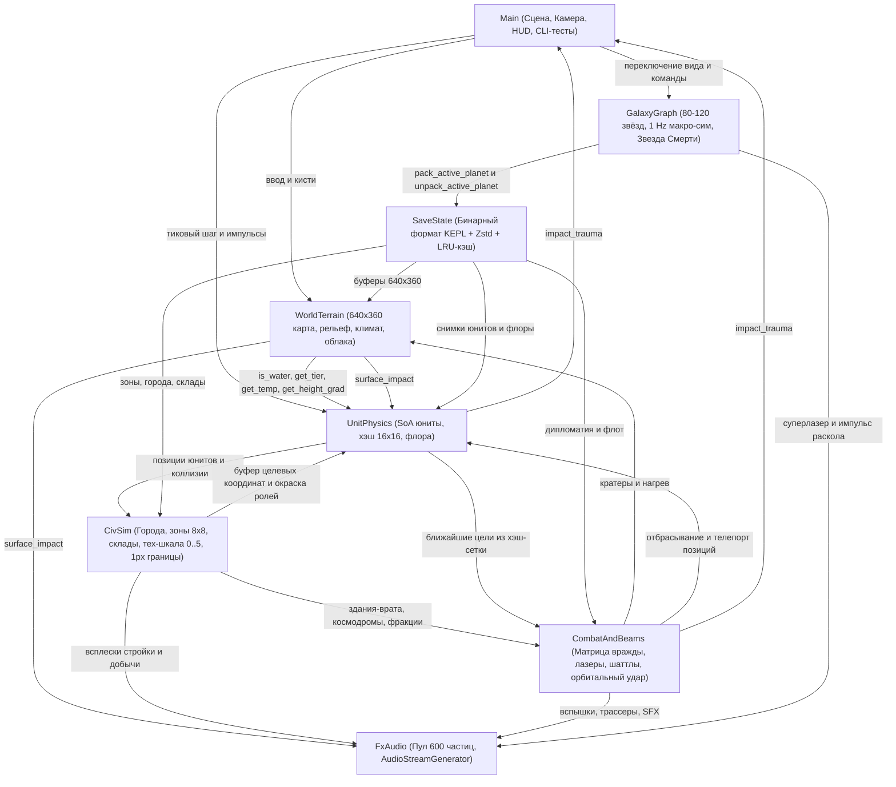

# Техническая архитектура и дорожная карта `Kepler Sandbox` (Godot 4.7.2)

Документ фиксирует текущее состояние кодовой базы (`VERIFIED`, Фаза 1), целевую модульную архитектуру до версии `1.0`, жёсткие бюджеты CPU/RAM/VRAM под `60 FPS`, поэтапный план вертикальных срезов (`Этап 2 -> Этап 5`) с автопроверками в `verify_tracer.ps1` и список сознательных сокращений для одного разработчика (*Via Negativa*).

---

## 1. Аудит текущего состояния (`VERIFIED` Baseline — Фаза 1)

### 1.1. Инвентарь файлов проекта

Все размеры и номера строк подтверждены прямым чтением файлов в корне проекта:

| Файл | Размер (байт) | Строки | Назначение и ключевые символы | Статус |
|---|---:|---:|---|---|
| `project.godot` | 714 | 27 | `4.7`, `Forward Plus`, окно `1280x720`, `canvas_items`/`expand`, `default_texture_filter=0`, фон `#080E18` | `VERIFIED` |
| `scenes/main.tscn` | 5755 | 219 | Корень `Main`, `WorldEnvironment`, `WorldTerrain` (`z=0`), `UnitPhysics` (`z=1`), `FxAudio` (`z=2`), `BrushReticle` (`z=5`), `Camera2D` (`zoom=2.0`), `HUD` (`CanvasLayer` `layer=2`) | `VERIFIED` |
| `scripts/main.gd` | 30311 | 820 | `TUNING_KNOBS`, HDR 2D (`use_hdr_2d=true`, `TONE_MAPPER_AGX`, `tonemap_agx_white=6.0`, `GLOW_BLEND_MODE_SCREEN`), `T^2/T^3` trauma-тряска, `Hit-Stop`, зум `1.2x..12.0x`, CLI `--smoke-test`, `--screenshot`, `--zoom-shot` | `VERIFIED` |
| `scripts/world_terrain.gd` | 46700 | 1495 | `class_name WorldTerrain`, карта `640x360`, чанки `16x16` (`40x23=920`), `BrushMode` `0..4`, `Tier` `0..8`, `Biome` `0..4`, плоские буферы `Packed*Array`, 16 рек, 3 вулкана, 4 кристальных очага, 26 облаков (`_mm_clouds`), `step_environment(dt)` | `VERIFIED` |
| `scripts/unit_physics.gd` | 38362 | 1166 | `class_name UnitPhysics`, SoA `PackedArrays` на `1200` юнитов (`5x5` px), пространственный хэш `CELL_SIZE=16` (`920` ячеек), `450` флоры (`12x12` px, Y-сортировка, `FLORA_SYNC_SLICE=75`), связь с рельефом/водой/лавой, `trigger_impulse`, `apply_vortex` | `VERIFIED` |
| `scripts/fx_audio.gd` | 17776 | 614 | `class_name FxAudio`, пул `MAX_PARTICLES=600` (`4x4` px, кольцевое вытеснение `_evict_cursor`), `AudioStreamGenerator` (`22050 Гц`, `8` голосов, `6` пресетов `SfxKind`, защита для `--headless` / `Dummy`) | `VERIFIED` |
| `shaders/terrain_water.gdshader` | 3285 | 88 | Читает `mask_tex` (`R`=глубина, `G`=пена/река, `B`=жар лавы, `A`=кончики кристаллов), Bayer4-каустики/пена, HDR-свечение (`rgb > 1.0`) только на лаве и кристаллах | `VERIFIED` |
| `shaders/cloud_shadow.gdshader` | 1915 | 60 | Пикселизованный Bayer4-дизеринг дрейфующих теней облаков и экзопланетной пылевой дымки | `VERIFIED` |
| `shaders/unit_sprite.gdshader` | 3499 | 107 | `sprite_mode` `0/1/2` (юниты/флора/частицы), флип `1.0 - UV.y`, squash-and-stretch, ветер, дрожание от удара, `spawn_spring`, HDR визоры/пламя/кристаллы | `VERIFIED` |
| `verify_tracer.ps1` | 4714 | 124 | Однопроцессный раннер `Godot_v4.7.2-stable_win64_console.exe` с таймаутом `25s`, фильтром критических ошибок и 3 прогонами (`--smoke-test`, `world_macro.png`, `world_zoom.png`) | `VERIFIED` |
| `screenshots/*.png` | — | — | Валидированные кадры: `world_macro.png` (`594523` B), `world_zoom.png` (`459243` B), `tracer_frame.png` (`106015` B) | `VERIFIED` |
| `Запустить_игру.bat` / `Открыть_в_Godot.bat` | 84 / 87 | 3 / 3 | Ярлыки запуска `..\bin\Godot_v4.7.2-stable_win64.exe` | `VERIFIED` |

### 1.2. Подтверждённые бюджеты и архитектурные инварианты Фазы 1

1. **Игровое поле (`WorldTerrain`):** `640x360 = 230 400` пикселей, `TEXTURE_FILTER_NEAREST`. Базовая сетка данных (`_tiers`, `_biomes`, `_river_mask`, `_vent_mask` по `1 B`; `_height`, `_temp`, `_rad`, `_moisture` по `4 B`) занимает ровно `20 B/px = 4 608 000 B` (`4.39 MiB`). Буферы рендера и штампа (`_rgba_buf`, `_mask_buf`, `_work_stamp` по `4 B`) занимают ещё `12 B/px = 2 764 800 B` (`2.64 MiB`).
2. **Агенты, флора и частицы (`UnitPhysics` + `FxAudio`):**
   - Юниты: `1200` активных колонистов без единого `Node2D` на сущность. Плоские массивы SoA (`64 B/юнит` = `76 800 B`) + связный список хэш-сетки (`_cell_head` `920 x 4 B = 3680 B`).
   - Флора: `450` экземпляров (`41 B/экз` = `18 450 B`), перепроверяется порциями по `FLORA_SYNC_SLICE = 75` за тик.
   - Частицы: `600` слотов (`74 B/слот` = `44 400 B`), итого вся симуляционная память `UnitPhysics + FxAudio` составляет `143 330 B` (`~140 KiB`).
3. **Слои отрисовки Фазы 1 (6 draw calls в мире + HUD):** `_terrain_sprite`, `_mm_clouds`, `_mm_flora`, `_mm_units`, `_mm_particles`, `BrushReticle`. Весь интерфейс вынесен на `CanvasLayer` (`layer = 2`), а `WorldEnvironment` ограничен `background_canvas_max_layer = 1`, поэтому HDR-блум не размывает шрифты HUD.
4. **Критическое ограничение холодного запуска (`--headless`):** при первом холодном запуске без прогретого кэша `.godot/` перекрёстные аннотации типов через `class_name` между скриптами провоцируют `Parse Error`. Все новые модули обязаны держать поля ссылок как `Node2D` или `RefCounted` и доставать перечисления через `const XScript = preload("res://scripts/x.gd")`.
5. **Единый сторожевой контур (`правил окружения Godot 4.x`):** строгая сериализация GPU-процессов Godot (не более одного активного `Godot*.exe`), запуск исключительно через `verify_tracer.ps1` с анализом `stderr` на `Assertion failed|Parse Error|Compile Error|SCRIPT ERROR|SHADER ERROR|Shader compilation failed` и обязательным чтением PNG через `read_file`.

---

## 2. Модульная архитектура (Глубокие модули Остерхаута + SoA Data-Oriented Godot 4)

### 2.1. Инженерные ограничения для всех модулей

- **Ноль `Node2D` на сущность:** ни один юнит, здание, снаряд, звезда или флот не создаёт дочернюю ноду в `SceneTree`. Данные лежат в плоских типизированных `PackedByteArray` / `PackedInt32Array` / `PackedFloat32Array` / `PackedVector2Array` / `PackedColorArray`.
- **Узкий интерфейс Остерхаута:** каждый публичный метод модуля принимает **`0–3` аргумента**, прячет внутренние массивы, кэши и индексные таблицы внутри модуля, обходится без проходных обёрток и булевых флагов-переключателей режимов.
- **Канонические перечисления:** сохраняются существующие `WorldTerrain.BrushMode` (`0..4`, расширяется до `0..13` по каталогу инструментов), `WorldTerrain.Tier` (`0..8`), `WorldTerrain.Biome` (`0..4`). Фракции кодируются единым `enum Faction { HUMAN = 0, ROBOT = 1, SPORE = 2 }` (в HUD и документации: **Колонисты (Люди)**, **Автономный Рой (Роботы)**, **Ксено-Спора (Био-рой)**).

### 2.2. Декомпозиция новых модулей (`Этапы 2–5`)

#### А. `scripts/civ_sim.gd` (`class_name CivSim extends Node2D`)

Отвечает за города, территориальные зоны `8x8`, локальные склады, экономику рабочих, постройку зданий, `2px` дороги/энергопроводы, тех-прогресс `tech_tier 0..5` и генерацию текстуры границ.

- **Внутренние SoA-структуры:**
  - **Зоны (`8x8` px):** сетка `zone_w = 80`, `zone_h = 45` (`3600` зон). Плоские массивы `_zone_city_id: PackedInt32Array` (`-1` = ничейная), `_zone_faction_id: PackedByteArray` (`255` = нейтральная), `_zone_flags: PackedByteArray` (фермы/дороги/застройка).
  - **Единый хелпер границ без сетки:** приватный метод `_get_zone_owner(zx: int, zy: int) -> int` вызывается одинаково и для пикселя текущей зоны, и для 4 его кардинальных соседей `(zx±1, zy±1)`. Это полностью исключает появление паразитной внутренней сетки `8x8` внутри королевства. Маска границ пишется в `_border_image: Image` (`640x360`, `RGBA8`): внутренние занятые пиксели получают `3%` заливку цветом фракции (`alpha` или `mix` в `0.03`), а внешний периметр при смене `_get_zone_owner` — сплошной `1px` контур. В эту же текстуру поверх территорий рисуются `2px` дороги/энергопроводы, что даёт **0 дополнительных draw calls**.
  - **Города (`MAX_CITIES = 64`):** SoA-массивы `_city_active`, `_city_faction`, `_city_center` (`Vector2`), `_city_tech_tier` (`0..5`), `_city_build_prog`, `_city_pop`, склады `_city_food`, `_city_ore`, `_city_energy`, `_city_science`.
  - **Здания (`MAX_BUILDINGS = 512`):** SoA-массивы `_bld_pos`, `_bld_type` (костёр, палатка, бур, склад, биокупол, солнечная ферма, термоядерный реактор, космодром, телепорт-кольцо, орбитальная верфь, щитовой пилон), `_bld_city_id`, `_bld_hp`, `_bld_spring`, `_bld_atlas_col`. Рендер одним батчем `_mm_buildings: MultiMeshInstance2D` (`8x8`/`12x12`/`16x16`/`24x24` — с опорой `16x16` у `24x24` — ячейки атласа с масштабом через `Transform2D`, `INSTANCE_CUSTOM` управляет анимацией роста `spawn_spring` и дрожанием удара, а парная маска `*_mask.png` через `sprite_mode = 3` разделяет тинт фракции и HDR-эмиссию).
  - **Задачи юнитов (`MAX_UNITS = 4096`):** параллельные `UnitPhysics` буферы `_u_faction`, `_u_city_id`, `_u_job` (`farmer`, `miner`, `builder`, `soldier`), `_u_target_pos` (`PackedVector2Array`), `_u_carry_amt`. Для связи с `UnitPhysics` без 1200 вызовов функций в кадр `CivSim` передаёт ссылку на массив целей целиком через один вызов за инициализацию (`set_goal_buffers`).
  - **Защита от накрутки `tech_tier`:** вклад однотипных зданий ограничивается правилом `TIER_DUP_DIMINISH_COUNT = 3` (первые `3` постройки дают `100%` прогресса, `4–6`-я копии — `25%`, `7+` — `0%`), поэтому переход `0 -> 5` требует реального накопления титана/кристаллов и постройки ключевых сооружений новой эпохи.
- **Узкий публичный контракт (`<= 3` аргументов):**
  - `bind_systems(world: Node2D, physics: Node2D, fx: Node2D) -> void`
  - `spawn_colony(world_pos: Vector2, faction_id: int) -> int` *(возвращает `city_id`)*
  - `step_civ(dt: float) -> void`
  - `on_terrain_damaged(world_pos: Vector2, radius: float) -> void`
  - `get_zone_owner_at(world_pos: Vector2) -> int`
  - `get_civ_stats() -> Dictionary`
  - `pack_state() -> PackedByteArray`
  - `unpack_state(blob: PackedByteArray) -> bool`

#### B. `scripts/combat_and_beams.gd` (`class_name CombatAndBeams extends Node2D`)

Отвечает за дипломатическую матрицу фракций, наземные бои, пул лазерных трассеров, орбитальные удары, корабли планетарного уровня и телепортацию отрядов через океан.

- **Внутренние SoA-структуры:**
  - **Матрица враждебности (`3x3`):** `_rel_matrix: PackedByteArray` (`9` байт: `NEUTRAL = 0`, `PACT = 1`, `TOTAL_WAR = 2`, `REBELLION = 3`) и `_tension_matrix: PackedFloat32Array` (`9` float).
  - **Пул трассеров (`MAX_BEAMS = 256`):** SoA-буферы `_b_p0`, `_b_p1`, `_b_color`, `_b_age`, `_b_life`, `_b_width`. Рендерится одним `_mm_beams: MultiMeshInstance2D` через `Transform2D`, поворачивающий и растягивающий единичный квад вдоль вектора `p1 - p0`, с HDR-цветом `rgb > 1.0`. Ни одной ноды `Line2D`.
  - **Корабли орбиты/атмосферы (`MAX_CRAFT = 64`):** шаттлы (`tech_tier >= 3`), фрегаты/дредноуты/ковчеги (`tech_tier >= 5`) в одном `_mm_craft: MultiMeshInstance2D`.
  - **Телепорты между континентами (`tech_tier >= 4`):** вместо дорогого глобального A* через глубокий океан отряд у активного телепорт-кольца (`src_gate_id`) мгновенно переносится к парным вратам (`dst_gate_id`) на другом континенте с прорисовкой энергетической дуги через `teleport_arc.gdshader` и вспышкой частиц в `FxAudio`.
  - **Боевая выборка:** использует уже перестроенный пространственный хэш `UnitPhysics` (или опрос сетки с шагом 1 раз в 3 кадра), ограничивая поиск цели ближайшими `3x3` ячейками (`16x16` px).
- **Узкий публичный контракт (`<= 3` аргументов):**
  - `bind_systems(world: Node2D, physics: Node2D, civ: Node2D) -> void`
  - `set_fx(fx: Node2D) -> void`
  - `step_combat(dt: float) -> void`
  - `fire_orbital_strike(world_pos: Vector2, power: float = 1.0) -> void`
  - `set_faction_relation(faction_a: int, faction_b: int, relation: int) -> void`
  - `transfer_squad_portal(src_gate_id: int, dst_gate_id: int, count: int) -> int`
  - `pack_state() -> PackedByteArray`
  - `unpack_state(blob: PackedByteArray) -> bool`

#### C. `scripts/galaxy_graph.gd` (`class_name GalaxyGraph extends Node2D`)

Отвечает за галактический масштаб (`80–120` звёздных узлов), гиперлинии и кротовые норы, ленивую фоновую макро-симуляцию `1 Hz`, переключение фокуса между планетами и конечный автомат Звезды Смерти.

- **Внутренние SoA-структуры:**
  - **Звёздные узлы (`80 <= N <= 120`, по умолчанию `100`):** `_star_pos` (`PackedVector2Array`), `_star_seed` (`PackedInt32Array`), `_star_biome` (`PackedByteArray`), `_star_owner` (`PackedByteArray`), `_star_pop` (`PackedInt32Array`), `_star_tech` (`PackedByteArray`), `_star_state` (`ALIVE = 0`, `RUINED = 1`, `SHATTERED_DEBRIS = 2`), `_star_flags` (битовая маска: `HAS_PORTAL`, `HAS_SHIPYARD`, `VISITED_MODIFIED`), `_star_res` (`PackedFloat32Array`, по 3 числа на звезду: био/металл/кристаллы).
  - **Граф связей (CSR / связный список без вложенных массивов):** `_edge_head` (`N` int32), `_edge_to` (`MAX_EDGES = 480`), `_edge_next`, `_edge_dist`, `_edge_type` (`HYPERLANE = 0`, `WORMHOLE = 1`).
  - **Макро-флоты (`MAX_FLEETS = 128`):** `_fl_src`, `_fl_dst`, `_fl_progress`, `_fl_faction`, `_fl_kind` (`COLONY_ARK`, `WAR_FLEET`, `DEATH_STAR`), `_fl_power`.
  - **Ленивая симуляция `1 Hz`:** переменная `_macro_accum += dt`. Раз в секунду обрабатываются все `N` звёзд кроме активной (посещённой в текущем окне): прирост/убыль населения, апгрейд `tech_tier`, запуск колониальных ковчегов по гиперлиниям, мгновенные рейды через кротовые норы (`tech_tier >= 4`), столкновения флотов на узлах. Внутри `world_terrain` и `unit_physics` при этом крутится только **1 активная планета**.
  - **Конечный автомат Звезды Смерти (`DeathStarState`):** `IDLE -> CONSTRUCTING -> TRANSITING -> CHARGING -> FIRING -> COOLDOWN`. Состояние `FIRING` запускает изумрудный HDR-суперлазер (`32x32` металлическая сфера + тарелка + луч), переводит целевой узел в `SHATTERED_DEBRIS` (астероидный пояс, пригодный для добычи лома — *failure-forward* без тупиков) и на активной планете запускает кратерный раскол поверхности + `impact_trauma(0.85, 0.085)`.
  - **Переключение вида без смены сцены:** `set_view_active(true)` включает галактические слои (`_mm_lanes`, `_mm_stars`, `_mm_fleets`) и отключает видимость планетарных слоёв, не уничтожая узлы сцены `Main`.
- **Узкий публичный контракт (`<= 3` аргументов):**
  - `bind_planet_systems(world: Node2D, physics: Node2D, civ: Node2D) -> void`
  - `set_combat_fx(combat: Node2D, fx: Node2D) -> void`
  - `set_save_state(save_state: RefCounted) -> void`
  - `generate_galaxy(seed_val: int, star_count: int = 100) -> void`
  - `step_galaxy(dt: float) -> void`
  - `switch_planet(star_id: int) -> bool`
  - `command_death_star(target_star_id: int, mode: int = 0) -> bool`
  - `set_view_active(enabled: bool) -> void`
  - `get_galaxy_stats() -> Dictionary`

#### D. `scripts/save_state.gd` (`class_name SaveState extends RefCounted`)

Отвечает за бинарную упаковку/распаковку состояния планеты за `< 50 ms`, кэширование посещённых миров и сохранение полной галактической кампании в файл `user://saves/*.kpl`.

- **Формат бинарного пакета (`KEPL`, версия `u32`):**
  - Отказ от JSON: хранение `230 400` пикселей и `1200+` юнитов в JSON раздувает файл в десятки мегабайт и стопорит парсер на сотни миллисекунд. `SaveState` пишет плоские бинарные срезы через `StreamPeerBuffer` и сжимает их `PackedByteArray.compress(FileAccess.COMPRESSION_ZSTD)`.
  - Квантование рельефа (`10 B/px` вместо `20 B/px`): `_tiers` (`1B`), `_biomes` (`1B`), `_river_mask` (`1B`), `_vent_mask` (`1B`), `_height` (`u16`, точность `1/65535`), `_temp` (`i16`, шаг `0.1°C` от `-3276.8°C` до `+3276.7°C`), `_rad` (`u8`), `_moisture` (`u8`). Итого `2 304 000 B` до сжатия (`~250–450 KiB` после Zstd).
  - Непосещённые звёзды в памяти держат только `seed` и макро-запись (`37 B`), а буфер планеты формируется лениво при первом визите.
  - Для переключения планет за `< 50 ms` `SaveState` держит тёплый LRU-кэш последних `6` посещённых планет в памяти (с уже готовыми `_rgba_buf` и `_mask_buf` — возврат занимает `< 5 ms`) и сжатые Zstd-блоки для остальных из `100` планет с фолбэком выгрузки на диск `user://campaigns/cache/`.
- **Узкий публичный контракт (`<= 3` аргументов):**
  - `bind_systems(world: Node2D, physics: Node2D, civ: Node2D) -> void`
  - `set_combat(combat: Node2D) -> void`
  - `pack_active_planet(star_id: int) -> PackedByteArray`
  - `unpack_active_planet(star_id: int, blob: PackedByteArray) -> bool`
  - `save_campaign(path: String, galaxy: Node2D) -> int`
  - `load_campaign(path: String, galaxy: Node2D) -> int`

### 2.3. Схема потоков данных между модулями

---

## 3. Бюджеты производительности и памяти (цель: 60 FPS)

### 3.1. Потолок вызовов отрисовки (`<= 12` мировых слоёв)

Режим **Планета (Уровень 1–2)** строго укладывается в **12 мировых draw calls** (из них 11-й и 12-й активируются только при наличии врат/раскола), плюс изолированный `HUD` на `CanvasLayer (layer = 2)`:

| # | Нода / Слой | Тип | Сущности | Статус |
|---:|---|---|---|---|
| 1 | `_terrain_sprite` (`WorldTerrain`) | `Sprite2D` + `terrain_water.gdshader` | Полотно `640x360` + маска воды/пены/лавы/кристаллов | `VERIFIED` |
| 2 | `_border_sprite` (`CivSim`) | `Sprite2D` (`TEXTURE_FILTER_NEAREST`) | `1px` границы зон `8x8` + `3%` заливка + `2px` дороги/трубы | План (Этап 2) |
| 3 | `_mm_flora` (`UnitPhysics`) | `MultiMeshInstance2D` + `unit_sprite.gdshader` | `450..600` деревьев, кристаллов, рудных жил, гейзеров, монолитов (`12x12`/`16x16`) | `VERIFIED` (`450`) |
| 4 | `_mm_buildings` (`CivSim`) | `MultiMeshInstance2D` + `unit_sprite.gdshader` (`sprite_mode=3`) | До `512` зданий `tier 0..5` (`8x8`..`24x24`) + `*_mask.png` | План (Этап 2) |
| 5 | `_mm_units` (`UnitPhysics`) | `MultiMeshInstance2D` + `unit_sprite.gdshader` (`sprite_mode=0/3`) | `1200..4000` юнитов 3 фракций (`5x5`..`12x12`, босс Левиафан `32x32`) | `VERIFIED` (`1200`) |
| 6 | `_mm_beams` (`CombatAndBeams`) | `MultiMeshInstance2D` (HDR аддитив/альфа) | До `256` лазерных трассеров и лучей орбитального удара | План (Этап 3) |
| 7 | `_mm_teleport_arcs` (`CombatAndBeams`) | `MultiMeshInstance2D` + `teleport_arc.gdshader` | Энергетические дуги между квантовыми вратами `Tier 4` | План (Этап 3) |
| 8 | `_mm_craft` (`CombatAndBeams`) | `MultiMeshInstance2D` | До `64` шаттлов, фрегатов, дредноутов, ковчегов и Звезда Смерти (`32x32`) | План (Этап 3/5) |
| 9 | `_mm_particles` (`FxAudio`) | `MultiMeshInstance2D` + `unit_sprite.gdshader` | `600` частиц в Фазе 1, расширение пула до `1600` на Этапах 3–5 | `VERIFIED` (`600`) |
| 10 | `_mm_clouds` (`WorldTerrain`) | `MultiMeshInstance2D` + `cloud_shadow.gdshader` | `26` облачных теней и атмосферной дымки | `VERIFIED` (`26`) |
| 11 | `BrushReticle` (`Main`) | `Node2D` (`_draw`) | Прицел активной кисти Бога | `VERIFIED` |
| 12 | `_fracture_overlay` (`CombatAndBeams`) | `Sprite2D` + `planet_fracture.gdshader` | Слой раскола коры планеты при выстреле Звезды Смерти (скрыт в покое) | План (Этап 5) |

В режиме **Галактика (Уровень 3)** планетарные слои `#1–#12` скрываются (`visible = false`), работают **3 draw calls**: `_mm_lanes` (гиперлинии и червоточины через `teleport_arc.gdshader`), `_mm_stars` (`80–120` звёзд с HDR-гало), `_mm_fleets` (`<= 128` флотов и Звезда Смерти).

### 3.2. Потолок CPU-симуляции на кадр (`<= 4.0 ms` в GDScript при `60 FPS`)

При целевой длительности кадра `16.67 ms` (`60 FPS`) на всю логику симуляции отводится не более **`4.00 ms`**:

| Модуль | Бюджет CPU (`1x` скорость) | Метод удержания бюджета |
|---|---:|---|
| `WorldTerrain.step_environment` | `<= 0.80 ms` | Активные чанки `16x16` с квотой `180` чанков/шаг; скользящий пересчёт средней температуры по `16` строк |
| `UnitPhysics.step_physics` | `<= 1.80 ms` | Плоский хэш `40x23`, ограничение `MAX_NEIGHBORS_CHECKED = 10`, нулевое выделение объектов/словарей |
| `CivSim.step_civ` | `<= 0.70 ms` | Распределение AI-решений городов и перерисовки грязных зон `8x8` по срезам (`1/8` городов за тик) |
| `CombatAndBeams.step_combat` | `<= 0.40 ms` | Поиск целей раз в `3` тика через `3x3` ячейки хэш-сетки, фиксированный пул трассеров |
| `FxAudio.step_fx` | `<= 0.25 ms` | Swap-and-pop пул на `600` (`-> 1600`) частиц, синтез звука блоками по `256` сэмплов (`22050 Гц`) |
| `GalaxyGraph.step_galaxy` | `<= 0.05 ms` (`<= 0.40 ms` на `1 Hz` тике) | Макро-тик раз в `1.0 s` по `100` узлам в плоских массивах |
| **Итого симуляция** | **`<= 4.00 ms`** | Оставляет `> 12.6 ms` на рендер Forward+, AGX-блум, аудио-поток и ввод |

**Жёсткий порог миграции горячих циклов в C# / GDExtension (C++20):**
1. Активное население на одной планете превышает **`4000` юнитов** (`> 4000`), ИЛИ
2. Замер `p95` суммарного времени `step_physics + step_civ + step_combat` за `120` кадров превышает **`4.0 ms`** на скорости `1x` (или **`11.0 ms`** с учётом подшагов на `3x`/`5x`).

При срабатывании этого порога архитектура не переписывается целиком: в `SimKernel` (C# `Godot.NET` или C++ GDExtension) выносятся только числодробильные циклы (`_rebuild_spatial_hash`, boids-разделение, проверка рельефа и выбор целей), работающие над теми же плоскими массивами `Packed*Array`. Оркестрация сцен, HUD, `SaveState`, `GalaxyGraph` и `FxAudio` остаются в GDScript.

### 3.3. Потолок RAM и VRAM для `100` сериализованных планет

Точный расчёт по структурам данных (вычислено скриптом):

| Ресурс | Объём | Пояснение |
|---|---:|---|
| Активная планета в CPU (`WorldTerrain`) | `7 372 800 B` (`7.03 MiB`) | `4.39 MiB` массивы симуляции (`20 B/px`) + `2.64 MiB` буферы рендера и штампа (`12 B/px`) |
| Активная планета в CPU (`UnitPhysics` + `CivSim` + `FxAudio`) | `~1.24 MiB` (`1200` юнитов) / `~1.41 MiB` (`4000` юнитов) | `75.0 KiB` (`1200` юнитов) или `250.0 KiB` (`4000` юнитов; преаллокация `MAX_UNITS = 4096 -> 256.0 KiB`) + `900.0 KiB` буфер `_border_image` (`640x360` `RGBA8`) + `~180 KiB` зоны, города, здания, флора + `115.6 KiB` (`1600` частиц) |
| VRAM активной планеты (текстуры + атласы + MultiMesh) | `~5.6 MiB` (потолок `< 16 MiB`) | 3 экранные `RGBA8`-текстуры (`640x360 x 4 B x 3 = 2 764 800 B = 2.64 MiB`) + спрайтовые атласы (`< 2 MiB`) + буферы инстансов (`< 1 MiB`) |
| `100` планет в `GalaxyGraph` (непосещённые) | `~14.4 KiB` | Граф на `120` звёзд, `480` рёбер и `128` флотов целиком занимает `14 776 B` (`~14.4 KiB`); непосещённый мир хранит лишь `seed` (`4 B`) и макро-счётчики |
| `100` модифицированных планет в `SaveState` | `~24.4 – 43.9 MiB` RAM (потолок `< 64 MiB`) | Квантованный срез (`10 B/px` + `3600` зон + сущности = `2 376 160 B` = `2.27 MiB` без сжатия) сжимается Zstd в `~250–450 KiB` на планету. При `> 48 MiB` холодные планеты выгружаются в `user://campaigns/cache/` |
| Бюджет переключения планеты (`switch_planet`) | **`< 50 ms`** | Попадание в 6-слотовый LRU-кэш: `< 5 ms`. Холодная распаковка из Zstd: `~5 ms` Zstd + `~10 ms` копирование массивов + `~18 ms` перерисовка и загрузка текстур = `~33 ms` |

---

## 4. Поэтапная дорожная карта вертикальных срезов (`Этап 2 -> Этап 5`)

Каждый этап расширяет рабочий проект строго вертикальными срезами и подключает автоматическую проверку в `verify_tracer.ps1` (безголовый логический ассерт + скриншот с визуальным аудитом через `read_file`).

### Этап 2: Города, ресурсы, границы, шкала 0..3

- **Цель среза:** превратить заселённую карту `640x360` в живую цивилизацию первой фракции (`Колонисты`): основание городов, захват `8x8` `TileZone` со сплошным `1px` внешним контуром и `3%` заливкой, цикл рабочих (сбор флоры, добыча рудных жил, фермы, возврат на склад и стройка), `2px` дороги и развитие по шкале `tech_tier 0 -> 3` (костры/палатки -> буры/склады -> биокупола/реакторы -> космодромы).
- **Новые/изменяемые файлы:**
  - Новый: `scripts/civ_sim.gd`.
  - Изменяемые: `scripts/unit_physics.gd` (чтение буфера целей `CivSim` и анимация рубки/добычи), `shaders/unit_sprite.gdshader` (`sprite_mode = 3` с парной маской `*_mask.png` для зданий/фракционных ролей без ложного HDR-свечения красной брони), `scripts/fx_audio.gd` (пресет `BUILD_POP`), `scripts/main.gd` и `scenes/main.tscn` (кисть спавна колонии, счётчики городов и максимального `tech_tier` в `TopBar`), `verify_tracer.ps1`.
- **Трассер (первый рабочий прогон):** разместить `1` стартовый город `Колонистов` на суше (`tech_tier = 0`); прогнать `60` тиков (`dt = 0.05`) так, чтобы юниты дошли до ближайшего дерева, потрясли флору (`_flora_shake`), принесли ресурс в город, захватили `>= 4` зон `8x8` и возвели `>= 1` здание через `_mm_buildings`.
- **Главный риск среды:** появление внутренней сетки `8x8` из-за несогласованных запросов к принадлежности зоны, либо застревание рабочих на береговой линии при возврате к складу через заливы.
- **Порог Стоп-крана:** (а) падение `verify_tracer.ps1` два раза подряд; (б) `step_physics + step_civ > 3.0 ms` при `1200` юнитах; (в) появление `Node2D` на здание/зону или метода с `> 3` параметрами.
- **Критерий приёмки:**
  - В `verify_tracer.ps1` добавлен флаг `--smoke-civ`: прогоняет `150` детерминированных тиков (`dt = 0.05`), проверяет `cities >= 1`, `zones_owned >= 4`, `buildings >= 4`, `tech_tier >= 1`, ненулевую добычу ресурсов на складе (`SMOKE_CIV_PASS`), код выхода `0`.
  - Добавлен съёмочный прогон `--shot-civ` -> `screenshots/stage2_civ.png` в масштабе `5.5x` на центре города; визуальная проверка через `read_file` подтверждает сплошной `1px` внешний контур без внутренних линий `8x8`, `2px` дороги, выросшие `8x8..16x16` здания и неперекрытый HUD.

### Этап 3: Война фракций, космодромы, телепорты между континентами

- **Цель среза:** ввести все 3 асимметричные фракции (`Колонисты`, `Автономный Рой`, `Ксено-Спора`), матрицу отношений (`Neutral / Pact / Total War / Rebellion`), наземный и орбитальный бой (`combat_and_beams.gd`), орбитальные шаттлы (`tech_tier = 3`), межконтинентальные квантовые врата-телепорты (`tech_tier = 4`) для переброски отрядов над океаном, а также новые кисти Бога (Орбитальный лазер, Сбой ИИ роботов, Ксено-вирус, спавнеры фракций).
- **Новые/изменяемые файлы:**
  - Новые: `scripts/combat_and_beams.gd`, `shaders/teleport_arc.gdshader`.
  - Изменяемые: `scripts/civ_sim.gd` (логика 3 фракций, `tech_tier 3..4`, постройка космодромов и телепортов), `scripts/unit_physics.gd` (боевые юниты/роботы/споровики в атласе с `*_mask.png`, перенос координат при телепортации), `scripts/fx_audio.gd` (расширение `MAX_PARTICLES` `600 -> 1600`, `VOICE_COUNT` `8 -> 16`, пресеты `LASER_LIGHT`, `LASER_HEAVY`, `TELEPORT_HUM`, `ROCKET_IGNITION`, `ORBITAL_STRIKE`), `scripts/main.gd` и `scenes/main.tscn` (расширенный 4-вкладочный `BottomDock` с `14` инструментами Бога и тумблер дипломатии), `verify_tracer.ps1`.
- **Трассер (первый рабочий прогон):** заспавнить 2 враждебных города (`Колонисты` и `Автономный Рой`) на двух островах с парой телепортов `tier 4`; за `60` тиков `transfer_squad_portal` переносит `4` юнитов через океан, а пул `_mm_beams` рисует первые лазерные трассеры и один выстрел `fire_orbital_strike` с воронкой и тряской камеры.
- **Главный риск среды:** засвет экрана от одновременного HDR-блума десятков лазеров и телепорт-дуг на тёмном фоне (либо ложное свечение красной брони роботов без `*_mask.png`), а также упорные попытки штурмовых отрядов плыть пешком через `DEEP_OCEAN` при отсутствии врат.
- **Порог Стоп-крана:** (а) превышение `3.8 ms` на сумму `step_physics + step_civ + step_combat` при `2000` юнитах; (б) рост `draw calls > 12`; (в) два провала `verify_tracer.ps1` подряд.
- **Критерий приёмки:**
  - В `verify_tracer.ps1` добавлен шаг `--smoke-combat`: прогоняет `120` тиков войны трёх фракций + `transfer_squad_portal` + `fire_orbital_strike`, проверяет `beams_fired >= 5`, `portal_transfers >= 4`, `casualties >= 1`, `max_speed > 40.0` после удара (`SMOKE_COMBAT_PASS`), ноль юнитов в `DEEP_OCEAN` без кнокбэка.
  - Добавлен съёмочный прогон `--shot-combat` -> `screenshots/stage3_war.png`; инспекция через `read_file` подтверждает читаемые HDR-лазеры, дугу телепорта, шаттлы, воронку орбитального удара и чистый текст HUD (`layer = 2`).

### Этап 4: Галактический граф, ленивая макро-симуляция, переключение планет

- **Цель среза:** собрать 3-й уровень масштаба — процедурную галактику из `80–120` звёзд (`galaxy_graph.gd`), гиперлинии и кротовые норы (`tech_tier >= 4`), фоновую макро-симуляцию `1 Hz` для всех неактивных звёзд, движение колониальных и военных флотов и быструю (`< 50 ms`) загрузку/выгрузку активной планеты через `save_state.gd`.
- **Новые/изменяемые файлы:**
  - Новые: `scripts/galaxy_graph.gd`, `scripts/save_state.gd`.
  - Изменяемые: `scripts/world_terrain.gd` (быстрый экспорт/импорт плоских буферов `export_raw_state` / `import_raw_state`), `scripts/civ_sim.gd` и `scripts/combat_and_beams.gd` (упаковка/распаковка состояния), `scripts/main.gd` и `scenes/main.tscn` (переключение вида Планета <-> Галактика, клик по звезде для спуска, строка сектора в HUD), `verify_tracer.ps1`.
- **Трассер (первый рабочий прогон):** сгенерировать граф из `100` звёзд, прогнать `10` тиков `1 Hz` макро-симуляции для перемещения колониального флота от звезды `0` к соседней `1`, переключиться `switch_planet(1)`, затем вернуться `switch_planet(0)` и сверить точное сохранение прошлых кратеров и городов планеты `0`.
- **Главный риск среды:** время `switch_planet` превышает `50 ms` при холодном возврате из-за полного пересчёта `_render_pixels_range(0, 0, 640, 360)` в GDScript, либо рассинхрон видимости нод и таймеров между видом Планеты и видом Галактики.
- **Порог Стоп-крана:** (а) `p95` времени `switch_planet > 50 ms` после подключения Zstd + 6-слотового LRU-кэша; (б) расхождение рельефа/городов после цикла `pack -> switch -> unpack`; (в) время одного `1 Hz` макро-тика `> 1.0 ms` или два сбоя `verify_tracer.ps1` подряд.
- **Критерий приёмки:**
  - В `verify_tracer.ps1` добавлен шаг `--smoke-galaxy`: генерация `100` звёзд, `15` тиков макро-сима (`dt = 1.0`), проверка изменения владельца/флота на графе, замер `switch_planet_ms < 50.0` и побайтовая проверка состояния планеты `0` до и после round-trip (`SMOKE_GALAXY_PASS`).
  - Добавлен съёмочный прогон `--shot-galaxy` -> `screenshots/stage4_galaxy.png`; визуальная проверка через `read_file` подтверждает читаемые узлы звёзд разного типа, гиперлинии, иконки флотов и незасвеченный HUD.

### Этап 5: Звезда Смерти, сохранения, полировка UI/звука к 1.0

- **Цель среза:** завершить тех-ветку `tech_tier = 5` (орбитальные верфи, планетарные щиты и **Звезда Смерти** с циклом постройки, перелёта, зарядки и уничтожения планеты в состояние `SHATTERED_DEBRIS` с механикой продолжения игры через добычу обломков), реализовать полноценное сохранение/загрузку кампании на диск (`user://saves/*.kpl`), дополнить звуковой синтез всеми событиями поздней игры и довести UI/баланс к релизу `1.0`.
- **Новые/изменяемые файлы:**
  - Новые: `shaders/planet_fracture.gdshader`.
  - Изменяемые: `scripts/galaxy_graph.gd` (конечный автомат Звезды Смерти и расколотые узлы), `scripts/combat_and_beams.gd` (изумрудный HDR-суперлазер, планетарный щит `tier 5`), `scripts/save_state.gd` (чтение/запись полной кампании с заголовком версии на диск), `scripts/fx_audio.gd` (синтез `SHIELD_HIT`, `WARP_JUMP`, `DEATH_STAR_CHARGE`, `DEATH_STAR_BLAST`), `scripts/main.gd` и `scenes/main.tscn` (меню сохранений, панель инспектора галактики, сворачиваемая по `Tab` таблица фракций с открытием `>= 90%` карты, единый `Hit-Stop = 85 ms` через `HIT_STOP_MAX_SEC = 0.085` при расколе планеты), `verify_tracer.ps1`.
- **Трассер (первый рабочий прогон):** выдать фракции `tech_tier = 5`, перевести Звезду Смерти через `CONSTRUCTING -> TRANSITING -> CHARGING -> FIRING` по соседней звезде, убедиться в переходе узла в `SHATTERED_DEBRIS`, сохранить кампанию в `user://smoke_campaign.kpl`, очистить состояние в памяти, загрузить обратно и подтвердить идентичность числа звёзд, обломков и городов.
- **Главный риск среды:** поломка ссылок или потеря данных при загрузке файла кампании с диска (устаревшие текстуры или отсоединившиеся сигналы), а также искажение звука в `AudioStreamGenerator` при одновременном звучании суперлазера, взрыва планеты и десятков лазеров.
- **Порог Стоп-крана:** (а) любой сбой round-trip загрузки кампании с диска; (б) падение производительности ниже `55 FPS` или `step_sim > 4.0 ms` в финальной поздней эре (`tech_tier 5` + война 3 фракций); (в) два провала `verify_tracer.ps1` подряд.
- **Критерий приёмки:**
  - Полный регресс в `verify_tracer.ps1` прогоняет последовательно `--smoke-test`, `--smoke-civ`, `--smoke-combat`, `--smoke-galaxy` и новый `--smoke-endgame` (цикл Звезды Смерти + `save_campaign` / `load_campaign` round-trip + профилирование `120` кадров с `avg_sim_ms <= 4.0`, выход `0`).
  - Итоговая галерея скриншотов (`world_macro.png`, `world_zoom.png`, `stage2_civ.png`, `stage3_war.png`, `stage4_galaxy.png`, `stage5_deathstar.png`) проходит полную проверку через `read_file` без визуальных артефактов, наложений HUD и ошибок в консоли.

---

## 5. Бритва сольного разработчика (*Via Negativa* — осознанные отказы до 1.0)

Все фичи ниже сознательно вынесены за пределы версии `1.0`, чтобы один разработчик довёл игру до релиза в стабильном `60 FPS` контуре:

| Отсечённая фича | Чем заменена в 1.0 | Почему отказ защищает релиз |
|---|---|---|
| Полный редактор ДНК / хромосом и органной биологии | 3 фракции с жёсткой таблицей модификаторов и мутаций от радиации в `TUNING_KNOBS` | Редактор генома умножает число комбинаторных багов баланса и требует отдельного сложного UI вместо полировки песочницы |
| Подводные города, верфи и бои субмарин | Океан служит естественной границей до эпохи шаттлов (`tier 3`) и телепортов (`tier 4`) | Исключает второй слой морского пасфайндинга, морских юнитов и дублирующий атлас зданий под водой |
| Режим ручного управления одним юнитом от 1-го/3-го лица | Прямое вмешательство идёт через `14` инструментов/кистей Бога и команды орбитального удара | Ручное управление ломает масштаб пиксельной песочницы `640x360` и заставляет делать отдельную боевую камеру и коллизии |
| Ручная прокладка конвейеров и поштучная стройка зданий игроком | Автоматическая застройка зон `8x8` силами городов + процедурные `2px` каналы | Предотвращает превращение симулятора бога в тяжёлую логистическую головоломку и экономит месяцы UI-программирования |
| Настоящий 3D-глобус планеты в отдельном `SubViewport 3D` | Чёткий 2D пиксель-арт `640x360` с `TEXTURE_FILTER_NEAREST` на Планете и граф-карта в Галактике | Исключает проблемы с развёрткой полюсов сферы, 3D-шейдерами воды/юнитов и двойным расходом VRAM |
| Полная гидродинамика Навье–Стокса и динамическая эрозия берегов | Клеточная диффузия тепла, застывание лавы о воду и шейдерные каустики/пена | Сохраняет детерминированный `<= 0.80 ms` бюджет `WorldTerrain.step_environment` на `640x360` |
| Сетевой мультиплеер и внешний SDK пользовательских модов | Локальный детерминированный движок + `TUNING_KNOBS` в заголовках скриптов | Мультиплеер с синхронизацией `230 400` пикселей и `4000` юнитов удваивает объём сетевого кода и отладки |
