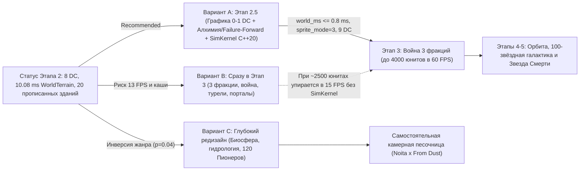

# Аудит Этапа 2 и дорожная карта апгрейдов (`kepler_sandbox`)

**Вердикт: потолок не достигнут ни по графике (~38% потенциала), ни по интересности (~20% — «90-секундная физическая лава-лампа»), однако в коде уже пробит потолок однопоточного GDScript VM на [`WorldTerrain`](../scripts/world_terrain.gd#L931-L1050) (`10.079 ms/тик` при бюджете `<= 0.80 ms`) и вплотную исчерпан запас на [`UnitPhysics`](../scripts/unit_physics.gd#L1999-L2025) (`2.271 ms/тик` держится лишь костылём пропуска `3/4` тиков у спокойных бродяг).** Раздувать Этап 3 (война трёх фракций и `2500–4000` юнитов) прямо поверх текущей базы опасно: кадр на скорости `5x` упадёт ниже `15 FPS`, а три армии утонут в шуме неразличимых белых скафандров, рваных гор и кислотной сетки дорог. Спасёт короткий **Этап 2.5 (Вариант A, Recommended)**: вычитание лишних `1090` статистов и визуального шума (*Via Negativa*), разблокировка графики `640×360` за счёт `0–1` draw call и вынос горячих циклов среды/физики в нативный C++20 `GDExtension` (`SimKernel`).

---

## 1. Панель потолков: факт против планки `ref_v2_*` и Godot `4.7.2`

| Ось оценки | Потолок достигнут? | Реализовано | Текущий факт (`VERIFIED`) | Жёсткий физический предел среды | Реальный запас роста |
| :--- | :--- | :--- | :--- | :--- | :--- |
| **Графика и читаемость** | **Нет** | **~38%** (вода/биомы ~55%, здания ~55%, горы/границы/юниты/облака ~20–30%) | Занято **`8` из `<= 12` мировых draw calls** ([02_SPRITES_MODELS_AND_VFX.md](02_SPRITES_MODELS_AND_VFX.md#L26)); здания чёткие, но мир плоский, горы рябят, облака ползут под деревьями, а юниты сливаются в белую кашу (`stage2_civ.png`, `world_macro.png`). | Холст **`640×360`** (`230 400 px`): на макрозуме `2.0x` 1 логический px = `2×2` экранных в `1280×720`. Мега-детализация `ref_v2_01/02` без укрупнения объектов сюда не влезет. | **~62%** за счёт рельефа NW-SE, контрастных границ с подложкой, теней под объектами, живого прибоя, облаков поверх крон и `sprite_mode = 3`. Остаются **`4` свободных draw call**. |
| **Функции и архитектура** | **Движка — нет; GDScript VM — да** | **~25–30%** от [01_SYSTEMS_AND_MECHANICS.md](01_SYSTEMS_AND_MECHANICS.md) | Прогон `#8` (`150` тиков `--smoke-civ`): **`world_ms = 1511.819` (`10.079 ms/тик`)**, `phys_ms = 340.717` (`2.271 ms/тик`), `civ_ms = 46.695` (`0.311 ms/тик`), `fx_ms = 14.031`, суммарно **`sim_ms = 1913.262` (`12.755 ms/тик`)**. | В не-Mono [verify_tracer.ps1](../verify_tracer.ps1#L9) (`Godot_v4.7.2-stable_win64_console.exe`) один поток GDScript физически не переваривает `46 080 px/тик` среды + `4000` бойцов с коллизиями в `<= 4.00 ms`. | Перенос циклов `WorldTerrain` + `UnitPhysics` в C++20 `GDExtension` (`SimKernel`) сжимает тик до **`~0.6–1.2 ms`** и открывает место под `CombatAndBeams`, `GalaxyGraph` и `SaveState`. |
| **Интересность игры** | **Нет** | **~20%** («лава-лампа на 90 секунд») | Первые `30 с` кистей сочные, но к `90–120 с` колония `KEPLER-1` сама закрывает список из `20` построек; смерть юнитов лечит их телепортом, фракции клонируют друг друга, терраформ не даёт ресурсов. | Жанровый лимит **3–4 ортогональных аксиомы** и читаемый отклик мира на каждую из 14 кистей без превращения в микроменеджмент-таблицу. | **~80%** через честную смертность + *Failure-Forward* (руины, мутации, беженцы), стихийную алхимию Вихря, переправы через проливы и отклик биомов. |

> [!CAUTION]
> **Слепое пятно автогейта:** [verify_tracer.ps1](../verify_tracer.ps1#L188-L206) проверяет *только* `if ($physCivTickMs -gt 3.0)` (`2.583 ms/тик` в прогоне `#8`), поэтому провал `WorldTerrain` до **`10.079 ms/тик`** (превышение бюджета `0.80 ms/тик` из [03_ARCHITECTURE_AND_ROADMAP.md](03_ARCHITECTURE_AND_ROADMAP.md#L195) в **12.6 раза**) проходил тесты как зелёный! На максимальной скорости `_sim_speed = 5.0` при `SIM_MAX_SUBSTEPS = 6` ([main.gd](../scripts/main.gd#L26)) один кадр уже тратит до **`6 × 12.755 = ~76.5 ms`** (`~13 FPS`).

---

## 2. Карта `VERIFIED` узких мест: картинка и код

### 2.1. Графика и шейдеры (сверка кода со скриншотами `stage2_civ.png`, `world_macro.png`, `world_zoom.png`)

1. **Перевёрнутый Z-порядок слоёв ([main.tscn](../scenes/main.tscn#L17-L35)):**
   - `WorldTerrain._mm_clouds` добавляется внутри узла `WorldTerrain` (`z_index = 0`) после `_terrain_sprite`: поэтому облака и пылевая дымка ползут **под** деревьями, границами, зданиями и юнитами (`world_macro.png`).
   - Оба узла `CivSim` и `UnitPhysics` сидят на `z_index = 1`, но `UnitPhysics` стоит ниже в дереве сцены. В итоге `_mm_flora` (`z=1+0`) перекрывает `_border_sprite` (`z=1+0`), а `_mm_units` (`z=1+1`) рисуется поверх не только границ, но и крыш в `_mm_buildings` (`z=1+1`).
2. **Дробный зум, неровные контуры и чужой векторный ретикл:**
   - По умолчанию выставлен `ZOOM_DETAIL_SHOT = 5.5` ([main.gd](../scripts/main.gd#L8-L39)), а позиция камеры дышит без округления до целого пикселя (`_camera.position = _cam_base_pos + breathe` в [main.gd](../scripts/main.gd#L1045)). На скриншоте `stage2_civ.png` (и при `6.5x`/`5.5x` зуме) это даёт ступенчатое биение `5px / 6px` на всех `1px`-обводках.
   - Курсор кисти рисует гладкую векторную окружность `_reticle.draw_arc(...)` ([main.gd](../scripts/main.gd#L1123)) поверх жёсткого `NEAREST` пиксель-арта.
3. **Плоские горы, статическая пена и «конфетти» кристаллов ([world_terrain.gd](../scripts/world_terrain.gd#L1211-L1456)):**
   - **Вода:** в `Tier.SHALLOW` забита жёсткая шахматка `((x + y) & 1) == 0` (`world_terrain.gd:1211`), а в [terrain_water.gdshader](../shaders/terrain_water.gdshader#L54-L64) блики квантованы через `floor(px * 0.5)` (`2×2`) с тяжёлым смешиванием пены на `0.74`. Глубокие углы океана (`#132E59`) на `world_macro.png` выглядят плоским однотонным полем без глубинной гряды.
   - **Горы и уступы:** `Tier.MOUNTAINS` залит косой сеткой `((x + y * 2) & 7) == 0` (`world_terrain.gd:1242`), а `Tier.SUMMIT` — шумом `h < 0.842 and hv > 34 and ((x * 3 - y) & 7) == 0` (`1251-1255`), который в правом углу `stage2_civ.png` читается как серо-белая перхоть. Уступы проверяют только `y - 1` и `y - 2` (`1259-1270`), игнорируя западный склон `x - 1` и готовый градиент `get_height_grad(px, py)` (`1456`) — свет с северо-запада `(-0.707, -0.707)` из [02_SPRITES_MODELS_AND_VFX.md](02_SPRITES_MODELS_AND_VFX.md#L17) не работает.
   - **Кристаллы и стыки биомов:** `_is_crystal_tip` / `_is_crystal_vein` (`1326-1350`) разбрасывают одиночные `1px` пиксели `#59F1FF` по сетке `4×4` (бирюзовые конфетти под ногами в `world_zoom.png`). Зелёные деревья `flora_tree_lush` вплотную соприкасаются с горячими лавовыми трещинами без обугливания (`stage2_civ.png`, `world_zoom.png`).
4. **Облака как грязные кляксы ([cloud_shadow.gdshader](../shaders/cloud_shadow.gdshader#L27-L56)):**
   - `CLOUD_COUNT = 26` ([world_terrain.gd](../scripts/world_terrain.gd#L15)) с квадом `96×48` ([world_terrain.gd](../scripts/world_terrain.gd#L251)) при масштабе до `2.2` ([world_terrain.gd](../scripts/world_terrain.gd#L738)) и разрешении `grid_res = vec2(64.0, 32.0)` растягивают каждый пиксель облака до `~3.3` мировых пикселей. Рендерятся *только* тёмные тени `vec3(0.015, 0.03, 0.075)` и пылевая дымка без светлой шапки облака (`world_macro.png`).
5. **Нечитаемые границы и слипшиеся L-дороги ([civ_sim.gd](../scripts/civ_sim.gd#L582-L682)):**
   - Заливка территории задана `BORDER_TINT_ALPHA = 0.035` ([civ_sim.gd](../scripts/civ_sim.gd#L23-L24), `clampi(..., 4, 24)` = `9/255` альфы — почти невидима), а обводка `8×8`-зон идёт жёсткой ступенькой `lx == 0/7, ly == 0/7` без `1px` тёмной контрастной подложки, без скругления диагональных углов и с заездом в океан.
   - `ROAD_CONDUIT` (`648-660`) чередует `#38F0FF` / `#46586B` через `((px + py) & 1) == 1` и рисует прямые L-коридоры от центра (`_stamp_road`, `936-955`) тем же цианом `#38F0FF`, что и внешняя граница колонии (`stage2_civ.png`).
6. **Юниты без ролей, здания без теней и пухлые взрывы:**
   - Колонисты (`UNIT_QUAD_PX = 5.0` в [unit_physics.gd](../scripts/unit_physics.gd#L11)) сжимают `8×8` спрайт методом `NEAREST`; у `_make_colonist_atlas` (`2768-2804`) не замкнут тёмный контур `#1A2230` сверху шлема и по бокам, а на кадре `walk_b` пропадают ботинки (`oy+7`). В `_compute_worker_tint` (`578-587`) бледная палитра ролей размывается цветом города на `0.58`, поэтому на экране толпа из `1224` человек сливается в одно белое пятно без теней и без видимого груза в руках. То же с неполным контуром `#15241A` на кронах `flora_tree_lush` (`2843-2866`) и `frost_pine` (`2959-2976`).
   - Все `17` построек в `buildings_atlas.png` ([tools/build_atlases.py](../tools/build_atlases.py#L108-L500)) чёткие, но не имеют контактной тени на земле (хотя [unit_sprite.gdshader](../shaders/unit_sprite.gdshader#L87) обрезает только `tex.a < 0.05` и готов рисовать полупрозрачную тень). А `bld_launchpad` (`col 7`) на `stage2_civ.png` вообще отсутствует, так как `_prepare_civ_capture_mode()` ([main.gd](../scripts/main.gd#L520-L532)) снимает скрин через `140` тиков после `tech_tier >= 2`.
   - Заливка красной фракции на `sprite_mode = 0/1` ломает эвристику в [unit_sprite.gdshader](../shaders/unit_sprite.gdshader#L76-L102): броня `#E63B3B` ошибочно триггерит `hdr_lava`, без перехода на `sprite_mode = 3` (`Albedo + Mask`) новые юниты Этапа 3 рисовать нельзя ([02_SPRITES_MODELS_AND_VFX.md](02_SPRITES_MODELS_AND_VFX.md#L51)).
   - Взрывы ([fx_audio.gd](../scripts/fx_audio.gd#L286-L326)) плодят `36` изолированных бусин `P_COL_RING` + `18` `P_COL_EMBER`, а `P_COL_PUFF` (`504-510`) раздувается до `~6.5 px` мягких шаров поверх резкого мира (`world_zoom.png`).

### 2.2. Производительность, память и заглушки в симуляции

- **Прожорливость `WorldTerrain` (`10.079 ms/тик`):** `_recompute_all_chunk_flags` ([world_terrain.gd](../scripts/world_terrain.gd#L1094)) держит все кристальные, вулканические и тёплые чанки постоянно активными; `step_environment` (`931-1050`) гонит до `active_budget = 180` чанков (`46 080 px/тик`) + `16` строк пересчёта средней температуры (`10 240 px/тик`) и каждый тик перегоняет в GPU целиком и цветной буфер `_image`, и маску `_mask_image` (`2 × 921 600 B = 1.76 MiB` по строкам `1132-1136`). По тому же шаблону `_flush_dirty_borders` ([civ_sim.gd](../scripts/civ_sim.gd#L680-L681)) вычисляет грязный прямоугольник `px0..px1, py0..py1`, но вызывает `_border_image.set_data(_map_w, _map_h, ...)` и заливает на GPU все `900.0 KiB`.
- **Хрупкий костыль `UnitPhysics` (`2.271 ms/тик`):** пропуск `3/4` тиков (`((i + tick_i) & 3) != 0` в [unit_physics.gd](../scripts/unit_physics.gd#L1999-L2025)) и боиды `& 15` (`2538-2539`) работают *только* для спокойных бродяг (`cid < 0 && kb <= 0.0`). Любой `trigger_impulse` (`1070, 1101`) или `apply_vortex` (`1137, 1167`) сбрасывает `_u_offtick_ok[idx] = 0`, синхронно перестраивает spatial hash и при массовом разгоне/бое мгновенно умножает время тика на `2.5–3.5x`.
- **Мёртвые контракты и неиспользуемые поля:**
  - `unit_physics.gd:149, 618, 749, 1255`: `_u_faction_id` только записывается, но не читается ни в одной ветке логики.
  - `unit_physics.gd:690-705`: `spawn_colony_units` не вербует свободных `cid < 0` бродяг, пока общий пул не забьётся до `MAX_UNITS = 4096` — поэтому город накручивает новых ботов поверх `1200` стартовых (`1224` на `stage2_civ.png`).
  - `unit_physics.gd:1728-1745, 2204, 2248-2267`: `_finish_harvest_cycle` лишь качает спрайт флоры без выработки, радиация `_world.get_rad()` юнитами не читается, а `hp <= 0` безопасно телепортирует юнита обратно в город или на сушу с `hp = 100.0` (бессмертие).
  - `civ_sim.gd`: `Faction.ROBOT` и `Faction.SPORE` (`39-43`) — клоны экономики `HUMAN` (отличается только палатка у `ROBOT` — `col 9` в `1445-1448`, у `SPORE` своих спрайтов нет; в [main.gd](../scripts/main.gd#L878-L880) кисть молча листает `0 -> 1 -> 2` без UI). `_pick_next_building_type` (`1117-1153`) крутит жёсткий список до `20` зданий и намертво встаёт (`-1`); `_step_single_city` (`1303-1412`) достраивает здания сам формулой `rate = (1/build_dur)*dt + work_boost` (`1365`) даже без рабочих, `_city_energy` (`1324, 1329, 1366`) нигде не расходуется, `ZONE_FLAG_FARM` (`77`) не используется, а `Launchpad` (`876-877`) лишь расширяет склад на `+300`.
  - `_scan_world_resources` (`451, 470, 476-526`) срабатывает **только** при инициализации/сбросе: кисти `ТЕРРАФОРМ`, `КРИСТАЛЛЫ` и `МЕТЕОР` не меняют ресурсный профиль города.
  - `REACTOR_MELTDOWN_RADIUS = 12.0` (`civ_sim.gd:36`) объявлен и забыт (`1567-1575` спавнят лишь `16` частиц); `_collapse_city` (`1648-1673`) удаляет город начисто без руин, мутаций и беженцев (*Failure-Forward = 0%*).
  - Узкие проливы шириной `4–10 px` (`civ_sim.gd:696-713`, `unit_physics.gd:922-934, 2447-2514`) полностью запирают расширение `TileZone` и проход колонистов.
  - `InspectorPanel` ([main.gd](../scripts/main.gd#L1086-L1097)) показывает только тайл земли (`_world.get_tile_info`), игнорируя города и юнитов. `pack_state`/`unpack_state` ([civ_sim.gd](../scripts/civ_sim.gd#L1795-L1965)) реализованы только на одном классе, а узлы `CombatAndBeams`, `GalaxyGraph` и `SaveState` в сцене ещё отсутствуют.

### 2.3. Почему на 90-й секунде наступает геймплейный клифф (`Reverse MDA`)

В первые 30 секунд игрок получает мощную тактильную игрушку: кратеры бьют ударной волной с `HIT_STOP_MAX_SEC = 0.085`, лава течёт, Вихрь закручивает физическую стаю в небо. Но к `90–120 с` любопытство обрушивается в пустоту по четырём причинам:
1. **Нулевая цена действия:** вы не можете погубить колонистов, спровоцировать мутацию, взорвать реактор с последствиями или истощить лес — любой урон откатывается телепортом и пассивным доходом.
2. **Оторванный автокликер:** поставив флаг колонии, вы откладываете мышь — город через `~40–60 с` сам закрывает 20 зданий и замирает навсегда, а ваши терраформ-кисти он в упор не видит.
3. **Замкнутые острова:** если колония стартовала на острове архипелага (`world_macro.png`), `4 px` воды становятся непроходимой стеной.
4. **Информационный вакуум:** `1224` белых точки создают шум, среди которого невозможно выделить «своего» строителя, голодный бунт или радиационный отряд.

---

## 3. Вычитание лишнего (`Via Negativa` & `Barbell Strategy`)

Перед добавлением новых систем вырезаем то, что прямо сейчас портит и картинку, и таймер:

| Что вычитаем / урезаем | Файл и строка (`VERIFIED`) | Сколько ресурса/шума сжирает сейчас | Что ставим взамен |
| :--- | :--- | :--- | :--- |
| **`1090` лишних стартовых статистов** (`1200 -> 110`) | [main.gd](../scripts/main.gd#L8-L39), [unit_physics.gd](../scripts/unit_physics.gd#L690-L705) | Забивают скриншот белой толпой, прячут реальных рабочих, грузят `UnitPhysics` и `spatial_hash`. | `110` осмысленных «Скитальцев» (мягкое притяжение к маяку города `96 px`); `spawn_colony_units` **сначала** вербует `cid < 0`, а не штампует новых сверху. |
| **Телепорт-бессмертие и пассивная авто-стройка** | [unit_physics.gd](../scripts/unit_physics.gd#L2204-L2267), [civ_sim.gd](../scripts/civ_sim.gd#L1365) | Стирает цену ошибок игрока и отключает связь между живыми рабочими и стройкой. | Реальная смерть юнита -> **Скрап/Руины** на тайле; без рабочих или питания город **останавливает** стройку (добыча остаётся только от живых буровиков/фермеров). |
| **Процедурный пиксельный шум воды, гор и кристаллов** | [world_terrain.gd](../scripts/world_terrain.gd#L1211-L1350) | Шахматка пены `& 1`, полосы гор `(x+y*2)&7`, снежная рябь и `4×4` конфетти кристаллов ломают силуэты. | Крупные фасеты по `get_height_grad` с единым светом `NW`, плавные кластерные кристаллы, живой прибой по дистанции от берега без статической решётки. |
| **Слепые перекачки памяти и `180` пустых чанков/тик** | [world_terrain.gd](../scripts/world_terrain.gd#L931-L1136), [civ_sim.gd](../scripts/civ_sim.gd#L680-L681) | `10.079 ms/тик` CPU и ежетиковые заливки `1.76 MiB` + `900 KiB` на GPU ради 5% изменившихся пикселей. | Очередь реально «горячих»/переходных чанков (или перенос в C++ `SimKernel`), пересчёт `avg_temp` по `4` строкам, GPU-обновление **только** грязного прямоугольника / флага дельты. |
| **Цветовое смешение ролей и конфликт циана дорог/границ** | [unit_physics.gd](../scripts/unit_physics.gd#L578-L587), [civ_sim.gd](../scripts/civ_sim.gd#L648-L660) | Бледная смесь `0.58` стирает отличия строителя от шахтёра, а циановые трубы спорят с границей `#38F0FF`. | Роль читается формой каски/инструментом/грузом и жёстким цветовым акцентом; дороги — тёмно-стальной контур `#46586B` с тусклой жилой `0.5x` от яркости границ. |

**Barbell-распределение (90 / 10):** `90%` бюджета — скучный, неубиваемый и предсказуемый фундамент (`<= 4.0 ms/тик` в автогейте, чистые `<= 12` draw calls, честная экономика и чёткий `1px` пиксель-арт); `10%` — острый авторский крюк **«Стихийная алхимия и шрамы истории»**: Вихрь, задевший лаву, воду или кристаллы, превращается в физический Огненный смерч, Ливень или Ионную бурю; взрыв `FUSION_REACTOR` выжигает зону `12 px` с мутантами; погибшая колония оставляет пригодные для раскопок руины и колонну беженцев.

---

## 4. Три ортогональных пути развития после Этапа 2

| Критерий | Вариант A `[Recommended]`: Этап 2.5 (Полировка + `SimKernel`) | Вариант B: Сразу в Этап 3 (3 фракции и война) | Вариант C: Редизайн в живую биосферу и алхимию |
| :--- | :--- | :--- | :--- |
| **Сдвиг потолков** | Графика `38% -> ~85%`, CPU разблокируется под `4000` юнитов, интересность `20% -> ~65%` ещё до войны. | Фичи `25% -> ~55%`, но графика остаётся `~45%`, а CPU просядет ниже `20 FPS`. | Графика `38% -> ~80%`, физика мира `~90%`, но уходит от 4X-галактики [00_MASTER_GDD.md](00_MASTER_GDD.md). |
| **Draw calls (`<= 12`)** | `8 -> 9` (запас `3` DC под лучи, шаттлы и разлом в Этапах 3–5). | Скачок до `11–12` (лучи, корабли, порталы) на грязном фундаменте. | `8 -> 9` (гидрология и огонь живут в буфере террейна / масках). |
| **Риск кадра** | **Низкий:** `verify_tracer.ps1` получает жёсткий гейт `world_ms <= 0.8` + `sim_ms <= 4.0`. | **Критический:** `world_ms = 10.08` + `4000` бойцов = крах `60 FPS`. | **Средний:** потоки воды/огня требуют точного бюджета чанков. |

---

### Вариант A `[Recommended]`: Этап 2.5 — Визуальный потолок `640×360`, реактивное ядро и разблокировка CPU до Этапа 3

Закрывает все три провала перед тем, как запускать три армии и межзвёздную карту. Вся графика добирается в пределах **9 мировых draw calls** (плюс `3` слота остаются свободными для `CombatAndBeams`, орбитальных дуг и разлома планеты в Этапах 3–5).

#### 1) Графический пакет (`0–1` лишний draw call)
- **Z-порядок ([main.tscn](../scenes/main.tscn#L17-L35)):** перевести облака в отдельный оверлей `z_index = 2` (или `z_index = 3` до частиц) с **двуслойной** палитрой в [cloud_shadow.gdshader](../shaders/cloud_shadow.gdshader#L27-L56): верхняя светлая шапка со сдвигом `(-6, -8) px` и нижняя тень на `1px` пиксельной сетке (`grid_res = vec2(96.0, 48.0)`). `_mm_flora` и `_mm_buildings` сортируются корректно относительно границ (`_border_sprite` на `z=1, sub=0`, юниты/здания — строго на `z=1, sub=1..2` или через корректный `Y-sort` / порядок детей).
- **Рельеф и вода ([world_terrain.gd](../scripts/world_terrain.gd#L1211-L1456)):** заменить диагональную/шахматную рябь гор на фасетные сколы по вектору `get_height_grad(px, py)` со светом `(-0.707, -0.707)`; уступы затенять и по `y - 1`, и по `x - 1`; пену мелководья выводить волновыми полосами от маски глубины без статики `((x+y)&1)`; кристаллы лепить в виде `2–4 px` игольчатых кластеров; на границе лавы и органики гасить траву и обугливать кроны деревьев.
- **Границы и кондуиты ([civ_sim.gd](../scripts/civ_sim.gd#L582-L682)):** обводка `1px` тёмным буфером `#101824` снаружи + `1px` фракционный край + диагональное скругление углов (`(n+w)` сдвиг) + отсечение в глубокой воде; поднять `BORDER_TINT_ALPHA` до `0.11–0.14` (`~30/255`). Дороги вшиваются в тот же `_border_image`, но приглушённым стальным тоном `#46586B` с редкой пульсацией жилы вместо сплошного циана.
- **Юниты, здания, камера и VFX:** замкнуть `1px` контур `#1A2230` у шлема и торса колониста, вернуть ботинки в `walk_b`, ввести пиксель-ящик руды в руках у носильщика и `sprite_mode = 3` (`Albedo + Mask`) в [unit_sprite.gdshader](../shaders/unit_sprite.gdshader#L76-L102); подложить под спрайты зданий ([tools/build_atlases.py](../tools/build_atlases.py)) `1–2` ряда полупрозрачной контактной тени (`alpha = 0.35`, читаемой шейдером без правок `discard < 0.05`) + фазу стройплощадки; округлять `_camera.position` до целого пикселя (`round()`) на целых зумах `2.0x` и `6.0x`; заменить `_reticle.draw_arc` на пиксельный круг Брезенхэма; сжать `P_COL_PUFF` и заменить `36` разрозненных точек ударной волны на цельное расширяющееся пиксель-кольцо.

#### 2) Реактивное ядро и геймплей (*Via Negativa* + *Failure-Forward*)
- **Скитальцы вместо массовки:** стартовые `110` юнитов блуждают по суше с мягким маяком притяжения (`96 px`) к ближайшему костру/городу и реально вербуются при росте колонии; каждый житель на счету, без телепорта при `hp <= 0`.
- **Алхимия Вихря и живая биосфера:** `apply_vortex` собирает состояние под собой (`вода` -> локальный ливень и тушение пожаров; `лава` -> огненный смерч, разбрасывающий уголь и оставляющий плодородный пепел; `кристаллы` -> ионный шторм, перегружающий энергосеть и обжигающий радиацией); `_scan_world_resources` перезапускается для грязной зоны после любой кисти терраформа, метеора или кристаллизации.
- **Честная экономика и проливы:** стройка зависит от реального подвоза скрапа/энергии `_city_energy`; `FUSION_REACTOR` при гибели взрывает `REACTOR_MELTDOWN_RADIUS = 12.0` (`civ_sim.gd:36`) с радиацией и появлением мутантов; падение города оставляет руины; `Launchpad` запускает челноки через проливы на соседние острова; `Shift+LMB` кистью земли копает узкие каналы; `InspectorPanel` на правом клике/наведении показывает и тайл, и город (склад/энергия/статус), и конкретную роль юнита.

#### 3) Разблокировка CPU и автогейта (`SimKernel`)
- Добавить в [verify_tracer.ps1](../verify_tracer.ps1#L188-L206) обязательные пороги: `world_tick_ms <= 0.80` (после `SimKernel`), `phys_civ_tick_ms <= 2.50`, `sim_tick_ms <= 4.00`.
- Вынести в нативный C++20 `GDExtension` (`SimKernel`, совместимый с `Godot_v4.7.2-stable_win64_console.exe` без Mono) плотные побайтовые массивы `WorldTerrain` (конвекция, температура, остывание, выдача dirty-прямоугольника для `Image.update_region`) и `UnitPhysics` (интегратор `4000` юнитов, spatial hash `64×64`, отталкивание и боиды). GDScript оставляет верхнюю оркестрацию, ввод и `MultiMesh` синхронизацию.

| Variable (`TUNING_KNOBS` Вариант A) | Min | Default | Max | Назначение и эффект при 60 FPS |
| :--- | :--- | :--- | :--- | :--- |
| `POPULATION_START_WANDERERS` | `60` | `110` | `180` | Стартовые свободные «Скитальцы» вместо `1200` статистов. |
| `WANDERER_BEACON_RADIUS_PX` | `48.0` | `96.0` | `160.0` | Радиус тяги города к бродячим Скитальцам для честного рекрутинга. |
| `ZOOM_DETAIL_SNAP` | `4.0` | `6.0` | `8.0` | Целочисленный крупный зум вместо `5.5` (убирает `5px/6px` биение). |
| `BORDER_TINT_ALPHA_NORM` | `0.08` | `0.12` | `0.18` | Прозрачность внутренней заливки территории `TileZone`. |
| `CONDUIT_PULSE_GAIN` | `0.35` | `0.55` | `0.75` | Яркость энергожил дорог относительно обводки границы (`1.0`). |
| `WORLD_ACTIVE_CHUNK_BUDGET` | `16` | `32` | `48` | Временный GDScript-лимит активных чанков среды до запуска `SimKernel`. |
| `TEMP_AVG_ROWS_PER_TICK` | `2` | `4` | `8` | Строк пересчёта средней температуры планеты за тик вместо `16`. |
| `VORTEX_ALCHEMY_RADIUS_PX` | `12.0` | `20.0` | `32.0` | Захват воды/лавы/кристаллов для порождения вторичных бурь. |
| `SHUTTLE_HOP_MAX_DIST_PX` | `40.0` | `110.0` | `220.0` | Дальность переброски десанта с `Launchpad` через водные проливы. |

---

### Вариант B: Сразу в Этап 3 — 3 асимметричные фракции, боёвка и телепорты (без Этапа 2.5)

Фокус сразу переносится на `CombatAndBeams`, асимметрию `HUMAN` / `ROBOT` / `SPORE`, турели, квантовые переправы и войны до `4000` юнитов.
- **Плюс:** максимально быстрое появление конфликта трёх империй в кадре.
- **Жёсткое ограничение (почему не `Recommended`):** без `SimKernel` текущие `10.079 ms/тик` среды плюс `2500–4000` активных бойцов (у которых нельзя пропускать `3/4` тиков!) гарантированно повалят кадр до **`10–18 FPS`**. А без правки `unit_sprite.gdshader` (`sprite_mode = 3`), раздельных границ и переделки `1200` клонов все три фракции сольются в неразличимый пиксельный муравейник.

| Variable (`TUNING_KNOBS` Вариант B) | Min | Default | Max | Назначение и эффект при 60 FPS |
| :--- | :--- | :--- | :--- | :--- |
| `MAX_COMBAT_UNITS_GDSCRIPT` | `400` | `800` | `1200` | Жёсткий потолок активных бойцов без C++ `SimKernel`. |
| `BEAM_POOL_MAX_SLOTS` | `128` | `256` | `512` | Максимум одновременных лазерных трассеров в `CombatAndBeams`. |
| `TELEPORT_LINK_MAX_RANGE_PX` | `32.0` | `90.0` | `180.0` | Максимальная дистанция моста квантовых врат над водой. |
| `FACTION_AGGRO_RADIUS_PX` | `28.0` | `56.0` | `96.0` | Дистанция обнаружения вражеского юнита или базы. |

---

### Вариант C: Глубокий редизайн ядра — физико-биосферная алхимия и `120` Пионеров (авторская инверсия)

Полный разворот от макро-4X и `100`-звёздной галактики [00_MASTER_GDD.md](00_MASTER_GDD.md) в камерную системную песочницу уровня *Noita × From Dust*: вместо тысяч анонимных рабочих мир заселяют `80–150` именных/ролевых Пионеров в `5–6` маленьких аванпостах, а **главным врагом и головоломкой становится сама физика планеты** — дамбы, затопление низин, цепные лесные пожары с регенерацией через пепел и прокладка маршрутов через радиоактивные разломы.
- **Плюс:** высокая системная глубина из **3 взаимодействующих правил** (`высота/вода` × `температура/огонь` × `жизнь/кристаллы`) при крошечной нагрузке на `UnitPhysics`.
- **Ограничение:** откладывает или полностью отменяет масштаб космических флотов и Звезды Смерти из `ref_v2_02` и `ref_v2_03`.

| Variable (`TUNING_KNOBS` Вариант C) | Min | Default | Max | Назначение и эффект при 60 FPS |
| :--- | :--- | :--- | :--- | :--- |
| `PIONEER_MAX_POPULATION` | `60` | `120` | `180` | Потолок автономных Пионеров с уникальной ролью и памятью цели. |
| `EROSION_SEDIMENT_RATE` | `0.02` | `0.08` | `0.20` | Скорость размыва песка и прорыва естественных дамб потоками воды. |
| `ASH_FERTILITY_MULTIPLIER` | `1.5` | `2.4` | `4.0` | Бонус к росту редкой флоры на месте потухших пожаров. |
| `ANOINT_HERO_AURA_PX` | `16.0` | `28.0` | `48.0` | Радиус влияния выбранного игроком лидера-проводника для отряда. |

---

## 5. Жёсткий порядок исполнения для Варианта A (`Recommended`)

1. **Чтобы остановить слепую деградацию FPS**, в [verify_tracer.ps1](../verify_tracer.ps1#L188-L206) добавляется проверка `world_tick_ms <= 0.80` (цель для C++) и `sim_tick_ms <= 4.00`, а на время рефакторинга фиксируется `WORLD_ACTIVE_CHUNK_BUDGET = 32`.
2. **Чтобы освободить экран и снять визуальный шум**, `POPULATION_COUNT` урезается с `1200` до `110` Скитальцев, `spawn_colony_units` вербует `cid < 0`, снимается телепорт-бессмертие, а `WorldTerrain` и `CivSim` чистят горный/водный шум, переносят облака поверх крон, ставят тени под здания и переводят [unit_sprite.gdshader](../shaders/unit_sprite.gdshader#L76-L102) на `sprite_mode = 3`.
3. **Чтобы закрыть 90-секундный клифф без роста сложности UI**, включаются стихийная алхимия Вихря, пересчёт ресурсов после кистей терраформа, *Failure-Forward* (руины, мутации на `REACTOR_MELTDOWN_RADIUS = 12.0`, беженцы), шаттлы `Launchpad` через проливы и информативный `InspectorPanel`.
4. **Чтобы открыть дорогу в Этап 3 на `4000` юнитов**, горячие циклы [`WorldTerrain`](../scripts/world_terrain.gd#L931-L1050) и [`UnitPhysics`](../scripts/unit_physics.gd#L1999-L2025) переносятся в нативный C++20 `GDExtension` `SimKernel` — только после зелёного замера `sim_tick_ms <= 2.5 ms` стартует боевая фаза с тремя асимметричными фракциями.
