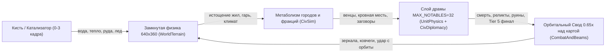
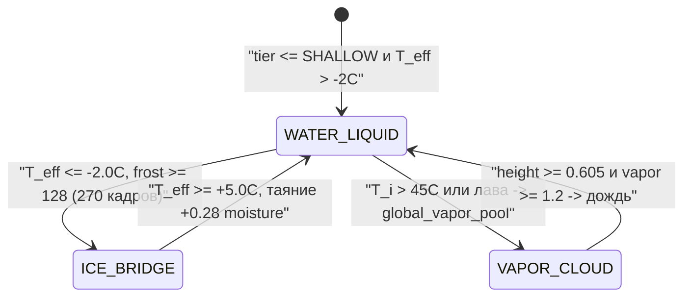
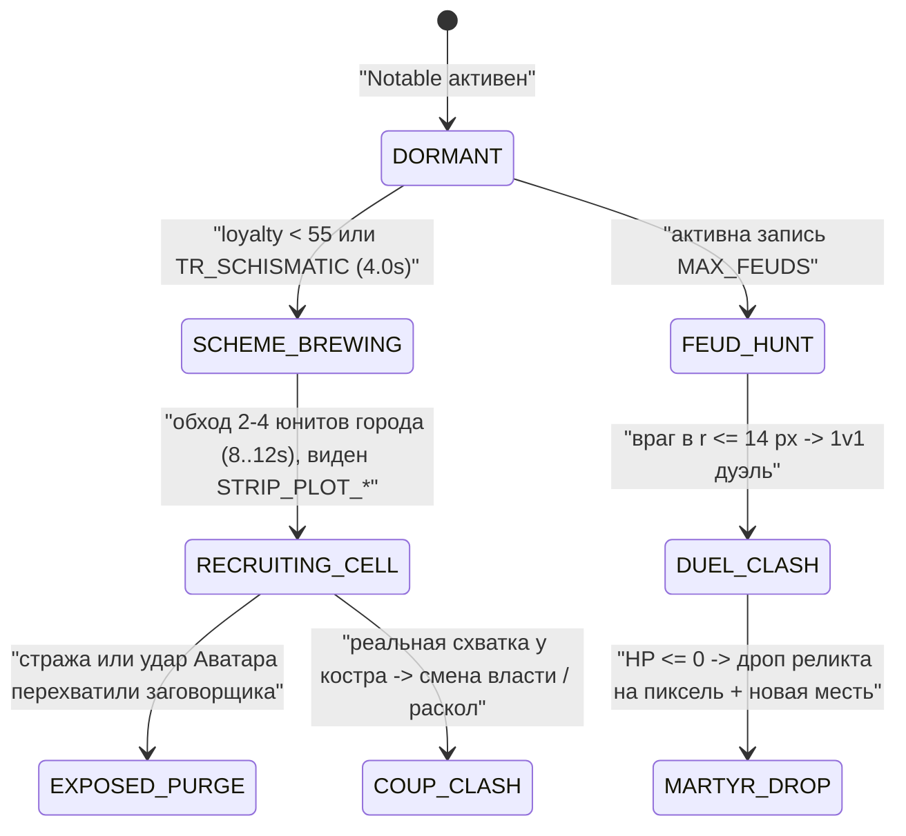
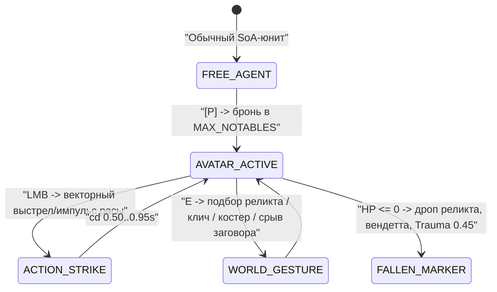

# Видение Совета Геймдизайна: Kepler Sandbox (`06_GAME_DESIGN_COUNCIL_VISION.md`)

**Вердикт:** после рефакторинга `e62c653` проект получил крепкое SoA-ядро (`sim_tick_ms = 2.652..3.078 ms` при потолке `3.80 ms`, `9/9` зелёных автогейтов `verify_tracer.ps1`), но застрял в ловушке «поверхностной песочницы на 120 секунд». Физика не сохраняет воду, тепло и руду, все три расы сходятся к одинаковым `10` постройкам и потолку `tech_tier = 4`, память юнитов `_u_mem_type` не влияет на решения, а ночной рендер проваливает силуэты Роботов и держит **16 мировых `CanvasItem` (плюс 2 `CanvasGroup` и 1 `SubViewport` `_light_mm` = 17 draw-эмиттеров)** при декларированном потолке `<= 12`. Решение по стратегии Штанги Талеба: **90% бюджета** уходит на жёсткое вычитание визуального и UI-шума (*Via Negativa*), замыкание законов сохранения и полную сериализацию `KEPL`, а **10%** — в смелый крючок **«Живого Террариума с Вечными Венцами и Орбитой над Землёй»**: `MAX_NOTABLES = 32` личностей и `MAX_RELICS = 16` реликтов поверх безымянной толпы, асимметричный финал `Tier 5` каждой расы, меняющий физику всей карты `640×360`, и Орбитальный Свод прямо над живыми городами (`zoom 0.65x..12.0x`) вместо отрывающего от мира 100-звёздного меню из `docs/03_ARCHITECTURE_AND_ROADMAP.md`.

**Целевая эмоция (Fumito Ueda Core Emotion):** *благоговение хрупкого соавторства* — игрок трогает мир грубой рукой стихии, но судьбу удерживают крошечные смертные фигуры внизу, чьи венцы, шрамы и переправы переживают даже смену эпох.

---

## 1. Честный аудит текущей игры (`commit e62c653`)

### 1.1. Бюджет рендера и пропускная способность (факт против спецификаций)

В [docs/00_MASTER_GDD.md](00_MASTER_GDD.md) и [docs/03_ARCHITECTURE_AND_ROADMAP.md](03_ARCHITECTURE_AND_ROADMAP.md) заявлен потолок `<= 12` мировых draw calls и планы по несуществующим на диске модулям `GalaxyGraph` и `SaveState`. В реальной кодовой базе `e62c653` уже работают:
- **CPU-база (`VERIFIED` по Round 11):** `--smoke-civ` укладывается в `world_tick_ms = 0.625`, `phys_civ_tick_ms = 1.872`, `sim_tick_ms = 2.652`; `--smoke-combat` — в `world_tick_ms = 0.628`, `phys_civ_tick_ms = 2.082`, `sim_tick_ms = 3.078` при потолках `1.20 / 2.50 / 3.80 ms/тик`.
- **Превышение бюджета слоёв отрисовки (`VERIFIED` по коду):** до добавления орбитального флота в сцене уже созданы **16 мировых `CanvasItem` (из них 2 `CanvasGroup` с внеэкранными буферами композитинга)** плюс **`1 SubViewport` (`_light_mm`)** внутри `FxAudio` (`17` draw-эмиттеров + `2` композита):

| Узел / Поле | Тип и проход | Привязка (`файл:строка`) | Проблема в `e62c653` |
|---|---|---|---|
| `_terrain_sprite` | `Sprite2D` (`terrain_water.gdshader`) | [scripts/world_terrain.gd:383](../scripts/world_terrain.gd#L383) | Чистый 1:1 проход, но не хранит лёд на воде и облачные тени |
| `_mm_clouds` | `MultiMeshInstance2D` (`cloud_shadow.gdshader`) | [scripts/world_terrain.gd:409](../scripts/world_terrain.gd#L409) | Полупрозрачные овалы и `is_haze` глушат города и пачкают океан |
| `_border_sprite` | `Sprite2D` (`640×360` `RGBA8`) | [scripts/civ_sim.gd:1072](../scripts/civ_sim.gd#L1072) | Чистый слой границ и дорог |
| `_shadow_group` + `_mm_bld_shadows` | `CanvasGroup` + `MultiMeshInstance2D` | [scripts/civ_sim.gd:1097-1115](../scripts/civ_sim.gd#L1097-L1115) | Лишний внеэкранный backbuffer ради единой альфы теней зданий |
| `_mm_buildings` | `MultiMeshInstance2D` (`sprite_mode=3`) | [scripts/civ_sim.gd:1144](../scripts/civ_sim.gd#L1144) | `BLD_COLS_ROBOT` клонирует колонки, анимация Роботов/Спор отключена |
| `_shadow_group` + `_mm_ground_shadows` | `CanvasGroup` + `MultiMeshInstance2D` | [scripts/unit_physics.gd:831-860](../scripts/unit_physics.gd#L831-L860) | Второй лишний `CanvasGroup` ради плоских теней юнитов/флоры |
| `_mm_flora`, `_mm_units` | `2 × MultiMeshInstance2D` | [scripts/unit_physics.gd:869,907](../scripts/unit_physics.gd#L869) | Лимит `MAX_UNITS = 720` (`unit_physics.gd:90`) |
| `_mm_cargo` | `MultiMeshInstance2D` (`cargo_pip` `8×8`) | [scripts/unit_physics.gd:935-962](../scripts/unit_physics.gd#L935-L962) | Лишний draw call; закрывает `8×8` юнитов квадратами; кадры груза уже есть в атласе (`3, 14, 19`) |
| `_mm_beams`, `_mm_teleport_arcs` | `2 × MultiMeshInstance2D` | [scripts/combat_and_beams.gd:641,665](../scripts/combat_and_beams.gd#L641) | Работают в бюджете |
| `_mm_particles`, `_mm_strips` | `2 × MultiMeshInstance2D` | [scripts/fx_audio.gd:259,501](../scripts/fx_audio.gd#L259) | `P_COL_PUFF` размывает кратеры; `STRIP_PLOT_*` и `STRIP_CROWN_BANNER` мертвы в коде |
| `_light_viewport` + `_light_mm` + `_light_sprite` | `SubViewport` `214×120` + `Sprite2D` (`LINEAR`) | [scripts/fx_audio.gd:552-609](../scripts/fx_audio.gd#L552-L609) | Билинейное мыло под чётким пиксель-артом |
| `WorldOverlay`, `BrushReticle` | `2 × Node2D._draw()` | [scenes/main.tscn:40-44](../scenes/main.tscn#L40-L44), [scripts/main.gd:3584,3860](../scripts/main.gd#L3584) | CPU `draw_rect`/`draw_line` заговоров, щитов Брезенхэма и ретикла |

### 1.2. Разбор 5 свежих скриншотов и точные дефекты кода (`файл:строка`)

1. **[screenshots/world_macro.png](../screenshots/world_macro.png) (макровид `2.0x`, `День`, `Золотое окно`):**
   - *Что работает:* читаемый архипелаг с шельфом, песчаными пляжами, 3 баннерами королевств (`Базальт · 24`, `Гифы · 20`, `Сигма · 16`) и чистой береговой каймой.
   - *Дефекты:* (а) в левой части экрана города и `1px` границы тонут под густой кроной `528` деревьев и дымкой `is_haze >= 0.5` (`shaders/cloud_shadow.gdshader:65-76`), оставляющей грязные бурые пятна поверх океана; (б) диагональный серый склон на западном острове выглядит как искусственный штрих; (в) [BottomDock](../scenes/main.tscn#L282-L558) шириной `960 px` держит в сцене `30` кнопок и оставляет `20` видимых кнопок на вкладках `Земля`/`Война` (`19` на `Погода`/`Эволюция`, включая `Люди|Роботы|Споры` и `4..48` при выбранной кисти `Поднять`).
2. **[screenshots/world_zoom.png](../screenshots/world_zoom.png) (крупный план кратеров, `Лава · Низина`, `+690.0°C`):**
   - *Что работает:* контраст кристальных шпилей слева и раскалённых трещин кратера, пиксельные искры.
   - *Дефекты:* (а) над кратером в центре одиночные `1px` оранжево-чёрные вкрапления сидят прямо на ярко-зелёной траве без полосы ожога/золы; (б) зелёные деревья в `3–4 px` от `+690°C` лавы остаются нетронутыми — огонь распространяется лишь случайным 4-сторонним шагом в [scripts/world_terrain.gd:1988-2005](../scripts/world_terrain.gd#L1988-L2005); (в) правый кратер замазан мутным коричнево-бежевым диском `P_COL_PUFF` со скейлом до `2.5x` ([scripts/fx_audio.gd:739-742](../scripts/fx_audio.gd#L739-L742)).
3. **[screenshots/stage2_civ.png](../screenshots/stage2_civ.png) (стык `Vesper Ridge (Human)` и `Ferrite Node (Robot)`):**
   - *Дефекты:* (а) **смешение языков** — [scripts/civ_sim.gd:187-191](../scripts/civ_sim.gd#L187-L191) задаёт английские имена городов (`Vesper Ridge`, `Ferrite Node`), пока [scripts/civ_diplomacy.gd:54-57](../scripts/civ_diplomacy.gd#L54-L57) и HUD (`main.gd:3370-3427`) пишут по-русски (`Базальт`, `Сигма`); (б) внутри циановой зоны Людей рядом с костром торчит одинокий красный `8×8` квадрат (фрагментация захвата без сглаживания анклавов); (в) справа постройки Роботов слились в тёмные коробки под белым облаком (`cloud_shadow.gdshader:103`), а поверх крыш растут деревья; (г) `8×8` кубики `_mm_cargo` перекрывают юнитов в нижней части кадра; (д) инспектор справа забит строками плотных сокращений (`Дип: Война(В:2 П:1)`, `ΔЭ:+0.5`) без визуальных шкал.
4. **[screenshots/stage2_night.png](../screenshots/stage2_night.png) (`Ночь`, `Ионная буря`, `Ferrite Node (Robot) · T3/4`):**
   - *Дефекты:* (а) **двойное ночное затемнение** — [shaders/unit_sprite.gdshader:202](../shaders/unit_sprite.gdshader#L202) режет красный канал `vec3(0.42, 0.50, 0.74)` при `nm = 0.80` поверх `CanvasModulate` ([scripts/main.gd:838-840](../scripts/main.gd#L838-L840)), проваливая тёмную сталь `#3B4659`/`#4D5A70` (`tools/build_atlases.py:78-80`) и красный тинт `#E03B3B` (`civ_sim.gd:196`) на базальте `#231E22` (`world_terrain.gd:205`) ниже `0.12` яркости; (б) `push_lights_to_fx` ([scripts/civ_sim.gd:3310-3336](../scripts/civ_sim.gd#L3310-L3336)) освещает костры/купола, но не буры/склады/палатки — промзона Роботов в темноте слепа; (в) лайтмап `214×120` (`LINEAR`) даёт мутное синее пятно под ударом луча, а кольцо щита `R = 48 px` (`main.gd:3685`, Брезенхэм `1 px`) выглядит плоской ступенчатой проволокой, внутри которой висит одинокое зелёное сердечко `STRIP_HAPPY`.
5. **[screenshots/stage3_war.png](../screenshots/stage3_war.png) (`Закат`, `Basalt Haven (Human) · T4/4`, `Войн: 8 · М:1`):**
   - *Дефекты:* (а) справа от квантового кольца над зданием висит квадрат с ярким **красным крестом `X`** — это результат `_draw_overlay_active_plots` ([scripts/main.gd:3735-3768](../scripts/main.gd#L3735-L3768)), который читается как сломанная текстура и дублирует неиспользованные `STRIP_PLOT_WAR/PACT/REBEL` (`fx_audio.gd:65-67`); (б) дуга телепорта уходит в верхний обрез кадра без читаемого маршрута, а взрыв орбитального луча справа сверху снова замазан мутным пятном `P_COL_PUFF`; (в) несмотря на `Войн: 8`, на экране не видно ни одного полководца или причины войны, а прогресс упёрся в потолок `Т4/4` (`civ_sim.gd:1727`).

### 1.3. Пять корневых поломок систем и драмы (`VERIFIED`)

1. **Нарушение законов сохранения воды, тепла, руды и энергии:**
   - `_moisture` ([scripts/world_terrain.gd:902-913](../scripts/world_terrain.gd#L902-L913)) не испаряется и не конденсируется в `_mm_clouds` (`1154-1206` двигают облака с жёстким `7.5 / 2.1 px/s`); при этом остывающий пепел сам рождает воду из ниоткуда (`world_terrain.gd:2109`: `minf(0.56, _moisture + 0.032*eff_dt)`).
   - `LOWER_CANAL` (`world_terrain.gd:1258-1279`) копает яму, но вода из рек/моря по прокопу не течёт. Тайлы холоднее `29.0°C` пропускаются на входе `step_environment` (`world_terrain.gd:1964`), поэтому холод в `ICE_SHADOW` не диффундирует и мелководье не замерзает.
   - Тепло сливается в бесконечный сток `TEMP_AMBIENT_C = 18.0` (`world_terrain.gd:18, 2045, 2071`); `get_avg_temp()` (`2966`) используется только для строки `TopBar` (`main.gd:3433`).
   - В экономике ([scripts/civ_sim.gd:2096-2106](../scripts/civ_sim.gd#L2096-L2106)): `_zone_ore` заполняется в `civ_territory.gd:175`, но никогда не вычитается бурами (`civ_sim.gd:2099` даёт вечные `1.65` руды/с); `FUSION_REACTOR` даёт `+10` энергии/с без руды, `BIODOME` работает бесплатно, `SHIELD_PYLON` заряжается без `consume_city_energy` (`2690-2694`), а шаттлы снабжения (`2586-2590` vs `2645-2647`) списывают `<= 15` ед. лишь при запасе `> 40` и всегда выгружают `25 + 25 + 15`.
2. **Экономический тупик после `Tier 3`:** `tech_tier` жёстко зажат в `0..4` (`civ_sim.gd:1727`), предел зданий на город `<= 32` (`1746-1750`), зоны `<= 36` (`2114`), авто-города `<= 8..10` (`civ_diplomacy.gd:943-945`), ресурсы упираются в `minf(cap, ...)` с потолком склада `1400`, после чего строители замирают навсегда.
3. **Сломанная сериализация `KEPL` (`F5 / F9`):** `pack_world_state()` ([scripts/main.gd:1023-1093](../scripts/main.gd#L1023-L1093)) сохраняет только `civ_blob`, `combat_blob` и `_seed_counter`. При загрузке (`1056-1058`) заново вызываются `_world.generate_planet` и `_physics.rebuild_population`, уничтожая все кратеры, каналы, лаву, юнитов, память и `_possessed_uid`.
4. **Анонимность толпы и свёрнутая асимметрия рас:**
   - Кольцо памяти `MEMORY_SLOTS = 8` ([scripts/unit_physics.gd:217-246, 2071-2092](../scripts/unit_physics.gd#L2071-L2092)) затирается рутинными `MEM_GATHERED` / `MEM_BUILT` / `MEM_FOUGHT` и читается **только** инспектором (`5944-5951`), а не логикой ИИ.
   - Капитан полка в [scripts/unit_combat_ai.gd:270-281](../scripts/unit_combat_ai.gd#L270-L281) — первый живой индекс без черт, ауры и реакции на гибель. Заговоры в [scripts/civ_diplomacy.gd:541-606](../scripts/civ_diplomacy.gd#L541-L606) — невидимые 14-секундные таймеры. Все три расы строят одинаковые 10 `BuildingType`, у Роботов в `BLD_COLS_ROBOT` (`civ_sim.gd:182`) продублированы колонки `21` и `22`, ранний `return` на `2772-2775` отключает анимацию зданий Роботов и Спор, а `_possessed_uid` (`unit_physics.gd:1046-1153`) сводится к одному импульсу `22 px` при блокировке кистей.
5. **UX и акустика первых 60 секунд:**
   - Кнопка `Новый мир` (`scenes/main.tscn:554`) без подтверждения в `3 px` от `Инсп`; колесо мыши зумит к центру, а не к курсору (`main.gd:2621`); клик `Колония` без `Shift` высаживает 1–8 бродяг вместо лагеря (`main.gd:2919-2938`), а `Shift` скрыт в тултипе.
   - В звуке ([scripts/fx_audio.gd:1348, 1559-1561, 1636, 1780](../scripts/fx_audio.gd#L1348)): `macro_t = clampf((_cam_zoom - 0.85) / 1.15, 0.0, 1.0)` при `ZOOM_MIN = 1.2` уже на дефолтном `2.0x` даёт громкость `1.0` на всю карту; `_audio_player.stop()` на тишине убивает эмбиент и даёт щелчки на Web; `main.gd:2943` не передаёт `world_x` для стереопанорамы.

---

## 2. Via Negativa: что вычитаем и сносим до новых фич

По правилу Нассима Талеба (анти-ятрогеника) и Правилу Стула Фумито Уэды запрещено лечить плохую читаемость или пустоту новыми слоями поверх старых костылей. Первым срезом (`S1`) вырезаем лишние узлы, шейдерные ветки и HUD-мусор:

| Что удаляем / сносим | Привязка (`файл:строка`) | Эффект вычитания | Чем заменяем (без лишних слоёв) |
|---|---|---|---|
| **2 `CanvasGroup` и 2 слоя теней** (`_mm_bld_shadows`, `_mm_ground_shadows`) | `civ_sim.gd:1097-1115`, `unit_physics.gd:831-860` | `-2` внеэкранных прохода `CanvasGroup` и `-2` draw calls | Запечённая контактная тень (`alpha=0.34`, порог `0.55` в `unit_sprite.gdshader:175`) прямо в базе спрайтов `tools/build_atlases.py`; тень летящего шаттла — слотом в `_mm_particles` |
| **Слой `_mm_cargo` (`cargo_pip`)** | `unit_physics.gd:935-962, 5709` | `-1` draw call, `-720` трансформов/тик, уходят `8×8` квадраты с юнитов | Существующие кадры атласа `UCOL_*_CARGO` (`col 3, 14, 19`) + 1px цветной маркер груза |
| **`Node2D` рендер `BrushReticle`** | `scenes/main.tscn:43`, `main.gd:3860` | `-1` draw call (слияние в `WorldOverlay`) | Отрисовка прицела кисти последним блоком в `WorldOverlay._draw()` |
| **CPU `_draw_overlay_active_plots`** | `main.gd:3735-3768` | Исчезает «красный крест `X`» на `stage3_war.png` | Уже готовые в атласе `STRIP_PLOT_WAR/PACT/REBEL` (`fx_audio.gd:65-67`) внутри `_mm_strips` |
| **Пятна `P_COL_PUFF` из взрывов и `is_haze`** | `fx_audio.gd:732-745`, `cloud_shadow.gdshader:65-76` | Уходят мутные пятна над кратерами и бурая грязь в океане | Чёткие `1:1` пиксельные осколки кольца; скрытие `_mm_clouds` при `zoom > 3.2x` или когда `_light_sprite.visible == true` (`_light_count > 0` в Закате `0.28..0.48`, Ночи и вспышках `fx_audio.gd:1032-1050`); перевод `_light_viewport.render_target_update_mode` в `SubViewport.UPDATE_DISABLED` при `_light_count == 0` (`fx_audio.gd:558`) |
| **Двойное ночное затемнение `CanvasModulate`** | `main.gd:835-840` | Убирает провал тёмных спрайтов в чёрную кашу на `stage2_night.png` | Единый ночной грейдинг в `terrain_water.gdshader` и `unit_sprite.gdshader` с полом яркости |
| **Лишние виджеты `TopBar` и `BottomDock`** | `scenes/main.tscn:63-221, 282-558` | `TopBar` сжимается `948 -> <= 520 px`; `BottomDock` `960 -> <= 420 px`, `>= 45%` воздуха (*Ma*) | `Флора/Темп` уходят в тултип; `FPS` под `F3`; `Новый мир` в верхнее системное меню с подтверждением; 2-рядная раскладка `BottomDock` (`<= 7` кнопок в ряду) |
| **Автосмена кисти при выборе расы** | `main.gd:658-661, 2569-2571` | Устраняет раздражающий сброс инструмента игрока | Выбор расы меняет только активную фракцию без прыжка в `BRUSH_COLONY` |
| **100-звёздный граф меню из `docs/03_ARCHITECTURE_AND_ROADMAP.md`** | `docs/03_ARCHITECTURE_AND_ROADMAP.md:92-112` | Срезает мёртвые таблицы и риск разрыва связи с картой `640×360` | Орбитальный Свод (`zoom 0.65x`) над живой картой + опциональная эстафета Ковчега |

**Итоговый бюджет слоёв после вычитания (`16 -> 11..12`):** в мире остаётся **12 узлов отрисовки** (`_terrain_sprite`, `_border_sprite`, `_mm_flora`, `_mm_buildings` [включая руины, шаттлы и орбитальный флот `S4`], `_mm_units`, `_mm_beams`, `_mm_teleport_arcs`, `_mm_particles`, `_mm_strips`, `_mm_clouds`, `WorldOverlay`, `_light_sprite`), с жёсткой взаимной блокировкой `_light_sprite.visible` и `_mm_clouds.visible` (`_light_viewport.render_target_update_mode = UPDATE_DISABLED` при `_light_count == 0`): при `0` огнях работают **11 слоёв (`_mm_clouds` включён, `_light_viewport` выключен)**, а при `_light_count > 0` (Закат `main.gd:805, 2008`, Ночь и вспышки `fx_audio.gd:1032-1050`) `_mm_clouds` скрывается и пик со встроенным `_light_mm` не превышает **`12` draw calls**, ноль `CanvasGroup` и ноль `Node2D` на сущность.

---

## 3. Три ортогональных вектора развития (`p < 0.10`)

Сброшенный `BANNED_BASELINE` (запрещено предлагать): абстрактную ману бога, меню налогов и ползунки тарифов, XP-уровни и деревья перков, текстовые квест-попапы, табличную 100-звёздную 4X-карту с макро-боями по формуле Ланчестера и механический спам `+20` однотипных кистей.

### Вектор A `[Recommended]` (`p = 0.07`): Живой террариум с законами сохранения, `MAX_NOTABLES = 32` и асимметричным `Tier 5`
- **Core Tension:** каждый технологический рывок к орбите сжигает исчерпаемые залежи и греет/истощает планету, пока смертные герои и еретики борются за венцы и переправы поверх хрупкой экосистемы.
- **Ueda Core Emotion + 30-Second Verb:** *тревожное покровительство* — каждые `30` секунд рука либо пробивает/сводит водные русла и поддувает ветер вихрем, либо перехватывает взгляд на закреплённого короля/еретика и сдвигает чашу весов одним точечным касанием.
- **Design Razor (TRIZ):** вместо добавления 100 новых планет или RPG-листов, вся драма держится на **3 сцепленных инвариантах**: (1) сохранение вещества и тепла; (2) разреженный слой `32` личностей и `16` реликтов в SoA; (3) расхождение `3` рас в физически разные `Tier 5` финалы, перестраивающие саму карту `640×360`.

### Вектор B (`p = 0.05`): Двухслойная Орбитальная диорама прямо над `640×360` (`zoom 0.65x..12.0x`)
- **Core Tension:** орбитальные мегапроекты (тросы лифтов Людей, солнечные зеркала Роботов, споровые кольца, Орбитальный Молот) физически привязаны координатами к городам внизу — разрушение опоры на земле роняет конструкцию с неба на жилые кварталы.
- **Ueda Core Emotion + 30-Second Verb:** *головокружение масштаба* — за один плавный зум колесом мыши игрок проваливается от орбитального троса в стратосфере до кузнечных искр у костра под ним, закрывая щитами и вихрем уязвимые узлы.
- **Design Razor (T-UoT инверсия):** запрет отдельной сцены/экрана космоса; космос — это верхняя кромка и отдаление камеры (`0.65x..1.2x`) того же поля `640×360` внутри уже существующего `CombatAndBeams` (органично стыкуется с Вектором A в вертикальном срезе `S4`).

### Вектор C (`p = 0.03`): Хроника Ковчега / мутирующие законы физики от мира к миру
- **Core Tension:** уходящий на Ковчеге/Болиде финал переносит до `8` живых `Notables` и `<= 4` реликтов в следующий сектор (`1..5` миров в Поясе), где базовая физическая константа (теплопроводность, точка замерзания, радиационный фон, солёность) сдвигается, вынуждая выживших героев адаптировать старые повадки к чужой природе.
- **Ueda Core Emotion + 30-Second Verb:** *хрупкая эстафета поколений* — игрок провожает знакомого ветерана с украденным венцом на новую холодную или радиоактивную землю и следит, чей культ или клан выживет в новых правилах.
- **Design Razor (E-UoT разделение по эпохам поколений):** никаких параллельных симуляций 99 фоновых звёзд — в каждый момент существует только **1 живой мир `640×360`**, а память прошлых миров несут лишь спасённые `8` душ, `4` реликта и 1 сдвиг константы среды.

| Критерий | Вектор A `[Recommended]` (`p = 0.07`) | Вектор B (`p = 0.05`) | Вектор C (`p = 0.03`) |
|---|---|---|---|
| **Что меняется для игрока за первые 5 минут** | Видимая сцепка воды/огня/руды, живые короли, реликты на карте и чистый HUD | Мгновенный доступ к орбитальному кольцу над городами без экранов меню | Преемственность легенд и мутация физических правил на втором мире |
| **Нагрузка на SoA и кадр (`<= 3.80 ms`)** | `+248 KiB` физика + `~15 KiB` драма; `+0.17 ms/тик` (`sim ≈ 3.25 ms`) | `+18 KiB` (`MAX_CRAFT = 64`); `+0.04 ms/тик` при отдалении камеры | `<= 2 MiB` LRU в `KEPL`/Zstd (до 5 миров); `0 ms` в обычном кадре |
| **Draw calls (`<= 12`)** | `11` днём / `12` ночью (`0` новых нод, используем `_mm_strips` и `_border_sprite`) | `0` лишних слоёв: аппараты орбиты идут в `_mm_buildings` (`11–12` всего) | `0` лишних draw calls |
| **Риск для интимности `640×360`** | Нулевой — углубляет жизнь самой планеты | Низкий — при соблюдении порога `zoom <= 1.2x` без перекрытия земли | Средний — работает только после того, как первый мир научился рождать легенды |

**Выбор Совета:** берём **Вектор A** как основу срезов `S1–S3`, а в срезе `S4` встраиваем **Вектор B** (Орбитальный Свод `0.65x`) и лёгкий эстафетный крючок **Вектора C** (`<= 8` пассажиров Ковчега при старте Нового Мира после победы `Tier 5`).

---

## 4. Детальные спецификации по 5 осям

### 4.1. Ось 1: Физика, экология и кисти-катализаторы (`WorldTerrain` + `CivSim`)

**Замкнутая гидрология (без новых draw calls):**
- **Испарение и облачный цикл:** в активных чанках `step_environment` (`ACTIVE_CHUNK_BUDGET = 14`) и при тушении лавы водой (`world_terrain.gd:2025`):
  $$\Delta m = \min\big(\text{moisture}_i,\; \text{EVAP\_RATE} \cdot \text{clamp}(\tfrac{T_i - 45}{120},\, 0,\, 1) \cdot dt\big)$$
  Влага уходит из `_moisture[i]` в `global_vapor_pool`, откуда равномерно распределяется в `_cloud_vapor[0..25]` (для `26` облаков `_mm_clouds`). Когда облако с зарядом `>= CLOUD_RAIN_THRESH` (`1.2`) проходит над возвышенностью (`_height >= 0.605`) или в зоне с `T_eff < 14°C`, оно темнеет через `instance_color` и сбрасывает дождь (`r = 14 px`, `RAIN_DEPOSIT * dt` в `_moisture`, тушение `_fire`, ЭМИ-шок роботам). Удаляем самогенерацию влаги пеплом в [scripts/world_terrain.gd:2109](../scripts/world_terrain.gd#L2109): пепел повышает плодородие (`+ASH_FERTILITY_BOOST = 0.55`) только после прихода воды (`_moisture >= 0.30`).
- **Волновая гидрология каналов (`LOWER_CANAL`):** кольцевой буфер `_water_queue: PackedInt32Array(2048)` (`8.0 KiB`) с лимитом `WATER_FLOW_TILES_PER_TICK = 48`. Если вода (`tier <= SHALLOW`) граничит с каналом (`_height <= 0.355`), русло заполняется со скоростью `30 px/s` (`1 px` за `2` кадра @ `60 FPS`), поднимая `_moisture` берегов на `+0.45`. Отрезанные дамбами пруды без притока пересыхают за `18.0 s` (`1080` кадров).
- **Двусторонний тепловой баланс, альбедо и лёд (`_frost: PackedByteArray`):**
  Снимаем пропуск холодных тайлов в [scripts/world_terrain.gd:1964](../scripts/world_terrain.gd#L1964) при `T_eff < eq_min_c` или `_frost > 0`. Равновесная температура в скользящем скане `4` строк/тик (`world_terrain.gd:2852`, полный оборот `90` кадров = `1.5 s`):
  $$T_{\text{eq}} = T_{\text{amb}} + \Delta T_{\text{cosmic}} + K_{\text{CO2}} \cdot \ln\!\left(1 + \frac{\text{co2\_load}}{400}\right) - K_{\text{albedo}} \cdot f_{\text{ice\_ash}} - K_{\text{ocean}} \cdot \max(0, T_{\text{avg}} - T_{\text{amb}})$$
  Член `-K_ocean * max(0, T_avg - T_amb)` (`K_ocean = 0.22`) — обязательный отрицательный стабилизатор против перегрева карты на `20x–70x`. При `T_eff <= ICE_FREEZE_TEMP_C (-2.0°C)` на мелководье (`SHALLOW`) и влажных берегах копится `_frost` (`+28/s` -> при `>= 128` за `4.5 s` / `270` кадров формируется **ледяной мост**, `is_walkable == true`, скорость `1.15x`). При `T_eff >= ICE_MELT_TEMP_C (+5.0°C)` лёд и горный снег (`SUMMIT`) тают (`-22/s`), питая реки. При `T_avg >= GLOBAL_HEAT_PENALTY_C (36.0°C)` урожайность плавно падает до `0.55x`.

**Реальный метаболизм ресурсов и катализаторы кистей (без спама кнопок):**
- **Истощение `_zone_ore` (`civ_sim.gd:2099`):** бур добывает `min(_zone_ore[z], DRILL_BASE_RATE * dt)`; на пустой жиле (`_zone_ore == 0`) выход падает до `DRILL_DEPLETED_MULT (0.20x)` с ростом `co2_load` и жара (`+8°C/s`). Восполняют жилы только метеориты (`+25..45`), остывшая лава (`+15..30`) и лом погибших Роботов (`+4`).
- **Честный `upkeep` и шаттлы (`civ_sim.gd:2096-2100, 2586-2647`):** `CAMPFIRE` сжигает `0.12` `_city_wood/s` ради согрева `+20°C` (`r = 14 px`); `BIODOME` потребляет `0.65` энергии/с и `0.04` влаги/с (без энергии гаснет и теряет щит от радиации); `FUSION_REACTOR` даёт `+12.0` энергии/с при расходе `0.22` руды/с (без руды — аварийные `2.5`); `SHIELD_PYLON` заряжается через `consume_city_energy(cid, 0.45 * dt)`. Шаттл хранит реально списанный груз в `_shuttle_cargo_{food,ore,energy}` (макс. `25.0`, нулевое дублирование).
- **Кисти-катализаторы (внутри прежних `4` вкладок, `0` новых кнопок):**
  1. `VORTEX_PULL` (перетаскивание): каждые `4` кадра (`15 Hz`) переносит долю `VORTEX_ADVECTION_RATE (0.35)` огня, пара, радиации и заряда облака на `5 px` по вектору движения мыши (`Shift+VORTEX` или `Shift+Дождь` в холодную эпоху фокусирует морозный вихрь `-22°C`, заменяя отдельную кнопку крио-кисти).
  2. `BIO_SEEDER`: адаптируется под биом клетки (вода -> прибрежные водоросли с ростом плодородия, гарь -> быстрая роща, кристалл -> энерго-спора).
  3. `ION_STORM` над `CRYSTAL`: перескакивает цепью на `<= 3` соседних очага кристаллов, заряжая `SHIELD_PYLON` (`+0.45`) или перегружая `FUSION_REACTOR`.
- **4 Failure-Forward шрама:** (1) взрыв `FUSION_REACTOR` (`civ_sim.gd:2360`) рождает **Изотопную кальдеру** (`_vent_mask = 2`, `_rad = 0.75` — смертельно людям без купола, `+16` энергии/с Роботам и кристаллы); (2) затопление района — **рудные отмели** (`+30%` плодородия вокруг); (3) пожар `>= 120` тайлов — **чернозёмная гарь** (`+55%` плодородия при дожде); (4) падение города `Tier 2+` — **древние сваи** в `_road_mask` + `+15` руды и `+0.35` науки первооткрывателям.
- **Память и CPU физического ядра:** `_frost` (`225.0 KiB`) + `_water_queue` (`8.0 KiB`) + `_cloud_vapor` (`104 B`) + `_zone_ore_cap` (`14.06 KiB`) + массивы шаттлов/куполов (`528 B`) = **`+247.7 KiB` RAM**, **`+0.13..0.20 ms/тик`** CPU.

---

### 4.2. Ось 2: Живой социум, `MAX_NOTABLES = 32`, Аватар и асимметрия рас до `Tier 5`

**Единый язык и полная сериализация:**
- Переводим `CITY_NAME_POOLS` ([scripts/civ_sim.gd:187-191](../scripts/civ_sim.gd#L187-L191)) на единый кириллический стандарт, согласованный с `KINGDOM_NAME_POOLS` (`civ_diplomacy.gd:54-57`), убирая диссонанс «`Vesper Ridge` внутри королевства `Базальт`».
- Исправляем `pack_world_state` / `unpack_world_state` ([scripts/main.gd:1023-1093](../scripts/main.gd#L1023-L1093)): добавляем бинарные срезы `WorldTerrain` (квантование `11 B/px`: `_tiers`, `_biomes`, `_river_mask`, `_vent_mask`, `_frost`, `_height` `u16`, `_temp` `i16`, `_rad` `u8`, `_moisture` `u8` -> Zstd сжатие `~280–460 KiB`) и `UnitPhysics` (`_unit_count`, SoA-состояние юнитов, `_possessed_uid`, `Notables/Relics/Feuds`), чтобы `F5/F9` не стирал карту и героев.

**Слой `MAX_NOTABLES = 32`, `MAX_RELICS = 16`, `MAX_FEUDS = 16` (`~14.2 KiB` RAM, `< 0.04 ms/кадр`):**
- В `scripts/unit_physics.gd` добавляем только `_u_notable_idx: PackedInt32Array` (`-1` для рядовых, `0..31` для личностей, синхронизируется за `O(1)` при `_kill_unit`).
- Внутри `scripts/civ_diplomacy.gd` (и `scripts/unit_combat_ai.gd`) хранятся плоские SoA-таблицы:
  - **Личности (`32` слота):** `_not_active`, `_not_uid`, `_not_slot`, `_not_faction`, `_not_rank` (`0=Герой`, `1=Знаменосец`, `2=Правитель/Ядро/Матка`, `3=Отступник/Вожак`), `_not_city_id`, `_not_kingdom_id`, `_not_clan_id`, `_not_traits` (битовая маска черт без XP-уровней: `TR_VENGEFUL`, `TR_SCHISMATIC`, `TR_ASHBORN`, `TR_BLESSED_HALO`, `TR_FERAL_ALPHA`), `_not_relic_id`, `_not_state`, `_not_pinned`, `_not_duel_uid`, `_not_renown`, `_not_name`.
  - **Нестираемая память вех (`NOTABLE_MEM_SLOTS = 12`):** `_not_mem_verb`, `_not_mem_subj_uid`, `_not_mem_city`, `_not_mem_time`. Пишет **только поворотные вехи** (`FOUNDED`, `CROWNED`, `DUEL_WON`, `RELIC_TAKEN`, `FEUD_SWORN`, `BETRAYED`, `BLESSED`, `MUTATED`, `SURVIVED_STRIKE`), а рутинную рубку/добычу сюда не пускаем.
  - **Реликты и Венцы (`16` слотов):** физически привязаны к `_rel_holder_uid` или координате пикселя на земле. После гибели владельца падают на землю (мигающий `2 px` ромб HDR через `_mm_strips` — **0 CPU `draw_rect`**) и перехватываются убийцей-личностью или любым солдатом/Аватаром в радиусе `6.0 px`.
  - **Кровная месть (`16` слотов, `ttl = 300.0 s`):** гибель Notable или разорение города открывает вендетту клана `src_clan -> tgt_uid/clan`, разрешая дуэли `1v1` (`r <= 14.0 px`) и локальные рейды даже в состоянии `NEUTRAL`.
  - **Живой Заговорщик (вместо невидимого таймера `civ_diplomacy.gd:541-606`):** к каждому `_plot_*` привязан `_plot_instigator_nid`.

**Асимметричный эндгейм `Tier 5` (победа и коллапс меняют физику планеты):**

| Ось `Tier 3 -> Tier 5` | `HUMAN` (Люди) | `ROBOT` (Автономный Рой) | `SPORE` (Ксено-Спора) |
|---|---|---|---|
| **Соц. устройство** | Династии, Венцы, Пакты, Вендетты, Отступники | Сетка Консенсуса `_robot_sync` (`0..100%`) и `1–3` Процессор-Узла | Единый Био-Мозг Роя без дипломатии; трупы -> биомасса |
| **Инфраструктура `T3+`** | Биокупола + **Орбитальный Причал Ковчега** (апгрейд Космодрома) | Кондуит-сеть `ROAD_CONDUIT` (`+25%` темпа турелей) и **Термоколлекторы** | Авто-ползучий мицелий (`1` зона / `12.0 s` по влажной земле) + **Споровые Болиды** |
| **Финал Победы `Tier 5`** | **«Исход Ковчегов»:** накопить `3` этапа сборки Ковчега (без принуждения к числу пактов!) -> запуск Ковчега на Орбиту, на земле остаётся Памятный Обелиск и Хранители-ветераны | **«Солнечный Коллектор»:** покрыть `>= 55%` суши `RUST/CONDUIT` и удержать `>= 3` Узла -> вывод орбитальных зеркал, позволяющих игроку/рою сдвигать температуру и свет над сектором | **«Великое Цветение»:** `>= 60%` суши под мицелием + `3` живых **Левиафана** -> постоянный `SPORE_BLOOM`, оживающий пепел `SCORCHED` и автозаражение границ |
| **Кризис Коллапса** | **«Смута»:** смерть Короля при `>= 2` вендеттах или потеря Столицы -> распад на города-полисы | **«Ересь Кода»:** разрыв кондуитов штормом ниже `40%` связности -> бунт части турелей и дронов | **«Огненный Мор»:** связанный мицелий горит в `2.4x` быстрее; выгорание `>= 40%` ковра разваливает рой |

**Тактильный 2-кнопочный Аватар (`_possessed_uid`, без ARPG-пианино):**
- Вход `[P]` сразу резервирует слот в `MAX_NOTABLES` (титул *«Вестник»*), **не блокирует** панораму и показывает только `2` физических действия (по Blow/Pope):
  - `LMB` — контекстный векторный жест по курсору: луч/выстрел (`HUMAN`), бронебойный сдвоенный импульс (`ROBOT`), кислотный плевок с меткой для стаи (`SPORE`/`MUTANT`).
  - `E` — физическое взаимодействие с миром: подобрать/положить реликт с земли, созвать ближайших союзников в свиту (`r = 24 px`), либо на дикой земле за Скитальца разжечь **первый Костёр** (`try_self_found_settlement`), а удар `LMB` или перехват `[E]` по заговорщику со знаком `STRIP_PLOT_*` срывает мятеж (`+15%` лояльности).
- **Цена смерти (Ueda/Taleb):** никаких `i-frames` перекатов и бесплатного воскрешения за `[R]`. Смерть Аватара даёт `Trauma 0.45`, роняет реликт на землю, открывает вендетту и оставляет **Памятный Знак** в точке гибели.

---

### 4.3. Ось 3: Визуал, шейдеры и спасение силуэтов (`<= 12` draw calls)

1. **Реанимация силуэтов и анимации Роботов и Спор (`tools/build_atlases.py`, `scripts/civ_sim.gd`, `shaders/unit_sprite.gdshader`):**
   - В `tools/build_atlases.py:78-95`: переводим корпус Роботов на холодно-титановую светлую сталь `#B8C4D4` / `#8A96A8` с `Mask.R = 0` (корпус НЕ умножается на тёмно-красный тинт `#E03B3B`, сохраняя контраст `> 0.48` против базальта `#231E22`!), оставляем `Mask.R = 240` только на полосах маркировки и добавляем тёплые оптические прорези (`Mask.G = 180`).
   - В `scripts/civ_sim.gd:182`: убираем копипасту и путаницу в `BLD_COLS_ROBOT = [22, 9, 20, 21, 22, 21, 23, 24, 34, 36]` (`TENT` `[1]` берёт человеческую палатку `9`, `CAMPFIRE` `[0]` и `SOLAR_ARRAY` `[4]` делят колонку `22`, `DEPOT` `[3]` и `BIODOME` `[5]` делят колонку `21`) — выдаём раздельные колонки всем `10` постройкам и удаляем ранний `return` на `civ_sim.gd:2772-2775`, возвращая 2-кадровую анимацию стройкам Роботов и Спор.
   - В `scripts/civ_sim.gd:3310-3336`: добавляем мягкие ночные огни в `push_lights_to_fx` для `DRILL`, `DEPOT` и `TENT`, а в `shaders/unit_sprite.gdshader:202` вводим лёгкий ночной `NW` rim-light (`+vec3(0.22, 0.34, 0.54) * 0.22 * nm`) с полом яркости `>= 0.46` при удалённом `CanvasModulate`.
2. **Жёсткий `1:1` пиксель-арт без мыла (`scripts/fx_audio.gd`, `scripts/main.gd`):**
   - В `fx_audio.gd:580-605`: переводим `_light_sprite` на `TEXTURE_FILTER_NEAREST` с `4×4` Bayer-дизерингом порога света в шейдере (резкие пиксельные ступени света вместо размазанного `214×120` градиента).
   - Заменяем Брезенхэм-проволоку щита `main.gd:3685` на **пунктирную пиксельную дугу** с яркостью от `_bld_shield_charge` и 2-кадровым пиком вспышки при перехвате.
   - В `civ_territory.gd`: сглаживаем одиночные `8×8` анклавы (как красный квадрат в `stage2_civ.png`) и запрещаем спавн `flora` внутри пятна постройки.
3. **Микро-жизнь деревень на `4x–8x` зуме (`0` новых draw calls):**
   - В `civ_sim.gd:2013-2030`: фильтруем `_emit_building_smoke` по текущему `Rect2` камеры (до `18` видимых частиц вместо глобального потолка `6` на весь мир).
   - Подключаем в `_mm_strips` (`fx_audio.gd:501, 956` — строго кратный скейл `0.5` или `1.0` без дробных текселей!) забытые колонки `STRIP_PLOT_WAR/PACT/REBEL` (`12..14`) и `STRIP_CROWN_BANNER` (`15`), а также `1×1` искры добычи в `unit_harvest.gd` и брызги на мелководье.

---

### 4.4. Ось 4: Процедурный звук (`22050 Hz`) и Game Juice (`60 FPS`)

**Матрица таймингов Game Juice (`1 кадр = 16.67 ms`, кривая тряски `T^2` / `T^3`, `TRAUMA_DECAY = 1.65 s^-1`, `Sx * Sy = 1`):**

| Игровое событие | `Anticipation` (кадры / ms) | `Active` (кадры / ms) | `Follow-through` (кадры / ms) | `Hit-Stop` & `Trauma` | Звуковой триггер (`fx_audio.gd`, `<= 1` кадр) |
|---|---|---|---|---|---|
| **Закладка / Апгрейд здания** | `3` (`50 ms`): `Sy=0.82`, `2` пылинки | `2` (`33 ms`): `Sy=1.26`, вспышка `HDR 1.6` | `14` (`233 ms`): пружина `omega=18.0, zeta=0.25`, `4` пылинки | `0 ms`, `+0.05` (`T^2`) | `BUILD_POP` (`240->580 Hz`, треуг., `pan(world_x)`) |
| **Орбитальный удар** | `10` (`167 ms`): `1 px` луч наведения | `3` (`50 ms`): луч `4 px`, вспышка `64 px` | `22` (`367 ms`): `16` осколков кольца без `PUFF` | `3` кадра (`50 ms`), `+0.42` (`T^3`) | `ORBITAL_BEAM` (нижний удар + ВЧ свип) |
| **Перехват щитом** | `0–1` (`0–17 ms`) | `2` (`33 ms`): пик пунктир-кольца `HDR 2.6` | `16` (`267 ms`): касательные рикошеты + `STRIP_SHIELD` | `2` кадра (`33 ms`), `+0.15` (`T^2`) | `SHIELD_DEFLECT` (резонансный колокол) |
| **Кирка / Выстрел / Дуэль** | `2` (`33 ms`): присед `Sy=0.86` | `1–2` (`17–33 ms`): `Sy=1.16`, `hit-flash`, `3` искры | `8` (`133 ms`): затухание `omega=20.0, zeta=0.30` | `0..1` (`0..17 ms`), `+0.03` | `SKIRMISH` / `LASER_LIGHT` с `Zoom-LOD` |
| **Смерть Аватара / Крах города** | `1` (`17 ms`): зум-пульс | `4` (`67 ms`): выброс реликта + кольцо | `24` (`400 ms`): пепел, памятный знак | `4` кадра (`67 ms`), `+0.45` (`T^3`) | `MELTDOWN` / низкий гул `110->48 Hz` |

**Исправления и генеративный эмбиент в `scripts/fx_audio.gd` (`<= 0.25 ms/кадр` при `22050 Hz`):**
1. **Фикс `Zoom-LOD` (`fx_audio.gd:1348`):** заменяем формулу на `macro_t = clampf((_cam_zoom - 1.2) / 3.8, 0.0, 1.0)` (на `1.2x` -> `0.0`, на `2.0x` -> `0.21`, на `5.0x+` -> `1.0`). Все вызовы из [scripts/main.gd:2943](../scripts/main.gd#L2943) и боя передают `world_x` для `pan = clampf((world_x - cam_x) / (320.0 / cam_zoom), -0.75, 0.75)`.
2. **Устойчивый поток на Web и анти-алиасинг:** удаляем `_audio_player.stop()` на тишине ([scripts/fx_audio.gd:1559-1561](../scripts/fx_audio.gd#L1559-L1561)), активируя генератор с первого клика игрока; ограничиваем частоту FM в `CRYSTAL` (`1636`) и `EMP_GLITCH` (`1780`) строго `<= 8500 Hz` (ниже порога Найквиста `11025 Hz`).
3. **Разделение UI-тонов:** вместо одного `SfxKind.UI` (`1785`) вводим `4` профиля: `UI_SELECT` (`660->880 Hz`, `45 ms`), `UI_TAB` (`440->587 Hz`, `55 ms`), `UI_PIN` (квинта `523+784 Hz`, `110 ms`), `UI_DENIED` (двойной тупой стук `165->110 Hz`, `85 ms`).
4. **Лёгкий 2-слойный эмбиент (бюджет `< 0.06 ms/тик`):** чтобы не перегрузить микс при `16` боевых голосах, шумовой ветер/прибой считается 1-pole LPF на пониженной вдвое сетке (`11025 Hz` линейной интерполяцией в `_mix_chunk`), а биомно-эпохальный дрон (два расстроенных синуса `±0.6 Hz`: `110/165` для `GOLD`, `220/330` для `CRYSTAL/ION`, `55/82.5` для `LAVA/FLARE`, `293.6` для `ICE`, `98/147` для `SPORE`) сглаживается по `zoom` и глушится, когда активны `>= 10` боевых голосов.

---

### 4.5. Ось 5: UX / HUD первых 60 секунд (Dieter Rams & *Ma*)

1. **Навигация и умный курсор (`scripts/main.gd`):**
   - **Zoom-to-Cursor** в `_step_zoom_level` (`main.gd:2621`): фиксируем мировую точку под мышью при изменении `_target_zoom`; добавляем панорамирование `MMB` и `Space + LMB` для ноутбучных трекпадов и браузеров.
   - **Понятная кисть `Колония` (`main.gd:2919-2938`):** вместо скрытого `Shift+ЛКМ` обычный клик по свободной суше (`> 48 px` от чужих ратуш) сразу закладывает **Костёр и первых 4 поселенцев**, а клик внутри существующего города добавляет жителей; в центре `WorldOverlay` при наведении рисуются 1-строчная метка `[R16 · Можно / Запрет: вода]` и цветной контур зоны посадки (зелёный / перечёркнутый красный).
2. **Очищенный HUD (`scenes/main.tscn`, `scripts/hud_world_laws.gd`):**
   - `TopBar` (`<= 520 px`): `[Города | Юниты | Тех X/5 | Войн] | [Свет: 1 кнопка-цикл] | [|| 1x 4x 16x] | [Эпоха] | [Законы] | [⚙]`. Выносим `Новый мир` в меню `[⚙]` с 1-кликовым подтверждением, спасая от случайного сброса в `3 px` от `Инсп`.
   - `BottomDock` (`<= 420 px` ширины, 2 компактных ряда по `<= 7` кнопок в ряду вместо `20` в 1 строку): верхний ряд `[Земля | Погода | Война | Эволюция] · [Фракция: цикл] · [R: цикл] · [Инсп]` (`7` кнопок); нижний ряд показывает `3–5` кистей активной вкладки (`Колония` и `Благо` переносятся внутрь вкладки `Эволюция`, либо клик по `[Фракция]` / `[R]` открывает мини-поповер из 3/5 пунктов).
   - **Точечные закладки (`[B]` -> `F1..F4`) без лишних панелей:** вместо постоянно висящих 4 больших коробок под `TopBar`, закрепление героя/города в инспекторе добавляет компактные `14×14 px` цветные точки-пины в правый край `TopBar` (`0` пикселей шума, пока игрок сам никого не закрепил). При гибели героя пин темнеет и по клику ведёт на место падения/реликт. Инспектор заменяет 5 строк сокращений на **2 тонкие полосы (`HP` и `Лояльность`)** + кликабельное имя столицы + 1 строку эпитафии/последней вехи. `MiniChroniclePanel` ограничена `<= 3` кликабельными пинами (`Tab` — свернуть).

---

### 4.6. Сводная таблица `TUNING_KNOBS` (все 5 осей)

| Variable | Min | Default | Max | Player Behavior Impact |
|---|---:|---:|---:|---|
| `CLOUD_RAIN_THRESH` | `0.4` | `1.2` | `3.0` | Порог пара облака; ниже — частые дожди у гор, выше — длинные засухи и редкие ливни |
| `WATER_FLOW_TILES_PER_TICK` | `16` | `48` | `128` | Скорость заполнения русел `LOWER_CANAL` и прорыва дамб водой (тайлов за тик) |
| `ICE_FREEZE_TEMP_C` | `-10.0` | `-2.0` | `2.0` | Порог замерзания мелководья в проходимые ледяные переправы (`ICE_SHADOW` / вихрь) |
| `ICE_MELT_TEMP_C` | `2.0` | `5.0` | `12.0` | Порог таяния ледяных мостов и горного снега с подпиткой рек |
| `CO2_HEAT_GAIN_PER_C` | `0.0` | `6.5` | `14.0` | Вес парникового сдвига `T_eq` от пожаров и заводов |
| `OCEAN_THERMAL_DAMP_K` | `0.10` | `0.22` | `0.45` | Отрицательная стабилизация климата океаном против перегрева на `20x–70x` |
| `GLOBAL_HEAT_PENALTY_C` | `30.0` | `36.0` | `48.0` | Порог средней температуры планеты для падения урожая до `0.55x` |
| `DRILL_DEPLETED_MULT` | `0.05` | `0.20` | `0.50` | Отдача бура после исчерпания `_zone_ore`, вынуждающая захватывать кратеры и горы |
| `BIODOME_ENERGY_UPKEEP` | `0.20` | `0.65` | `1.50` | Расход энергии куполом в секунду; отключение куполов в кризис открывает город радиации |
| `REACTOR_ORE_UPKEEP` | `0.05` | `0.22` | `0.60` | Потребление руды реактором; привязывает `Tier 3–5` к живым шахтам |
| `VORTEX_ADVECTION_RATE` | `0.10` | `0.35` | `0.80` | Доля огня, пара и радиации, увлекаемая за движением вихря |
| `MAX_NOTABLES` | `16` | `32` | `64` | Потолок живых личностей с биографией (`NOTABLE_MEM_SLOTS = 12`) в `< 8 KiB` |
| `MAX_RELICS` | `8` | `16` | `24` | Число переходящих венцов и артефактов на земле и у владельцев |
| `MAX_FEUDS` | `8` | `16` | `32` | Лимит активных кровных вендетт (`ttl = 300.0 s`) между кланами |
| `PLOT_RECRUIT_SEC` | `6.0` | `10.0` | `20.0` | Длительность физического обхода города заговорщиком до схватки у костра |
| `DUEL_DETECT_RADIUS_PX` | `10.0` | `14.0` | `20.0` | Дистанция начала дуэли `1v1` между враждующими личностями |
| `SPORE_CREEP_INTERVAL_SEC` | `6.0` | `12.0` | `24.0` | Темп ползучего захвата влажных зон мицелием Споры без строителей |
| `ROBOT_CLAD_VICTORY_PCT` | `0.40` | `0.55` | `0.75` | Доля суши в `RUST/CONDUIT` для запуска орбитальных зеркал Роботов |
| `SPORE_BLOOM_VICTORY_PCT` | `0.45` | `0.60` | `0.80` | Доля суши под мицелием (+ `3` Левиафана) для «Великого Цветения» |
| `AVATAR_ACTION_CD_SEC` | `0.40` | `0.65` | `1.20` | Пауза между контекстными выстрелами/ударами Аватара (`LMB`) |
| `ORBIT_ZOOM_MIN` | `0.55` | `0.65` | `0.85` | Минимальный зум единого Орбитального Свода прямо над `640×360` |
| `ARK_CARRY_NOTABLES_MAX` | `3` | `8` | `12` | Потолок выживших героев (и `<= 4` реликтов), переходящих на следующий мир Ковчега |
| `ROBOT_NIGHT_LUMA_FLOOR` | `0.38` | `0.48` | `0.65` | Нижний предел яркости стальных плит Роботов ночью без искажения базальта |
| `ZOOM_AUDIO_LOD_SPAN` | `2.0` | `3.8` | `6.0` | Диапазон зума от `1.2x` для плавного раскрытия громкости микро-событий |
| `TOPBAR_MAX_WIDTH_PX` | `460` | `520` | `640` | Целевая ширина верхней панели для удержания `>= 45%` свободного поля (*Ma*) |

---

## 5. План вертикальных срезов `S1..S4` и автопроверки `verify_tracer.ps1`

Все доработки строятся строго внутри существующих `11` скриптов и `4` шейдеров (`0` новых файлов `.gd`/`.gdshader`, `0` взаимных аннотаций `class_name` в 5 `RefCounted`-помощниках, `<= 3` аргументов публичных методов, функции `<= 120` строк, `0 Node2D` на сущность).

| Срез | Суть и изменяемые файлы | Новые узкие контракты (`<= 3` арг.) | Бюджеты (RAM / Draw / CPU) | Гейты в `verify_tracer.ps1` и порог Стоп-крана |
|---|---|---|---|---|
| **S1: Via Negativa, Силуэты, Аудио и UX** | [scenes/main.tscn](../scenes/main.tscn), [scripts/main.gd](../scripts/main.gd), [scripts/hud_world_laws.gd](../scripts/hud_world_laws.gd), [scripts/fx_audio.gd](../scripts/fx_audio.gd), [scripts/civ_sim.gd](../scripts/civ_sim.gd), [scripts/unit_physics.gd](../scripts/unit_physics.gd), [shaders/unit_sprite.gdshader](../shaders/unit_sprite.gdshader), [shaders/cloud_shadow.gdshader](../shaders/cloud_shadow.gdshader), [tools/build_atlases.py](../tools/build_atlases.py), [verify_tracer.ps1](../verify_tracer.ps1) | `fx.play_sfx_at(kind: int, world_x: float)`; `main.pin_watchlist_uid(uid: int)` | `0` доп. RAM (`-1` буфер груза и `-2` буфера теней); **пик draw calls `17 -> 11` (без огней) / `12` (Закат/Ночь/вспышка при `UPDATE_DISABLED` на `0` огнях и скрытии `_mm_clouds`)**; `fx_tick <= 0.25 ms`, `sim_tick_ms <= 3.10 ms` | Флаг `--smoke-hud-render`: `active_draw_calls <= 12` в `DAY`/`DUSK`/`NIGHT`, `light_vp_disabled_at_zero == 1`, `canvas_groups == 0`, `robot_luma_night >= 0.42`, `zoom_lod_at_1_2 <= 0.05`, `TopBar <= 520 px`, `BottomDock <= 420 px` (`row_buttons <= 8`); осмотр 5 свежих PNG. **Стоп-кран:** 2 провала раннера или `fx_tick > 0.25 ms`. |
| **S2: Физика сохранения и полная сериализация `KEPL`** | [scripts/world_terrain.gd](../scripts/world_terrain.gd), [scripts/civ_sim.gd](../scripts/civ_sim.gd), [scripts/civ_territory.gd](../scripts/civ_territory.gd), [scripts/unit_harvest.gd](../scripts/unit_harvest.gd), [scripts/main.gd](../scripts/main.gd), [shaders/terrain_water.gdshader](../shaders/terrain_water.gdshader), [verify_tracer.ps1](../verify_tracer.ps1) | `world.export_raw_state() -> PackedByteArray`; `world.import_raw_state(blob: PackedByteArray) -> bool`; `physics.pack_state() -> PackedByteArray` | **`+247.7 KiB` RAM** (`_frost`, `_water_queue`, `_cloud_vapor`, `_zone_ore_cap`); **`11–12` draw calls**; `+0.15 ms/тик` (`sim_tick_ms <= 3.30 ms`) | Флаг `--smoke-conservation`: прокоп `LOWER_CANAL` заливается водой (`water_flow >= 12`), мороз `<= -2°C` рождает ледяной мост (`frost_walkable >= 4`), истощение `_zone_ore` снижает добычу бура, `save -> load` побайтово сохраняет кратеры, каналы и юнитов (`roundtrip_ok == 1`). **Стоп-кран:** `world_tick_ms > 1.20 ms` или рассинхрон `F5/F9`. |
| **S3: Социум `MAX_NOTABLES = 32`, Реликты, Вендетты и Аватар** | [scripts/unit_physics.gd](../scripts/unit_physics.gd), [scripts/unit_combat_ai.gd](../scripts/unit_combat_ai.gd), [scripts/civ_diplomacy.gd](../scripts/civ_diplomacy.gd), [scripts/civ_sim.gd](../scripts/civ_sim.gd), [scripts/fx_audio.gd](../scripts/fx_audio.gd), [scripts/main.gd](../scripts/main.gd), [verify_tracer.ps1](../verify_tracer.ps1) | `diplomacy.pin_notable(uid: int, pinned: bool)`; `physics.avatar_action(aim_pos: Vector2, is_alt: bool) -> int`; `diplomacy.get_notable_card(uid: int) -> Dictionary` | **`+14.2 KiB` RAM** (`32` героев, `16` реликтов, `16` вендетт); **`11–12` draw calls** (метки через `_mm_strips`); `+0.04 ms/тик` (`sim_tick_ms <= 3.35 ms`) | Флаг `--smoke-notables`: возвышение `>= 2` героев (`notables >= 2`), физический заговорщик доходит до схватки или срыва (`plots_resolved >= 1`), реликт падает при смерти и подбирается (`relic_transfers >= 1`), `avatar_action` срывает заговор или разжигает костёр. **Стоп-кран:** `phys_civ_tick_ms > 2.50 ms` или утечка RID/ObjectDB. |
| **S4: Асимметричный финал `Tier 5`, Орбитальный Свод `0.65x` и Эстафета Ковчега** | [scripts/civ_sim.gd](../scripts/civ_sim.gd), [scripts/combat_and_beams.gd](../scripts/combat_and_beams.gd), [scripts/world_terrain.gd](../scripts/world_terrain.gd), [scripts/main.gd](../scripts/main.gd), [shaders/teleport_arc.gdshader](../shaders/teleport_arc.gdshader), [verify_tracer.ps1](../verify_tracer.ps1) | `combat.step_orbital_vault(dt: float, cam_zoom: float)`; `civ.launch_ark_sector(seed_val: int) -> PackedByteArray`; `civ.land_ark_passengers(blob: PackedByteArray) -> int` | **`+18 KiB` craft-пул** (`<= 64` аппаратов) + `<= 2 MiB` LRU (до `5` миров); **`11–12` draw calls** (орбитальные модели внутри `_mm_buildings` как `BLD_COL_SHUTTLE`); `+0.05 ms/тик` (`sim_tick_ms <= 3.45 ms`) | Флаг `--smoke-endgame`: достижение `Tier 5` каждой фракцией (`human_ark >= 1`, `robot_clad >= 0.55`, `spore_bloom >= 0.60`), откат камеры на `zoom = 0.65` включает орбитальные тросы/зеркала без скрытия `640×360`, а `launch_ark_sector -> land_ark_passengers` переносит `<= 8` живых `Notables` на новую карту. **Стоп-кран:** `sim_tick_ms > 3.80 ms` или `draw_calls > 12`. |

Финальным критерием готовности каждого среза в [verify_tracer.ps1](../verify_tracer.ps1) остаётся ноль активных процессов `Godot*` на выходе (`ACTIVE_GODOT=0`), `0` ошибок `SCRIPT/SHADER ERROR` и прямой визуальный контроль обновлённых PNG через `read_file` на отсутствие засветов, мыла и слияния силуэтов.
