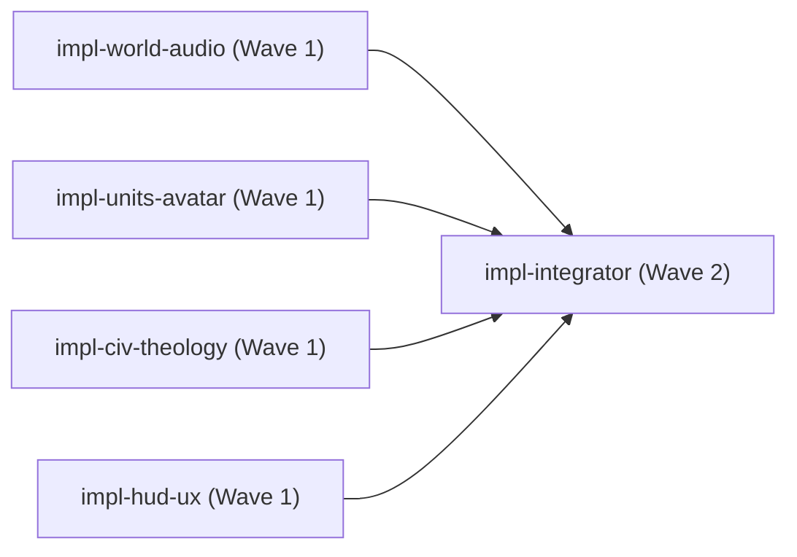

# План эволюции Kepler Sandbox (`08_EVOLUTION_BEYOND_PARITY_PLAN.md`)

**Статус:** Архитектурный чертёж Фазы 1 (синтез аудитов `@evo-tactile`, `@evo-society`, `@evo-ux-director` и системной критики `@evo-architect`).  
**Базовый ориентир (`VERIFIED` по `verify_tracer.ps1` и прогону #187):** `10/10` шагов зелены, но `--smoke-combat` уже держит **`world_tick_ms = 1.063 ms` (`<= 1.20`)**, **`phys_civ_tick_ms = 2.137 ms` (`<= 2.50`)**, **`sim_tick_ms = 3.463 ms` (`<= 3.80`)** — запас по `sim_tick_ms` всего **`0.337 ms`**.  
**Жёсткая цель плана:** купить не менее **`0.35–0.65 ms/тик`** за счёт *Via Negativa* и удаления дублей горячих циклов, встроить 6 сцепленных эволюционных систем, закрыть живые баги Web-аудио и окна `Кодекс` и удержать `--smoke-combat` на уровне **`sim_tick_ms <= 3.55 ms`**.

---

## 1. Творческий тезис и *Via Negativa* (вычитание до добавления)

### 1.1. Главная идея (*Fumito Ueda × Jonathan Blow × Nassim Taleb*)
Вместо добавления десятков одноразовых кнопок и изолированных RPG-таблиц превращаем Kepler Sandbox в **осязаемый террариум со свидетелями**:
- **Рука демиурга** физически хватает, швыряет через континенты и оставляет осязаемый отклик (`Грави-длань`, ударные волны, волны от судов, вспышки молний в лайтмапе, остывающие угли кратеров, живой звук по зуму и биому).
- **Мир отвечает идеологией и обороной:** города запоминают благословения, Монолиты и орбитальные удары (*Теология Свидетелей*), сдвигают доктрину (`Солярный культ` / `Техно-скептики` / `Стражи Орбиты`), рождают Пророков и Еретиков, а батареи `T3–T5` сбивают падающие метеориты и десантные капсулы в воздухе трассерами ПВО.
- **Конфликты получают тактический вес:** корабли реально переправляют штурмовые группы на вражеский берег, угроза Мега-Босса заставляет врагов заключать временное перемирие, режим Аватара `[P]` превращается в плотный экшен-инструмент (`Shift` рывок, `LMB` удар фракции, `Space` ударная волна, `[R]` клин свиты), а `Кодекс` + Директор камеры + 4 сценария дают мгновенный старт драмы в 1 клик.

### 1.2. Обязательные корневые фиксы и *Via Negativa* (S0)

| Проблема (`VERIFIED файл:строка`) | Корневая причина | Решение (*Via Negativa* / фикс) | Эффект |
|---|---|---|---|
| **Web warning:** `"trying to play a sample from a stream that cannot be sampled"` ([scripts/fx_audio.gd:784-791](../scripts/fx_audio.gd#L784-L791), `1739-1741`, `1919-1936`) | Создан `AudioStreamPlayer` + `AudioStreamGenerator` без `playback_type = AudioServer.PLAYBACK_TYPE_STREAM`; `play_sfx()` преждевременно ставит `_audio_unlocked = true` до жеста игрока; `_pump_audio()` не проверяет `can_push_buffer()`; буфер `0.14s` рвётся при просадке кадра WebGL2; `_was_silent` (`184`) не используется, а `STEREO_PAN_HALF_WIDTH_PX` (`33`) игнорируется | Установить `_audio_player.playback_type = AudioServer.PLAYBACK_TYPE_STREAM` **до** `.stream = gen`; на `OS.has_feature("web")` разблокировать звук строго в `activate_audio()`; проверять `pb.can_push_buffer(AUDIO_CHUNK_SIZE)`; поднять `AUDIO_BUFFER_SEC = 0.18` на Web (`max_frames = AUDIO_CHUNK_SIZE * 6` в `step_fx`); удалить мёртвый `_was_silent` и использовать `STEREO_PAN_HALF_WIDTH_PX` | `0` ошибок Web Audio, стабильный поток при `22050 Hz` |
| **Клик по `Кодекс` подсвечивает hover, но не открывает окно** ([scripts/hud_windows.gd:1464-1503](../scripts/hud_windows.gd#L1464-L1503), `946-975`, `1835-1842`, [scripts/main.gd:3458-3461](../scripts/main.gd#L3458-L3461), `4353`) | (1) `_attach_hover_motion(wbtn, 0.0)` масштабирует кнопки `VBoxContainer` (`scale = 1.07 -> 0.92`) при `toggle_mode = true` и `ACTION_MODE_BUTTON_RELEASE` — край хитбокса и ре-лейаут от `_codex_badge_lbl` сбрасывают `pressed`; (2) `_modal_backdrop` добавлен в `$HUD` **после** `_win_panel` и съедает клики при открытом окне, а `Законы` не закрывают модалки; (3) `_refresh_open_modal_live()` каждые `0.75s` сносит содержимое `_modal_body` вместе с нажимаемыми кнопками; (4) `_read_wasd_dir()` читает клавиатуру при открытой модалке, а колесо мыши зумит карту сквозь HUD | Снять `_attach_hover_motion` (`scale`/`rotation`) с кнопок `_win_panel` и `_lens_panel`, перевести `wbtn.toggle_mode = false` и фиксировать ширину `_codex_badge_lbl` (`28 px`); поднять `_win_panel`/`_lens_panel` над `_modal_backdrop`; сделать взаимозакрытие `Законы <-> Модалка`; обновлять текст/бары живого окна без `queue_free()` интерактивных кнопок (или только при смене ID/структуры); блокировать `_read_wasd_dir()` при `has_open_modal()` или фокусе в `LineEdit`; запретить колесо зума над контролами (`gui_get_hovered_control() != null`) | Надёжное открытие всех 6 окон кликом мыши, чистый фокус |
| **Деревья рисуются ПОВЕРХ зданий** (`stage2_civ.png`, [scenes/main.tscn:22-28](../scenes/main.tscn#L22-L28), [scripts/civ_sim.gd:1212](../scripts/civ_sim.gd#L1212), [scripts/unit_physics.gd:921](../scripts/unit_physics.gd#L921)) | `CivSim` (`z_index=1`) + `_mm_buildings` (`z_index=1` -> global `2`), но `UnitPhysics` (`z_index=2`) + `_mm_flora` (`z_index=0` -> global `2`, позже в дереве) рисует кроны поверх крыш | Поставить `_mm_flora.z_as_relative = false; _mm_flora.z_index = 1` (`_mm_buildings` на `z=2`, `_mm_units` на `z=3`) | Чистые силуэты городов и заводов |
| **Грязные тени под иконками `fx_strips`** (`stage2_civ.png`, `stage3_war.png`, [tools/build_atlases.py:5317](../tools/build_atlases.py#L5317)) | Для `fx_strips_atlas` включён `bake_building_shadows=True` — под парящими коронами, сердцами и иконками заговоров запекаются чёрные кляксы | Выставить `bake_building_shadows=False` в [tools/build_atlases.py:5317](../tools/build_atlases.py#L5317) и пересобрать `fx_strips_atlas*.png` | Чёткие `1:1` иконки статуса |
| **Моргание облаков при дневных взрывах** ([scripts/main.gd:4350](../scripts/main.gd#L4350)) | `spawn_shockwave` создаёт временный огонь `_tl_*`, из-за чего `is_light_layer_visible()` гасит все облака на карте днём на `0.36 s` | Гасить `_mm_clouds` только при `_night_mix > 0.25 or _camera.zoom.x > 3.2`; днём разрешить точечным вспышкам работать без скрытия облаков (в слое `<= 12` draw calls при взаимной блокировке облаков на `night_mix > 0.25`) | Облака больше не мигают днём |
| **Мусорные кнопки и штампы в текстах** ([scripts/hud_windows.gd:55, 175-186, 282, 314, 1579-1582](../scripts/hud_windows.gd#L175-L186), [scripts/unit_traits_fauna.gd:161, 389](../scripts/unit_traits_fauna.gd#L161)) | (1) `TOOL_FLICK` дублирует `TOOL_MAGNET`; (2) `POSSESSION_CMDS` рисует 5 мёртвых кнопок, вызывающих несуществующую `trigger_possession_command`; (3) `SelectedBar` показывает для города `HP`/`Сыт.`/`Мор.`; (4) запрещённые штампы `Сингуляр-ядро`, `Сингулярности`, `Сингулярный зенит` | Слить `TOOL_FLICK` внутрь `TOOL_MAGNET` (*«Грави-длань»*); оставить в `POSSESSION_CMDS` только живые клавиши (`WASD`, `ЛКМ`, `Space`, `E`, `Shift`, `R`, `Esc`); исправить подписи `SelectedBar` города на `Нас./Еда/Лоял./Щит`; заменить штампы на `Грави-ядро`, `Горизонта`, `Орбитальный зенит`, `чёрной бездне` | `-1` лишняя кнопка, `0` мёртвых кнопок, чистый стиль |

### 1.3. Рекультивация CPU-бюджета (покупаем `-0.40..-0.65 ms/тик` в `SMOKE_COMBAT`)

| Горячий узел (`VERIFIED файл:строка`) | Потеря сейчас | Конкретная оптимизация | Экономия (est.) |
|---|---|---|---|
| **1. Дубль `O(U)` скана турелей и капитанов** ([scripts/civ_meta_noosphere.gd:1659-1735, 1808-1863](../scripts/civ_meta_noosphere.gd#L1659-L1735), [scripts/civ_sim.gd:3765, 3793](../scripts/civ_sim.gd#L3765)) | `_step_defense_turrets` + `_find_nearest_hostile_unit` перебирают `512` зданий и `720` юнитов линейно, дублируя `combat_and_beams._step_city_turrets`; аналогично дублируется выбор капитана полка (`unit_combat_ai.gd:293`) и перебор `0.._bld_count` для щитов | Удалить `_find_nearest_hostile_unit` и `_step_defense_turrets` из `civ_meta_noosphere.gd`; в `_fire_ship_board_laser` вызывать `phys.find_nearest_hostile_pos` (`64 px` `_macro_head`); читать `_combat_ai._reg_leader_uid` напрямую; в `civ_sim.gd` завести кэш `_turret_indices` / `_aa_battery_indices` по образцу `_shield_indices` и перебирать его в `try_intercept_orbital_impact` и `get_shield_pylons` | **`-0.14 .. -0.22 ms`** |
| **2. Линейный перебор `MAX_FAUNA=192` всеми юнитами и `O(U)` хиты Аватара/щита** ([scripts/unit_physics.gd:4613-4633, 1023, 7095](../scripts/unit_physics.gd#L4613-L4633), [scripts/unit_traits_fauna.gd:1651](../scripts/unit_traits_fauna.gd#L1651)) | Каждый свободный от боя юнит каждые 4 тика сканирует до `192` фауны (`~34k` проверок/тик); `notify_shield_saved` и `_avatar_hit_enemies` идут по `0.._unit_count` | В `unit_traits_fauna.gd` поддерживать плоский кэш `_hostile_fauna_indices: PackedInt32Array` (только хищники и боссы — `2..14` слотов, обновляется при спавне/смерти); перевести `notify_shield_saved` и `_avatar_hit_enemies` на обход `16 px` пространственной сетки `_cell_head` / `_unit_next` | **`-0.25 .. -0.45 ms`** |
| **3. Ложный `_mm_scale_dirty`, 26 облаков, пересчёт средней температуры и 480 `draw_rect` щита** ([scripts/unit_physics.gd:4295](../scripts/unit_physics.gd#L4295), [scripts/world_terrain.gd:17, 1754-1790, 1920](../scripts/world_terrain.gd#L1754-L1790), [shaders/unit_sprite.gdshader:239](../shaders/unit_sprite.gdshader#L239), [scripts/main.gd:4760-4810](../scripts/main.gd#L4760-L4810)) | `_step_fauna_and_pack` принудительно ставит `_mm_scale_dirty = true` каждый тик при `_f_count > 0`, переписывая `1440` float масштаба; `_step_clouds` крутит `26` `MultiMesh`-трансформов на каждом подшаге (до `12x/кадр` на `40x`); `_recompute_avg_temp_full()` сканирует `230,400` пикселей при кисти; щиты рисуют `~480` `draw_rect`; ночной rim-light делает лишний `texture()` на `900` флоры | Ставить `_mm_scale_dirty = true` **только** при `_unit_count != pre_uc`; сократить `CLOUD_COUNT` `26 -> 14` и вынести `mm.set_instance_transform_2d` облаков из `_step_clouds` в `_flush_env_outputs()`; заменить `_recompute_avg_temp_full()` на инкрементальный `_temp_total_sum`; в `unit_sprite.gdshader` отключить ночной `NW` texture fetch для `motion_mode == 1`; заменить `draw_rect` щитов на 24-точ. `draw_polyline`, скрывать дуги дипломатии при `zoom > 1.8x` (кроме линзы/кисти Дипломатии) и паковать `_mm_particles` через `mm.buffer` | **`-0.10 .. -0.18 ms`** |

**Совокупный возврат бюджета:** **`-0.49 .. -0.85 ms/тик`**, что даёт запас под все 6 новых систем (`<= +0.07 ms` суммарно в пике, `< +0.02 ms` в простое) с итоговым `--smoke-combat` **`sim_tick_ms <= 3.35 ms`** (`<= 3.55` цель, `<= 3.80` стоп-кран).

---

## 2. Ранжированные эволюционные апгрейды (6 систем)

### Ранг 1 (Signature Differentiator): Теология Свидетелей и активное ПВО `T3–T5` по метеорам/капсулам
- **Механика (`God-Witness`):** каждое значимое действие курсора (`Благо`, `Монолит`, `Орбитальный удар`, `Метеор`, `ИИ-Сбой`, перехват щитом) обновляет SoA-счётчик города в радиусе (`r + 44 px`):
  $$\text{heat}_{cid} \leftarrow \text{clamp}\big(\text{heat}_{cid} + \Delta_{\text{witness}},\; -100.0,\; +100.0\big)$$
  - `WITNESS_BLESS = +14.0`, `WITNESS_MONOLITH = +24.0`, `WITNESS_SHIELD_SAVE = +8.0`, `WITNESS_METEOR = -28.0`, `WITNESS_ORBITAL = -36.0`, `WITNESS_GLITCH = -22.0` (медленный распад к `0` на `0.15/с`).
  - Сцепляется с существующими `_city_creed_id`, `_creed_tenet` (`civ_meta_noosphere.gd:231, 255`) и `STATUS_INSPIRED_BIT = 1 << 6` (`unit_traits_fauna.gd:99`):
    1. **`DOCTRINE_SOLAR_CULT (1)`** (`heat >= +25.0`): `+15%` к выработке ферм и СЭС, `+12` к лояльности, солдаты возле `MONOLITH` получают `STATUS_INSPIRED_BIT` (`+15%` урон/скорость), в `MAX_NOTABLES` возводится **Пророк (`RANK_HERALD`, `TR_BLESSED_HALO`)**.
    2. **`DOCTRINE_TECH_SKEPTICS (2)`** (`heat <= -25.0`): город считает руку игрока орбитальной угрозой; `_pick_next_building_type` в `T3–T5` приоритизирует `SHIELD_PYLON` и `DEFENSE_TURRET`; щиты заряжаются в `1.35x` быстрее; выжившие после удара (`MEM_SURVIVED`) становятся **Еретиками (`RANK_HERETIC`, `TR_SCHISMATIC | TR_VENGEFUL`)** и запускают `PLOT_ORBITAL_SHIELD` / `PLOT_SCHISM`.
    3. **`DOCTRINE_ORBITAL_WARDENS (3)`** (есть `MONOLITH` + `SHIELD_PYLON` на `T3+` и `|heat| < 25` или `shield_blocked >= 2`): `+12 px` дальности ПВО турелей, `+35%` науки от `MONOLITH`, авто-агрессия к `FACTION_MUTANT` и Мега-Боссам.
- **Активный перехват ПВО в воздухе (`WorldDrops` + `CombatAndBeams` + `CivSim`):**
  - В `world_drops.gd` добавляется `DropKind.HOSTILE_POD = 25` (десантная капсула Роботов / `BOSS_UFO` / ионного шторма, порождающая дрона-захватчика или ЭМИ-разряд при падении).
  - `CivSim` кэширует `_aa_battery_indices` (все живые `SHIELD_PYLON` и `DEFENSE_TURRET` городов `tech_tier >= 3`, макс. `32` точки).
  - Пока `_drops.get_count() > 0`, на шаге симуляции вызывается `world.intercept_sky_drops(batteries, max_per_tick)` -> `drops.intercept_hostile_drops(...)`: любой летящий `METEOR_SHARD`, `PLASMA_BOMB` или `HOSTILE_POD` с `pos_z >= 14.0` в радиусе батареи (`52 px` для `SHIELD_PYLON`, `46 + (tier - 3) * 6 px` для `T3–T5 DEFENSE_TURRET`) при наличии `2.5` энергии города **уничтожается в воздухе до вызова `_on_sky_drop_landed`**, тратя энергию города и вызывая `fx.emit_laser_tracer(turret_pos, sky_pos, city_col)` + `fx.spawn_shockwave` + `STRIP_SHIELD`.
  - Дополнительно `civ.try_intercept_orbital_impact` для `TECH_SKEPTICS` / `ORBITAL_WARDENS` на `T3–T5` проверяет и `DEFENSE_TURRET` (`r = 32 px`, цена `3.5` энергии, `65%` поглощения мгновенных метеоров).
- **Память / `TUNING_KNOBS` / CPU:** `_city_doctrine_heat(64)` (`256 B`) + `_city_doctrine_id(64)` (`64 B`) + `_city_witness_counts(64)` (`256 B`) + `_aa_battery_indices` (`<= 128 B`) = **`~704 B` RAM**. `TUNING_KNOBS`: `WITNESS_SOLAR_THRESH = 25.0`, `WITNESS_SKEPTIC_THRESH = -25.0`, `AA_INTERCEPT_MIN_Z = 14.0`, `AA_ENERGY_COST = 2.5`, `AA_MAX_PER_TICK = 4`. **CPU:** `0.000 ms` в покое, `+0.018 ms` при активном бомбардировании.

### Ранг 2: Осязаемая «Грави-длань» (`TOOL_MAGNET`, слияние `TOOL_FLICK`)
- **Физика удержания и броска (`unit_physics.gd`, `unit_traits_fauna.gd`, `world_drops.gd`, `main.gd`):**
  - В режиме удержания (`STATUS_MAG_BIT = 1 << 15`): пропускаются гравитация по Z, боевые выстрелы, урон от лавы/утопления, расталкивание толпой и привязка к зданиям; высота `pos_z` стремится к `MAG_LIFT_Z = 15.0` по формуле без зависимости от FPS:
    $$z \leftarrow z + (Z_{\text{lift}} - z)\cdot\big(1 - e^{-16.0 \cdot dt}\big)$$
  - В `main.gd` вычисляется сглаженная скорость курсора и пиковый буфер с распадом `0.09 s` (пауза курсора на 1 кадр перед отпусканием ЛКМ больше не обнуляет бросок!):
    $$\mathbf{v}_{\text{ema}} \leftarrow \text{lerp}\big(\mathbf{v}_{\text{ema}},\, \mathbf{v}_{\text{raw}},\, 1 - e^{-14.0 \cdot dt}\big),\quad v_{\text{throw}} \le 360.0\text{ px/s},\quad v_z = \text{clamp}(32 + 0.25|\mathbf{v}_{\text{throw}}|,\, 28,\, 62)$$
  - Клик `< 0.18 s` при смещении `< 4 px` или `Shift + ЛКМ` с тем же инструментом вызывает радиальный щелчок `apply_kinetic_flick` (`1` инструмент вместо `2`).
  - В полёте (`pz > 0.5` и не захвачен): сниженное воздушное сопротивление `exp(-0.28 * dt)` вместо наземного `exp(-3.2 * dt)` (перелёт через проливы и материки) и растяжение в шейдере `sy = clamp(1.0 + absf(vz) * 0.0048, 1.0, 1.34)` с сохранением объёма `sx = 1/sqrt(sy)` (`unit_sprite.gdshader:98`).
  - **Приземление (`vz < -18.0` через `pz <= 0`):** запись `_u_squash_y[i] = 0.66` (`SPRING_OMEGA = 18.0, SPRING_ZETA = 0.25`), плюс:
    - На воду (`tier <= SHALLOW`, не лёд): брызги + `"drop_rain"` SFX (`_cur_splash_budget`).
    - На сушу (`v_imp >= 140.0`): ударная волна, расталкивание соседей через `_cell_head` (`r = 12 px`), урон от падения `(v_imp - 140.0) * 0.18` (потолок `85.0`, пока `v_imp < 280.0` — здоровый колонист выживает после одного сильного броска), микро-кратер `radius = 3` при `v_imp >= 230.0` или броске босса, `trauma = 0.14`.
  - Дополнительно `WorldDrops.grab_drops_in_radius(world_pos, radius, vel_target)` подтягивает летящие капли/бомбы и подбрасывает `1–2` осколка породы/угля через `launch_parabolic`.
- **Память / `TUNING_KNOBS` / CPU:** `_u_squash_y(720)` + `_u_squash_vy(720)` = `5.76 KiB` (только пока `!= 1.0`) + `_f_squash(192)` = `0.75 KiB`. `TUNING_KNOBS`: `MAG_LIFT_Z = 15.0`, `MAG_AIR_DRAG = 0.28`, `MAG_THROW_MAX_SPEED = 360.0`, `MAG_IMPACT_MIN_VEL = 140.0`, `MAG_CRATER_MIN_VEL = 230.0`, `MAG_SQUASH_IMPACT = 0.66`. **CPU:** `0.000 ms` в покое (`_any_z_active == false`), `+0.015 ms` в момент броска.

### Ранг 3: Настоящие морские десанты и перемирия перед Мега-Боссом
- **4 точечных фикса морского десанта:**
  1. В `unit_physics.gd` добавляем `_u_embarked: PackedByteArray(720)` (`720 B`) и `_u_mission_pos: PackedVector2Array(720)` (`5.76 KiB`). Пока `_u_embarked[i] != 0`, юнит пропускает утопление, боиды и рутину (выделено в `_step_embarked_unit`), рисуется со скейлом `0.001`, а `civ_meta_noosphere.gd::_hold_embarked_units` синхронизирует его координаты с `_ship_pos[s]` (при гибели корабля `:1461` десант падает в точку гибели с `vel_z = 18.0`).
  2. В `unit_combat_ai.gd:170-182, 391`: не обрезать `target_pos` берегом родного острова, если у юнита активна десантная миссия или `up._count_water_hits(unit_pos, target_pos) < 2` — высадившийся отряд штурмует вражеский берег вглубь, а не откатывается на домашний пляж через `0.45 s`.
  3. В `civ_meta_noosphere.gd:1498-1500` (`_check_city_auto_ferry`): убрать запрет `if has_gate: return` — квантовые врата соединяют только союзные города, так что города `T4` с вратами ошибочно не спускали десант.
  4. В `civ_meta_noosphere.gd:1352-1358` и `civ_diplomacy.gd:1278`: во время `SHIP_STATE_LOADING` направлять полк к `pick_shore`, грузить солдат в радиусе `48 px` и разрешить захват береговой зоны плацдарма при `att_sol >= 2 or att_cnt >= 4`.
- **Охотничьи перемирия и рейды на Мега-Боссов:**
  - Раз в `2.5 s` в `civ_meta_noosphere._step_noosphere_and_politics` проверять `<= 4` активных боссов (`SCLASS_BOSS`) на дистанцию `<= 110 px` до городов: помечать угрозу `_city_threat_pos[cid] = boss_pos`, включать `45.0 s` перемирие (`_kingdom_truce`) между воюющими королевствами в `180 px` от босса (*«Перемирие перед угрозой»*), активировать спящий `NSTATE_FEUD_HUNT` в `civ_diplomacy.gd` для `<= 4` ближайших `RANK_HERO`/`RANK_BANNER` + их полков, а при гибели босса вызывать `civ.on_boss_slain(pos, killer_uid, species_id)` -> дроп Реликта (`MAX_RELICS`), `+25` славы, `+60` науки, запись в Хронику.
- **CPU:** `+0.015 ms` амортизированно (`2.5 s` скан боссов, `0` лишних обходов).

### Ранг 4: Сочный Аватар `[P]` (Рывок + Ударная волна + `[R]` Свита)
- Разделяем общий `_possess_cd` (`unit_physics.gd:1085, 7031`) на 3 независимых таймера: `_possess_atk_cd` (`0.42s`), `_possess_dash_cd` (`0.95s`), `_possess_rally_cd` (`4.0s`); убираем двойной вызов импульса/SFX в `main.gd:4150-4152`.
- **Рывок (`Shift` -> `avatar_dash(dir: Vector2) -> int`, `0.95s` CD):** импульс `145 px/s`, подскок `vel_z = 18.0`, иммунитет к отбрасыванию `0.20s` + броня `50%` на время рывка (без бессмысленного бессмертия, сохраняя хрупкость по Уэде), сохраняющая объём растяжка `_u_squash_y = 1.36`, таран врагов в `12 px` через `_cell_head` (`28.0` импульс) и `"dodge"` SFX.
- **Фракционный `LMB` и `Space` (`1.6s` CD):**
  - `LMB`: Люди — пробивной болт (`0.025s` micro hit-stop при убийстве); Роботы — сдвоенный рельсо-луч + `8 px` ЭМИ-сбой; Споры — кислотный залп с меткой стаи + `+6 HP` био-вампиризм при попадании.
  - `Space`: радиальный выброс (`r = 26 px`, `vel_z = 28`, `0.035s` hit-stop) + уничтожение вражеских снарядов в радиусе (`combat.clear_projectiles_in_radius(pos, 26.0)`).
- **Клич авангарда (`KEY_R` -> `avatar_rally() -> int`, `4.0s` CD):** через `_cell_head` собирает до `8` союзников в `48 px`, выставляет `_u_escort_timer[j] = 12.0` (`2.88 KiB`) и `STATUS_INSPIRED_BIT`, распределяет вокруг Аватара по `_reg_slot_offsets` и синхронизирует фокус атаки; `[E]` остаётся строго под физические мировые жесты (реликт / срыв заговора / костёр).
- **CPU:** `0.000 ms` вне режима `[P]`, `+0.005 ms` при активном Аватаре.

### Ранг 5: Директор камеры (клик -> плавный полёт + пинг) и 4 мгновенных сценария
- **Директор камеры:** `_focus_camera_on(world_pos, close_on_jump := true)` в `hud_windows.gd` закрывает модальное окно при клике на строку Хроники, карточку войны/альянса (`WIN_WARS`) или героя в новом списке `Notables` (`_civ.get_notables_summary()`), эмитит `focus_ping_requested(world_pos, col, zoom_floor)`, плавно ведёт камеру через `1.0 - exp(-9.5 * dt)` (включая клик по городу в `main.gd:3573` вместо мгновенного прыжка) и рисует в `WorldOverlay` расширяющееся кольцо пинга `6 -> 18 px` за `1.1 s`. При пересоздании мира в `main.gd:863-885` вызывается `_world_laws_ui.clear_history_log()`.
- **4 курируемых 1-кликовых сценария (`SCENARIO_DEFS` в `WIN_CODEX`, вкладка 2 `"Шаблоны и сценарии"` + доступ из меню пересоздания мира):**
  1. *Архипелаг Флотов* (`ARCHIPELAGO = 2`): 3 островные державы `T2` (`Люди` vs `Роботы` + `Споры`) в активной войне -> мгновенные верфи, флот и десант.
  2. *Пробуждение Монолита* (`CRATER = 4`): ударный кратер с кольцом кристаллов, стаями фауны, `apply_monolith_uplift` и 2 лагерями `T1` -> возвышение и стычки.
  3. *Осада Левиафанов* (`ATOLL = 3`): атолл с двумя укреплёнными цитаделями `T3` (`SHIELD_PYLON` + турели), эпохой `ION_STORM`, `Левиафаном` и `Дрон-НЛО` -> немедленное ПВО по капсулам и охотничье перемирие.
  4. *Раскол Кольца* (`RIFT = 5`): разлом с очагом `CREEP_MYCELIUM`, тотальной войной `T3` и назревшим мятежом -> каналы, орбитальные удары и Аватар `[P]`.
- **UX-чистота:** системные тултипы комбо-реакций в `scenes/main.tscn` и `hud_windows.gd`, 2 полосы прогресса + табличка без сокращений в `InspectorPanel`, компактная сетка `6×2` для `GroupCreator` и адаптивное сжатие `TopBar` на `1280×720 / 1280×800`.

### Ранг 6: Живая атмосфера (кильватеры, вспышки в лайтмапе, угли кратеров, переходы биомов, звук)
- **Кильватер кораблей:** `fx.emit_water_wake(pos, dir)` через существующий `_mm_particles` каждые `0.18 s` (строго при `_sim_pace_mult < 10.0` — `0.000 ms` в `SMOKE_COMBAT`, `< 0.005 ms` в `1x`).
- **Вспышки молний и метеоров в лайтмапе:** `fx.emit_lightning_flash(pos, radius, col)` (3–4 ломаных сегмента `P_COL_BOLT` + временный свет `0.18 s`, `rad = 64..88`, `intensity = 2.1`) вызывается из `world_terrain.gd:4351` (`ION_LIGHTNING`) и `3538` (`METEOR_SHARD`/`PLASMA_BOMB`).
- **3-зонные кратеры и переходы биомов (`world_terrain.gd`):** общий хелпер `_stamp_crater_ring(cx, cy, r, core_lava)` штампует юбку золы/сажи (`0.66..1.04r`), порог тлеющих углей в `_render_row_commit:5000` снижен `185°C -> 115°C`, диагональный артефакт гор (`4891`) заменён на хэш-шум, границы биомов дизеринг-смешиваются на `1 px` кромке (`0.000 ms` на тик симуляции).
- **Реактивный звук мира (`fx_audio.gd` + `world_terrain.gd`):** расширяем пробу `world_terrain.get_audio_env_probe(cam_rect: Rect2) -> Dictionary` (`ocean_ratio`, `coast_ratio`, `fire_ratio`, `city_count`, `dominant_biome` в прежних 80 выборках раз в `0.50 s`). В `fx_audio.gd:1966` исправляем инверсию зума: `close_t = clampf((_cam_zoom - 1.0) / 3.5, 0.0, 1.0)` гасит прибой/кузню/треск в макро-космосе (`close_t -> 0`), плавно раскрывая береговой прибой, гул городских кузниц и треск пожаров/бурь при приближении.

---

## 3. Строгая матрица владения файлами (Волна 1 + Волна 2, без пересечений)

| Агент | Волна | Эксклюзивные файлы (правка разрешена ТОЛЬКО владельцу) | Запрещено трогать |
|---|---|---|---|
| **`impl-world-audio`** | Wave 1 | `scripts/world_terrain.gd`, `scripts/world_drops.gd`, `scripts/fx_audio.gd`, `shaders/terrain_water.gdshader`, `shaders/unit_sprite.gdshader`, `tools/build_atlases.py`, `assets/atlases/*` | Всё в `scripts/unit_*`, `scripts/civ_*`, `scripts/hud_*`, `main.gd`, `main.tscn` |
| **`impl-units-avatar`** | Wave 1 | `scripts/unit_physics.gd`, `scripts/unit_traits_fauna.gd`, `scripts/unit_harvest.gd`, `scripts/unit_combat_ai.gd`, `scripts/combat_and_beams.gd` | Всё в `world_*`, `fx_audio.gd`, `scripts/civ_*`, `scripts/hud_*`, `main.gd` |
| **`impl-civ-theology`** | Wave 1 | `scripts/civ_sim.gd`, `scripts/civ_meta_noosphere.gd`, `scripts/civ_territory.gd`, `scripts/civ_diplomacy.gd` | Всё в `world_*`, `fx_audio.gd`, `scripts/unit_*`, `scripts/hud_*`, `main.gd` |
| **`impl-hud-ux`** | Wave 1 | `scripts/hud_windows.gd`, `scripts/hud_world_laws.gd` | Всё в `world_*`, `fx_audio.gd`, `scripts/unit_*`, `scripts/civ_*`, `main.gd`, `main.tscn` |
| **`impl-integrator`** | Wave 2 | `scripts/main.gd`, `scenes/main.tscn`, `verify_tracer.ps1` (+ фикс кросс-стыков после Wave 1, прогон `verify_tracer.ps1`, Web-экспорт и визуальная приёмка PNG) | Массивы логики внутри модулей Wave 1 (кроме точечных багфиксов при интеграции) |

**Неприкосновенные инварианты всех 5 исполнителей:** функции **`<= 120` строк**, строго табы, ноль `CanvasGroup`, ноль `Node2D.new()` на сущность, ноль `draw_arc`/`draw_circle` по динамике, ноль голых `class_name` / `preload` в 9 `RefCounted`-скриптах, `<= 3` аргументов публичных контрактов.

---

## 4. Точные кросс-модульные API-контракты и совместимость сохранений

### 4.1. Общие константы, enum и ключи словарей
- **`WorldDrops.DropKind`** (`scripts/world_drops.gd`): добавить `HOSTILE_POD = 25`, расширить `clampi(drop_kind, 0, DropKind.HOSTILE_POD)`.
- **Статус-биты юнитов (`scripts/unit_physics.gd` <-> `scripts/unit_traits_fauna.gd`):**
  - `STATUS_INSPIRED_BIT: int = 1 << 6` (совпадает 1:1 с `STATUS_INSPIRED = 6` в `unit_traits_fauna.gd:99`).
  - `STATUS_MAG_BIT: int = 1 << 15` (совпадает 1:1 с `STATUS_MAGNETIZED = 15` в `unit_traits_fauna.gd:108`).
- **Свидетель и доктрины (`scripts/civ_sim.gd`, `scripts/civ_meta_noosphere.gd`):**
  - `enum WitnessKind { BLESS = 0, MONOLITH = 1, ORBITAL = 2, METEOR = 3, GLITCH = 4, SHIELD_SAVE = 5 }`
  - `enum DoctrineId { NEUTRAL = 0, SOLAR_CULT = 1, TECH_SKEPTICS = 2, ORBITAL_WARDENS = 3 }`
- **Сценарии (`scripts/hud_windows.gd` <-> `scripts/main.gd`):**
  - `const SCENARIO_DEFS: Array[Dictionary]` (`id: 0..3`): `0` = *Архипелаг Флотов*, `1` = *Пробуждение Монолита*, `2` = *Осада Левиафанов*, `3` = *Раскол Кольца*.

### 4.2. Публичные сигнатуры (`<= 3` аргументов)

| Модуль-владелец | Сигнатура метода / сигнала | Контракт возврата и побочных эффектов |
|---|---|---|
| `world_drops.gd` | `grab_drops_in_radius(world_pos: Vector2, radius: float, vel_target: Vector2) -> int` | Затягивает активные капли в радиусе (`pos_z = max(pos_z, 12.0)`, `vx/vy` к `vel_target`), возвращает число захваченных капель |
| `world_drops.gd` | `intercept_hostile_drops(batteries: Array, max_per_tick: int = 4) -> Array[Dictionary]` | Проверяет `METEOR_SHARD`, `PLASMA_BOMB`, `HOSTILE_POD` при `pos_z >= 14.0`; удаляет перехваченные капли **до** посадки и возвращает `[{"pos": Vector2, "battery_pos": Vector2, "city_id": int, "kind": int}]` |
| `world_terrain.gd` | `intercept_sky_drops(batteries: Array, max_per_tick: int = 4) -> Array[Dictionary]` | Пробрасывает `_drops.intercept_hostile_drops(...)` только если `_drops != null and _drops.get_count() > 0` (`0.000 ms` при пустом пуле) |
| `world_terrain.gd` | `get_audio_env_probe(cam_rect: Rect2) -> Dictionary` | Возвращает `{"biome_id": int, "ocean_ratio": float, "coast_ratio": float, "fire_ratio": float, "avg_temp": float}` по `<= 80` точкам |
| `fx_audio.gd` | `emit_water_wake(world_pos: Vector2, dir: Vector2) -> void` | Добавляет 1–2 частицы кильватера в `_mm_particles` (`0` новых узлов) |
| `fx_audio.gd` | `emit_lightning_flash(world_pos: Vector2, radius: float, col: Color = Color(0.55, 0.92, 1.0, 1.0)) -> void` | Спавнит `P_COL_BOLT` разряд + временный свет `_spawn_transient_light` (`0.18 s`, `intensity = 2.1`) |
| `fx_audio.gd` | `set_camera_audio_context(cam_rect: Rect2, zoom_val: float, sim_speed: float) -> void` | Кэширует контекст для `step_fx` и 4-слойного эмбиента (`Space/Surf/Forge/Storm`) |
| `unit_traits_fauna.gd` | `get_hostile_fauna_indices() -> PackedInt32Array` | Возвращает кэшированные индексы активных хищников и боссов (`SCLASS_PREDATOR`, `SCLASS_BOSS`) |
| `unit_traits_fauna.gd` | `get_active_boss_snapshots() -> Array[Dictionary]` | Возвращает `[{"uid": int, "species": int, "pos": Vector2, "hp": float}]` (`<= 4` записей) |
| `unit_physics.gd` | `avatar_dash(dir: Vector2) -> int` | Выполняет направленный рывок (`0.95s` CD, `_u_squash_y = 1.36`, `vel_z = 18`, таран через `_cell_head`), возвращает число сбитых врагов (`>= 1` или `1` при успешном рывке, `0` на откате) |
| `unit_physics.gd` | `avatar_rally() -> int` | Собирает до `8` союзников в `48 px` (`4.0s` CD), ставит `_u_escort_timer = 12.0` + `STATUS_INSPIRED_BIT`, возвращает число откликнувшихся союзников |
| `unit_physics.gd` | `set_unit_embarked(uid: int, ship_pos: Vector2, active: bool) -> bool` | Ставит/снимает `_u_embarked` и синхронизирует `(px, py)` (при высадке сбрасывает `vel_z = 16`, задаёт `_u_mission_pos`) |
| `combat_and_beams.gd` | `clear_projectiles_in_radius(world_pos: Vector2, radius: float) -> int` | Гасит вражеские баллистические снаряды при ударной волне Аватара `[Space]` |
| `civ_sim.gd` | `record_cursor_witness(world_pos: Vector2, radius: float, witness_kind: int) -> int` | Обновляет `_city_doctrine_heat` и доктрину ближайших городов, возвращает `DoctrineId` главного затронутого города |
| `civ_sim.gd` | `get_aa_batteries() -> Array[Dictionary]` | Возвращает кэш `[{"pos": Vector2, "range": float, "city_id": int, "kind": int}]` из `_shield_indices` и `T3–T5` `_turret_indices` (пустой массив при `tech < 3` или `energy < 2.5`) |
| `civ_sim.gd` | `on_boss_slain(world_pos: Vector2, killer_uid: int, species_id: int) -> void` | Выдаёт Реликт (`MAX_RELICS`), `+25` славы, `+60` науки и запись Хроники |
| `civ_sim.gd` | `get_notables_summary() -> Array[Dictionary]` | Проброс из `_diplomacy`: `[{"uid": int, "name": String, "rank": int, "faction": int, "city_id": int, "pos": Vector2, "doctrine": int, "pinned": bool}]` |
| `hud_windows.gd` | `signal scenario_requested(scenario_id: int)` + `signal focus_ping_requested(world_pos: Vector2, col: Color, zoom_floor: float)` | Запускает выбранный сценарий в `main.gd` и активирует плавный перелёт + целевой пинг с автозакрытием модалки |

### 4.3. Обратная совместимость `SAVE_VERSION` (`F5 / F9` и старые сейвы)
1. **`scripts/main.gd`:** `SAVE_VERSION: int = 8`; `unpack_world_state` принимает `ver >= 5 and ver <= SAVE_VERSION`. Поля `v8` (`_cam_ping_timer` сбрасывается, `chronicle_history` опциональна через `snapshot.get("chronicle_history", [])`) не ломают `v5–v7`.
2. **`scripts/civ_sim.gd`:** `SAVE_VERSION: int = 8`; `unpack_state` принимает `ver >= 2 and ver <= SAVE_VERSION`. В конец бинарного потока `v8` пишется блок доктрин (`max_cities` байт `_city_doctrine_id` + float `_city_doctrine_heat` + u16 `_city_witness_counts` + u32 `_aa_intercepts_total`); при загрузке `ver <= 7` массивы чисто сбрасываются в `NEUTRAL / 0.0`.
3. **`scripts/unit_physics.gd`:** `SAVE_VERSION: int = 3`; `unpack_state` принимает `ver == 1 or ver == 2 or ver == SAVE_VERSION`. Для `ver >= 3` после блоков `v2` пишутся `_u_embarked`, `_u_mission_pos`, `_u_escort_timer`; при загрузке `ver <= 2` все три буфера обнуляются (`0` вылетов).
4. **`scripts/world_drops.gd`:** формат `38 B/слот` неизменен (`DropKind.HOSTILE_POD = 25` умещается в `u8`).

---

## 5. Спецификация верификации (`verify_tracer.ps1` Шаг 11 `--smoke-evolution`)

Шаги `1–10` и все пороги (`world_tick_ms <= 1.20`, `phys_civ_tick_ms <= 2.50`, `sim_tick_ms <= 3.80`, `hud_brush_ok=1`, `ACTIVE_GODOT=0`) **остаются нетронутыми**. Дополнительно в `verify_tracer.ps1` добавляется **Step 11 (`--smoke-evolution`)**, проверяющий реальную работоспособность всех 6 систем:

1. **`audio_stream_ok == 1`:** метод-помощник `fx.verify_audio_config()` подтверждает логику `PLAYBACK_TYPE_STREAM` (на интерактивных бэкендах) + правильный знак градиента `zoom_lod_audio_ok` (`close_t(3.5x) > close_t(0.8x)`) + непустой `world.get_audio_env_probe()`.
2. **`codex_click_ok == 1`:** синтетический `InputEventMouseButton` (press + release по глобальному центру каждой из 6 кнопок `_win_rail_btns[WIN_UNIT..WIN_CODEX]` через `get_viewport().push_input()`) открывает и закрывает все 6 окон включая `Кодекс`; `_read_wasd_dir()` возвращает `Vector2.ZERO` при открытом окне (`wasd_blocked_ok == 1`); `POSSESSION_CMDS.size() <= 7` без мёртвых команд.
3. **`magnet_toss_ok == 1`:** `apply_magnet_step(..., hold=1)` поднимает юнита на `pos_z >= 8.0`, отпускание с вектором `300 px/s` даёт перелёт `> 40 px` и удар с деформацией приземления.
4. **`theology_aa_ok == 1`:** `record_cursor_witness(..., WITNESS_BLESS)` переводит город в `SOLAR_CULT`, `WITNESS_ORBITAL` — в `TECH_SKEPTICS`; запуск `METEOR_SHARD` / `HOSTILE_POD` над батареей `T3+` даёт `aa_intercepts >= 1` до посадки капли.
5. **`avatar_kit_ok == 1`:** вход `[P]` -> `avatar_dash` (`dash_ok == 1`) + `avatar_action` (`strike_ok == 1`) + `avatar_rally` (`rallied >= 1`, `STATUS_INSPIRED_BIT` активен у союзника) -> выход `[P]`.
6. **`amphib_boss_ok == 1`:** десантный корабль переправляет солдат на вражеский берег без возврата на домашний пляж (`_u_embarked` обнулён, позиция на острове цели); спавн `BOSS_LEVIATHAN` в `90 px` от двух воюющих городов открывает перемирие; убийство босса даёт Реликт/славу.
7. **`scenario_save_ok == 1`:** запуск сценария №2 (*Осада Левиафанов*) + `pack_world_state() -> unpack_world_state()` на `SAVE_VERSION = 8` сохраняет доктрины, сценарий и состояние юнитов.
8. **Гейт производительности (`--smoke-combat` и `--smoke-evolution`):**
   - `world_tick_ms <= 1.10` (жёсткий порог `1.20`), `phys_civ_tick_ms <= 2.35` (жёсткий `2.50`), `sim_tick_ms <= 3.55` (жёсткий `3.80`).
   - `canvas_groups == 0`, `entity_node2d == 0`, `get_meta_errs == 0`, `ACTIVE_GODOT=0`, визуальный осмотр `screenshots/*.png` после Wave 2 и чистая сборка `Web` (`gl_compatibility`).
